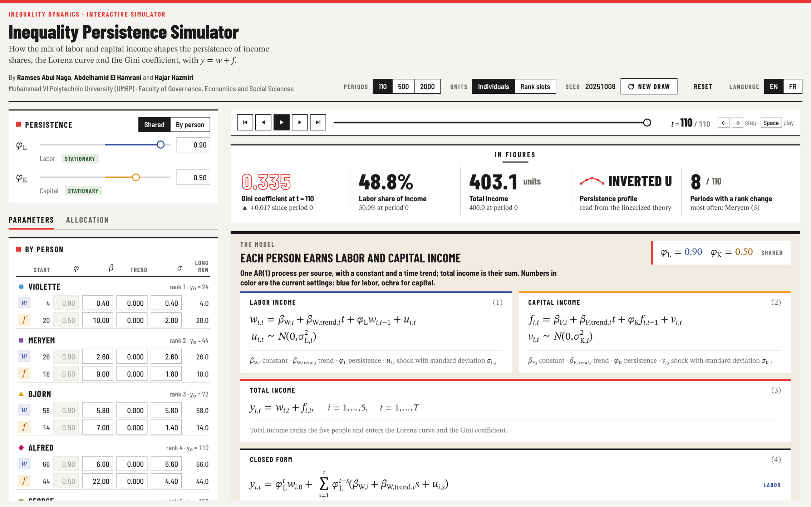
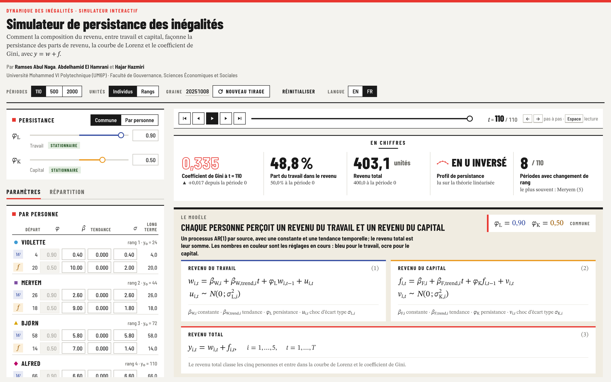

<a id="english"></a>

# Inequality Persistence Simulator

**English** · [Français](#francais)

**An interactive simulator of the persistence of income shares in a two-source economy, and of its relation to the Lorenz curve and the Gini coefficient.**



**Run it:** [online version](https://abdelhamidelhamrani777.github.io/Inequality-Persistence-Simulator/), or download [`index.html`](index.html) and open it in a recent browser. The interface is available in English and French (**EN / FR** switch).

**Documentation:** the [user guide](docs/GUIDE.md) sets out the analytical framework, documents every control and figure, and reports twelve controlled experiments; the [technical reference](docs/TECHNICAL.md) gives the implementation details.

## About the project

The simulator results from a research effort carried out within the master's theses of Abdelhamid El Hamrani and Hajar Hazmiri at the Faculty of Governance, Economics and Social Sciences (FGSES) of Mohammed VI Polytechnic University (UM6P), under the supervision of Professor Ramses Abul Naga. The research studies the dynamics of income shares along the distribution, and more precisely the **persistence of the deviations of each share from its long-run path**.

Its central hypothesis is that persistence depends on the **composition of income by source**. Labor income, set by contracts, wage schedules and institutions, adjusts slowly; capital income, which follows profits, asset prices and the timing of realizations, reverts quickly. Since a sum of autoregressive components with different coefficients does not have the persistence of any single component (Granger and Morris, 1976), income shares with different compositions should follow different dynamics, whatever their level.

The simulator isolates this mechanism. Five individuals receive labor and capital income, each following an AR(1) process with a constant and a trend; composition is the only source of heterogeneity across individuals. For each income share, the simulator reports the first-order autocorrelation of its deviations from the no-shock path, averaged over 200 samples of 110 periods, together with its linearized theoretical value, the Lorenz curve and the Gini coefficient.

## What the simulator shows

1. **The persistence of a share is a variance-weighted average of the persistence of its sources.** To a first order, a share inherits a persistence close to $`\phi_L`$ when its fluctuations come mainly from labor income, and close to $`\phi_K`$ when they come from capital income; the weights reflect contributions to fluctuations, not to the level of income. With $`\phi_L = 0.90`$ and $`\phi_K = 0.50`$, the starting economy, labor-intensive in the middle and capital-intensive at both ends, produces an inverted-U profile: 0.59 at the bottom, 0.83 in the middle and 0.69 at the top. *(Guide, experiment 6.1)*
2. **Composition generates every profile shape while the Lorenz curve and the Gini coefficient stay fixed.** Five economies give the five individuals the same period-0 incomes (24, 44, 72, 110 and 150 units, Gini coefficient 0.318) and differ only in the split between labor and capital. They produce decreasing, increasing, flat, U-shaped and inverted-U profiles, with the linearized persistence of individual shares ranging from 0.62 to 0.88 in the inverted-U economy and uniform at 0.82 in the flat one, while their mean Gini coefficients over 110 periods lie between 0.317 and 0.322. Static inequality measures do not capture this heterogeneity. *(6.4)*
3. **Composition matters only through differences in source persistence.** With $`\phi_L = \phi_K`$ every share has the common persistence, whatever its composition; reversing the ordering of $`\phi_L`$ and $`\phi_K`$ reverses the profile. *(6.2, 6.3)*
4. **Persistence and volatility are distinct dimensions.** Scaling every shock by three widens the fluctuations of every share, to the point that the number of periods with a rank change rises from 8 to 64, yet leaves the persistence profile essentially unchanged (0.58 to 0.82). *(6.5)*
5. **Rank positions are not individuals.** When individuals change rank frequently, the persistence of rank positions, the object measured by quantile-group series, is compressed (0.56 to 0.64, against 0.58 to 0.82 for the same individuals). *(6.6)*
6. **Deterministic components and unit roots must be separated from persistence.** A trend in top capital income raises the Gini coefficient from 0.32 to 0.40 over 110 periods without altering the profile; a unit root makes deviations permanent and removes the long-run anchor. *(6.7, 6.8)*
7. **The effect of a one-off redistribution decays at the persistence of the income it targets.** Equalizing capital income at period 0 halves the Gini coefficient, but the economy is back on its original path within about ten periods; the same operation on labor income fades with a half-life of 6.6 periods. Only a change in long-run levels is permanent. *(6.11)*
8. **Short samples bias persistence downward but preserve its ordering.** With 110 periods, simulated values lie 0.05 to 0.07 below the theoretical ones; with 2000 periods, within 0.006. *(6.10)*

The simulator is a laboratory: it illustrates a mechanism under controlled conditions and estimates nothing from data.

## The model

```math
w_{i,t} = \beta_{W,i} + \beta_{W,trend,i}\, t + \phi_{L}\, w_{i,t-1} + u_{i,t}, \qquad u_{i,t} \sim N\!\left(0, \sigma_{L,i}^{2}\right)
```

```math
f_{i,t} = \beta_{F,i} + \beta_{F,trend,i}\, t + \phi_{K}\, f_{i,t-1} + v_{i,t}, \qquad v_{i,t} \sim N\!\left(0, \sigma_{K,i}^{2}\right)
```

```math
y_{i,t} = w_{i,t} + f_{i,t}, \qquad S_{i,t} = \frac{y_{i,t}}{\sum_{j} y_{j,t}}
```

Labor income $`w`$ and capital income $`f`$ follow AR(1) processes with persistence $`\phi_L`$ and $`\phi_K`$, shared or set by individual. Shocks are independent across individuals, sources and periods. By default, $`\phi_L = 0.90`$, $`\phi_K = 0.50`$, the economy holds 200 units of each source at period 0, each income fluctuates around its own start ($`\beta = (1-\phi)\times`$ start) and shocks are proportional to holdings ($`\sigma = `$ start / 10). Every change of parameters reuses the same random shocks, so differences between settings come from the parameters alone.

## Authors

- **Ramses Abul Naga**, Faculty of Governance, Economics and Social Sciences, Mohammed VI Polytechnic University
- **Abdelhamid El Hamrani**, Faculty of Governance, Economics and Social Sciences, Mohammed VI Polytechnic University
- **Hajar Hazmiri**, Faculty of Governance, Economics and Social Sciences, Mohammed VI Polytechnic University

## How to cite

> Abul Naga, R., El Hamrani, A., & Hazmiri, H. (2026). *Inequality Persistence Simulator* (Version 1.2) [Computer software]. <https://github.com/abdelhamidelhamrani777/Inequality-Persistence-Simulator>

```bibtex
@software{inequality_persistence_simulator_2026,
  author  = {Abul Naga, Ramses and El Hamrani, Abdelhamid and Hazmiri, Hajar},
  title   = {Inequality Persistence Simulator},
  version = {1.2},
  year    = {2026},
  url     = {https://github.com/abdelhamidelhamrani777/Inequality-Persistence-Simulator}
}
```

## Related work

- Engle, R. F. (2001). GARCH 101: The use of ARCH/GARCH models in applied econometrics. *Journal of Economic Perspectives*, 15(4), 157–168.
- Gomez, M. (2025). Macro perspectives on income inequality. *Journal of Economic Perspectives*, 39(2), 127–148.
- Granger, C. W. J., and Morris, M. J. (1976). Time series modelling and interpretation. *Journal of the Royal Statistical Society, Series A*, 139(2), 246–257.
- Piketty, T., and Saez, E. (2003). Income inequality in the United States, 1913–1998. *Quarterly Journal of Economics*, 118(1), 1–39.
- Piketty, T., Saez, E., and Zucman, G. (2018). Distributional national accounts: Methods and estimates for the United States. *Quarterly Journal of Economics*, 133(2), 553–609.

---

<a id="francais"></a>

# Simulateur de persistance des inégalités

[English](#english) · **Français**

**Un simulateur interactif de la persistance des parts de revenu dans une économie à deux sources de revenu, et de son lien avec la courbe de Lorenz et le coefficient de Gini.**



**Utilisation :** [version en ligne en français](https://abdelhamidelhamrani777.github.io/Inequality-Persistence-Simulator/?lang=fr), ou téléchargez [`index.html`](index.html) et ouvrez-le dans un navigateur récent. L'interface est disponible en anglais et en français (bouton **EN / FR**).

**Documentation :** le [guide d'utilisation](docs/GUIDE.fr.md) expose le cadre d'analyse, documente chaque réglage et chaque figure, et présente douze expériences contrôlées ; la [référence technique](docs/TECHNICAL.md), en anglais, détaille la mise en œuvre.

## Le projet

Le simulateur est issu d'un travail de recherche mené dans le cadre des mémoires de master d'Abdelhamid El Hamrani et de Hajar Hazmiri à la Faculté de Gouvernance, Sciences Économiques et Sociales (FGSES) de l'Université Mohammed VI Polytechnique (UM6P), sous la direction du professeur Ramses Abul Naga. Cette recherche étudie la dynamique des parts de revenu le long de la distribution, et plus précisément la **persistance des écarts de chaque part à sa trajectoire de long terme**.

Son hypothèse centrale est que la persistance dépend de la **composition du revenu par source**. Le revenu du travail, fixé par des contrats, des grilles salariales et des institutions, s'ajuste lentement ; le revenu du capital, qui suit les profits, les prix des actifs et le calendrier des réalisations, revient vite à son niveau. Une somme de composantes autorégressives de coefficients différents n'ayant la persistance d'aucune de ses composantes (Granger et Morris, 1976), des parts de revenu de compositions différentes doivent suivre des dynamiques différentes, quel que soit leur niveau.

Le simulateur isole ce mécanisme. Cinq individus perçoivent un revenu du travail et un revenu du capital, chacun suivant un processus AR(1) avec une constante et une tendance ; la composition est la seule source d'hétérogénéité entre individus. Pour chaque part de revenu, le simulateur calcule l'autocorrélation d'ordre 1 de ses écarts à la trajectoire sans choc, en moyenne sur 200 échantillons de 110 périodes, ainsi que sa valeur théorique linéarisée, la courbe de Lorenz et le coefficient de Gini.

## Ce que montre le simulateur

1. **La persistance d'une part est une moyenne des persistances de ses sources, pondérée par les variances.** Au premier ordre, une part hérite d'une persistance proche de $`\phi_L`$ quand ses fluctuations viennent surtout du revenu du travail, et proche de $`\phi_K`$ quand elles viennent du revenu du capital ; les pondérations reflètent les contributions aux fluctuations, non au niveau du revenu. Avec $`\phi_L = 0{,}90`$ et $`\phi_K = 0{,}50`$, l'économie de départ, intensive en travail au milieu et en capital aux deux extrémités, produit un profil en U inversé : 0,59 en bas, 0,83 au milieu et 0,69 en haut. *(Guide, expérience 6.1)*
2. **La composition engendre toutes les formes de profil alors que la courbe de Lorenz et le coefficient de Gini restent inchangés.** Cinq économies donnent aux cinq individus les mêmes revenus à la période 0 (24, 44, 72, 110 et 150 unités, coefficient de Gini 0,318) et ne diffèrent que par le partage entre travail et capital. Elles produisent des profils décroissant, croissant, plat, en U et en U inversé : la persistance linéarisée des parts individuelles va de 0,62 à 0,88 dans l'économie en U inversé et vaut uniformément 0,82 dans l'économie plate, tandis que leurs coefficients de Gini moyens sur 110 périodes restent compris entre 0,317 et 0,322. Les mesures statiques des inégalités ne saisissent pas cette hétérogénéité. *(6.4)*
3. **La composition n'importe qu'à travers les différences de persistance entre sources.** Avec $`\phi_L = \phi_K`$, toutes les parts ont la persistance commune, quelle que soit leur composition ; inverser l'ordre de $`\phi_L`$ et $`\phi_K`$ inverse le profil. *(6.2, 6.3)*
4. **Persistance et volatilité sont des dimensions distinctes.** Multiplier tous les chocs par trois élargit les fluctuations de chaque part, au point que le nombre de périodes avec un changement de rang passe de 8 à 64, mais laisse le profil de persistance pratiquement inchangé (de 0,58 à 0,82). *(6.5)*
5. **Les positions de rang ne sont pas des individus.** Quand les individus changent souvent de rang, la persistance des positions de rang, objet mesuré par les séries de groupes de quantiles, se resserre (de 0,56 à 0,64, contre 0,58 à 0,82 pour les mêmes individus). *(6.6)*
6. **Les composantes déterministes et les racines unitaires doivent être distinguées de la persistance.** Une tendance du revenu du capital en haut de la distribution fait passer le coefficient de Gini de 0,32 à 0,40 en 110 périodes sans modifier le profil ; une racine unitaire rend les écarts permanents et supprime tout point d'ancrage de long terme. *(6.7, 6.8)*
7. **L'effet d'une redistribution ponctuelle décroît au rythme de la persistance du revenu qu'elle touche.** Égaliser le revenu du capital à la période 0 divise par deux le coefficient de Gini, mais l'économie retrouve sa trajectoire initiale en une dizaine de périodes ; la même opération sur le revenu du travail s'estompe avec une demi-vie de 6,6 périodes. Seule une modification des niveaux de long terme est permanente. *(6.11)*
8. **Les échantillons courts biaisent la persistance vers le bas mais en préservent l'ordre.** Avec 110 périodes, les valeurs simulées sont inférieures de 0,05 à 0,07 aux valeurs théoriques ; avec 2 000 périodes, elles en sont à moins de 0,006. *(6.10)*

Le simulateur est un laboratoire : il illustre un mécanisme dans des conditions contrôlées et n'estime rien à partir de données.

## Le modèle

```math
w_{i,t} = \beta_{W,i} + \beta_{W,trend,i}\, t + \phi_{L}\, w_{i,t-1} + u_{i,t}, \qquad u_{i,t} \sim N\!\left(0\,;\, \sigma_{L,i}^{2}\right)
```

```math
f_{i,t} = \beta_{F,i} + \beta_{F,trend,i}\, t + \phi_{K}\, f_{i,t-1} + v_{i,t}, \qquad v_{i,t} \sim N\!\left(0\,;\, \sigma_{K,i}^{2}\right)
```

```math
y_{i,t} = w_{i,t} + f_{i,t}, \qquad S_{i,t} = \frac{y_{i,t}}{\sum_{j} y_{j,t}}
```

Le revenu du travail $`w`$ et le revenu du capital $`f`$ suivent des processus AR(1) de persistances $`\phi_L`$ et $`\phi_K`$, communes ou propres à chaque individu. Les chocs sont indépendants entre individus, entre sources et dans le temps. Par défaut, $`\phi_L = 0{,}90`$ et $`\phi_K = 0{,}50`$, l'économie dispose de 200 unités de chaque source à la période 0, chaque revenu fluctue autour de sa valeur de départ ($`\beta = (1-\phi)\times`$ départ) et les chocs sont proportionnels aux dotations ($`\sigma = `$ départ / 10). Chaque modification de paramètres réutilise les mêmes chocs aléatoires, de sorte que les écarts entre deux réglages ne tiennent qu'aux paramètres.

## Auteurs

- **Ramses Abul Naga**, Faculté de Gouvernance, Sciences Économiques et Sociales, Université Mohammed VI Polytechnique
- **Abdelhamid El Hamrani**, Faculté de Gouvernance, Sciences Économiques et Sociales, Université Mohammed VI Polytechnique
- **Hajar Hazmiri**, Faculté de Gouvernance, Sciences Économiques et Sociales, Université Mohammed VI Polytechnique

## Citer le simulateur

> Abul Naga, R., El Hamrani, A., & Hazmiri, H. (2026). *Inequality Persistence Simulator* (version 1.2) [logiciel]. <https://github.com/abdelhamidelhamrani777/Inequality-Persistence-Simulator>

La référence BibTeX et les travaux cités figurent dans la partie anglaise ci-dessus.
