# Simulateur de persistance des inégalités : guide d'utilisation

[English](GUIDE.md) · **Français**

**Le cadre d'analyse du simulateur, ses réglages et ses figures, et douze expériences contrôlées sur la persistance des parts de revenu.**

Le guide comporte trois parties. Les sections 1 à 3 exposent la question de recherche, le cadre d'analyse et l'économie simulée. Les sections 4 et 5 documentent l'interface. Les sections 6 et 7 présentent des expériences contrôlées et les rattachent aux travaux empiriques sur les parts de revenu. Chaque chiffre et chaque capture d'écran proviennent du simulateur, réglé sur sa graine par défaut (20251008) : chaque résultat peut donc être reproduit à l'identique.

Le simulateur fonctionne dans tout navigateur récent : ouvrez [`index.html`](../index.html) depuis ce dépôt, ou utilisez la [version en ligne en français](https://abdelhamidelhamrani777.github.io/Inequality-Persistence-Simulator/?lang=fr). Les détails de mise en œuvre figurent dans la [référence technique](TECHNICAL.md), en anglais.

## Sommaire

1. [Question de recherche](#1-question-de-recherche)
2. [Cadre d'analyse](#2-cadre-danalyse)
3. [L'économie simulée](#3-léconomie-simulée)
4. [Interface et réglages](#4-interface-et-réglages)
5. [Lire les figures](#5-lire-les-figures)
6. [Expériences contrôlées](#6-expériences-contrôlées)
7. [Du simulateur aux données de parts de revenu](#7-du-simulateur-aux-données-de-parts-de-revenu)
8. [Questions fréquentes](#8-questions-fréquentes)
9. [Notations](#9-notations)
10. [Limites du modèle](#10-limites-du-modèle)
11. [Références](#11-références)
12. [Crédits](#12-crédits)

---

## 1. Question de recherche

Les études de long terme sur les inégalités dans les pays riches mettent en évidence des évolutions divergentes des parts de revenu : les groupes du bas ont perdu du terrain, les parts des classes moyennes ont reculé et la part du centile supérieur a augmenté depuis 1980 (Piketty et Saez, 2003 ; Piketty, Saez et Zucman, 2018 ; Alvaredo et al., 2018). Ces évolutions suggèrent que les parts de revenu situées à différents points de la distribution suivent des processus générateurs différents. Des tendances divergentes ne suffisent pas à l'établir, puisque des parts dont la somme vaut un doivent évoluer en sens opposés. La question est de savoir si la partie *aléatoire* de chaque part, ce qui reste une fois sa trajectoire de long terme retirée, diffère elle aussi le long de la distribution.

La caractéristique de cette partie aléatoire étudiée ici est la **persistance** : la mesure dans laquelle un écart d'une part à sa trajectoire de long terme au cours d'une période se reporte sur la suivante. La persistance décrit la manière dont un changement dans la répartition du revenu se propage dans le temps.

- Un profil de persistance **plat** signifie que les parts de revenu faibles et élevées ont la même inertie.
- Un profil **en U inversé**, par exemple 0,5 en bas, 0,8 au milieu et 0,4 en haut, signifie que les écarts persistent au milieu et s'effacent aux extrémités. Quand les inégalités changent, l'ajustement d'une année sur l'autre porte alors sur les extrémités, tandis que le milieu reporte les écarts pendant plusieurs années.
- Un profil **en U** implique l'inverse : les ajustements se produisent plus souvent au milieu que dans les parts basses et hautes.

L'hypothèse de travail est que la persistance dépend de la **composition du revenu par source**. Les salaires dominent le milieu de la distribution, la protection sociale est une source majeure en bas et le revenu des entreprises domine le sommet (Gomez, 2025). Le revenu du travail est fixé par des contrats, des grilles salariales et des institutions qui évoluent lentement. Le revenu du capital suit les profits, les prix des actifs et le calendrier des réalisations, et les transferts réagissent aux règles d'éligibilité et au cycle économique. Si chaque source a sa propre dynamique, chaque part de revenu hérite d'un processus différent. Le fondement statistique de l'argument est qu'une somme de composantes autorégressives de coefficients différents n'a la persistance d'aucune de ses composantes (Granger et Morris, 1976).

Le simulateur isole ce mécanisme. Il construit une économie dans laquelle la composition est la seule source d'hétérogénéité entre individus, et mesure la persistance de chaque part de revenu, la courbe de Lorenz et le coefficient de Gini. Il est issu d'un travail de recherche mené dans le cadre des mémoires de master d'Abdelhamid El Hamrani et de Hajar Hazmiri à la Faculté de Gouvernance, Sciences Économiques et Sociales (FGSES) de l'Université Mohammed VI Polytechnique (UM6P), sous la direction du professeur Ramses Abul Naga.

## 2. Cadre d'analyse

### 2.1 Parts de revenu, courbe de Lorenz et coefficient de Gini

Avec $`N = 5`$ individus, la part de revenu de l'individu $`i`$ à la période $`t`$ est

```math
S_{i,t} = \frac{y_{i,t}}{\sum_{j=1}^{N} y_{j,t}} .
```

En classant les individus par revenu à la période $`t`$, la courbe de Lorenz est l'ensemble des points $`(k/N,\, L_t(k/N))`$, où $`L_t(k/N)`$ est la somme des $`k`$ plus petites parts. Le coefficient de Gini est le double de l'aire comprise entre la diagonale et la courbe de Lorenz,

```math
G_t = 1 - \frac{1}{N}\sum_{k=1}^{N}\left[L_t\!\left(\tfrac{k}{N}\right) + L_t\!\left(\tfrac{k-1}{N}\right)\right],
```

et sa valeur maximale avec cinq individus est $`1 - 1/N = 0{,}8`$. Chaque ordonnée de la courbe de Lorenz étant une somme de parts, ses écarts sont des sommes des écarts des parts situées en dessous, et leur persistance est une combinaison de la persistance de ces parts pondérée par les variances (section 2.7).

### 2.2 Persistance d'une source de revenu

Chaque source de revenu suit un processus autorégressif d'ordre un, augmenté d'une constante et d'une tendance linéaire :

```math
x_t = \beta + \beta_{trend}\, t + \phi\, x_{t-1} + e_t, \qquad e_t \sim N(0\,;\, \sigma^2).
```

Le coefficient $`\phi`$ est la fraction de l'écart de cette période qui subsiste à la période suivante. Le processus est stationnaire autour de sa trajectoire déterministe quand $`|\phi| < 1`$ ; sans tendance, il se stabilise alors au niveau de long terme $`\beta/(1-\phi)`$, et avec une tendance sur une droite de pente $`\beta_{trend}/(1-\phi)`$. À $`\phi = 1`$ (racine unitaire), les chocs ne s'effacent jamais, et pour $`\phi < 0`$ le processus oscille, une période haute étant suivie d'une période basse. La demi-vie d'un écart, $`\ln 0{,}5/\ln\phi`$ pour $`0 < \phi < 1`$, traduit $`\phi`$ en nombre de périodes :

| $`\phi`$ | 0,50 | 0,70 | 0,80 | 0,90 | 0,95 | 0,99 |
| --- | --- | --- | --- | --- | --- | --- |
| Demi-vie (périodes) | 1,0 | 1,9 | 3,1 | 6,6 | 13,5 | 69,0 |

### 2.3 Persistance d'une part de revenu

La persistance d'une part est mesurée par l'autocorrélation d'ordre un de son **écart à la trajectoire déterministe**, c'est-à-dire à la part que le modèle produirait si tous les chocs étaient nuls (la *trajectoire sans choc*). Pour chaque échantillon simulé,

```math
\hat\rho_i(1) = \frac{\sum_{t=1}^{T} \left(d_{i,t}-\bar d_i\right)\left(d_{i,t-1}-\bar d_i\right)}{\sum_{t=0}^{T} \left(d_{i,t}-\bar d_i\right)^2}, \qquad d_{i,t} = S_{i,t} - S^{0}_{i,t},
```

où $`S^{0}_{i,t}`$ est la part sans choc. La figure 1 présente la moyenne de $`\hat\rho_i(1)`$ sur les échantillons simulés, ainsi que ses 5e et 95e centiles. Retirer la composante déterministe évite de compter comme de la persistance une tendance, ou l'ajustement lent de la répartition de départ vers les niveaux de long terme, de la même manière que des tendances et des ruptures non modélisées biaisent vers le haut la persistance des séries observées (Perron, 1989 ; Lamoureux et Lastrapes, 1990).

### 2.4 Le mécanisme de composition

Une linéarisation au premier ordre de chaque part autour des niveaux de long terme $`m = \beta/(1-\phi)`$ donne la persistance d'une part comme une moyenne de $`\phi_L`$ et $`\phi_K`$ pondérée par les variances :

```math
\rho_i(1) \approx \frac{\sum_{j} c_{ij}^{2}\left(\phi_{L}\,\gamma_{L,j} + \phi_{K}\,\gamma_{K,j}\right)}{\sum_{j} c_{ij}^{2}\left(\gamma_{L,j} + \gamma_{K,j}\right)}, \qquad c_{ij} = \frac{\mathbf{1}[i=j] - s_i}{M},
```

où $`\gamma = \sigma^2/(1-\phi^2)`$ est la variance stationnaire de chaque source, $`s_i`$ la part de long terme de l'individu $`i`$ et $`M`$ le revenu total de long terme. Trois conséquences en découlent.

1. **Chaque part se situe entre $`\phi_K`$ et $`\phi_L`$.** Un individu dont les fluctuations viennent surtout du revenu du travail hérite d'une persistance proche de $`\phi_L`$ ; un individu dont les fluctuations viennent surtout du revenu du capital hérite d'une persistance proche de $`\phi_K`$.
2. **Les pondérations sont des contributions aux fluctuations, non au niveau du revenu.** Une source faible en niveau mais volatile peut dominer les mouvements d'une part.
3. **Une part dépend du revenu de tous.** Les termes $`j \neq i`$ interviennent parce qu'une part bouge aussi quand le total bouge : aucune part n'atteint exactement $`\phi_L`$, et une modification du processus d'un individu affecte toutes les parts (expériences 6.9 et 6.12).

Aux réglages par défaut ($`\phi_L = 0{,}90`$, $`\phi_K = 0{,}50`$, chocs proportionnels aux dotations), le classement des persistances est exactement celui de la part de la variance du revenu de chaque individu qui provient du travail :

| Individu | Part du capital dans le revenu, période 0 | Part de la variance du revenu due au travail | $`\hat\rho(1)`$ simulé de la part |
| --- | --- | --- | --- |
| Bjørn | 0,19 | 98,5 % | 0,831 |
| Alfred | 0,40 | 89,9 % | 0,787 |
| Meryem | 0,41 | 89,2 % | 0,773 |
| George | 0,69 | 43,6 % | 0,688 |
| Violette | 0,83 | 13,6 % | 0,588 |

La linéarisation est définie pour des individus fixes quand tous les $`|\phi|`$ sont inférieurs à 1, toutes les tendances nulles et le revenu total de long terme positif. Le simulateur la trace sous le nom de *ligne théorique*.

### 2.5 Persistance et volatilité

La persistance se distingue de la volatilité (Engle, 2001). La première décrit la durée d'un écart ; la seconde en mesure l'ampleur.

| Dimension | Question | Où la lire |
| --- | --- | --- |
| Persistance | Combien de temps un écart dure-t-il ? | Figure 1 |
| Volatilité | Quelle est l'ampleur des écarts ? | Figures 3 et 4 ; trajectoire du Gini de la figure 2 |

La persistance est invariante à une remise à l'échelle commune des chocs, alors que la volatilité varie avec eux. Des fluctuations plus amples font aussi se dépasser les individus plus souvent, car les changements de rang dépendent de la taille des chocs rapportée aux écarts de revenu. L'expérience 6.5 sépare les deux dimensions.

### 2.6 Individus et positions de rang

Les statistiques d'inégalité comme les parts des hauts revenus suivent des positions de rang, non les mêmes personnes au fil du temps. La persistance mesurée sur un groupe de quantiles est celle de la part du revenu national revenant à un groupe, qui combine la dynamique des revenus de ses membres avec les entrées dans le groupe et les sorties. Les travaux sur la dynamique des revenus individuels (Gottschalk et Moffitt, 2009) suivent des individus dans le temps et portent donc sur un autre objet. Le mode **Rangs** du simulateur reclasse les individus selon leur revenu à chaque période et mesure la persistance des positions (expérience 6.6).

### 2.7 Ce que les mesures statiques ne montrent pas

Une courbe de Lorenz et un coefficient de Gini résument la répartition du revenu à un instant donné. Ils ne disent rien de la durée d'un changement de cette répartition, ni de l'endroit de la distribution où il durera. Deux économies ayant la même courbe de Lorenz peuvent différer selon qu'un choc au milieu s'efface en une période ou persiste pendant plusieurs. La courbe de Lorenz elle-même peut changer de forme à des vitesses différentes selon ses segments : avec un profil en U inversé, sa partie basse hérite des écarts rapidement résorbés des parts du bas, tandis que les ordonnées proches de la médiane portent les écarts persistants du milieu. L'expérience 6.4 construit cinq économies de ce type. La persistance constitue donc, à côté du niveau des inégalités et de la volatilité des parts, une dimension distincte de toute évaluation distributive.

## 3. L'économie simulée

### 3.1 Modèle

Cinq individus, Violette, Meryem, Bjørn, Alfred et George, perçoivent un revenu du travail $`w`$ et un revenu du capital $`f`$. Chaque source suit son propre processus autorégressif, et le revenu total $`y`$ est leur somme :

```math
\begin{aligned}
w_{i,t} &= \beta_{W,i} + \beta_{W,trend,i}\, t + \phi_L\, w_{i,t-1} + u_{i,t}, & u_{i,t} &\sim N\!\left(0\,;\,\sigma_{L,i}^2\right) &\quad (1)\\
f_{i,t} &= \beta_{F,i} + \beta_{F,trend,i}\, t + \phi_K\, f_{i,t-1} + v_{i,t}, & v_{i,t} &\sim N\!\left(0\,;\,\sigma_{K,i}^2\right) &\quad (2)\\
y_{i,t} &= w_{i,t} + f_{i,t}, & i &= 1,\dots,5, \quad t = 1,\dots,T &\quad (3)
\end{aligned}
```

La substitution récursive jusqu'à la période 0 donne la forme explicite

```math
y_{i,t} = \phi_L^{t}\, w_{i,0} + \sum_{s=1}^{t} \phi_L^{t-s}\left(\beta_{W,i} + \beta_{W,trend,i}\, s + u_{i,s}\right) + \phi_K^{t}\, f_{i,0} + \sum_{s=1}^{t} \phi_K^{t-s}\left(\beta_{F,i} + \beta_{F,trend,i}\, s + v_{i,s}\right). \qquad (4)
```

Le revenu de la période $`t`$ est la valeur de départ actualisée par $`\phi^t`$ plus chaque choc passé actualisé par $`\phi^{t-s}`$, séparément pour chaque source. Les chocs sont indépendants entre individus, entre sources et dans le temps. Les paramètres de persistance peuvent être communs à tous les individus ou propres à chacun.

### 3.2 Étalonnage

| Élément | Valeur par défaut |
| --- | --- |
| Persistance | $`\phi_L = 0{,}90`$, $`\phi_K = 0{,}50`$ : le travail est plus persistant que le capital |
| Répartition à la période 0 | 200 unités de travail et 200 unités de capital (tableau ci-dessous) |
| Constantes | $`\beta = (1-\phi)\times`$ départ, pour que chaque revenu fluctue autour de sa propre valeur de départ |
| Tendances | 0 |
| Chocs | $`\sigma = `$ départ / 10 : les chocs sont proportionnels aux dotations |
| Échantillon | $`T = 110`$ périodes, la longueur d'un siècle de données annuelles ; 200 échantillons simulés |
| Nombres aléatoires | Graine 20251008 ; un flux distinct par individu, source et échantillon |

| Individu | Travail | Capital | Total | Part du capital |
| --- | --- | --- | --- | --- |
| Violette | 4 | 20 | 24 | 0,83 |
| Meryem | 26 | 18 | 44 | 0,41 |
| Bjørn | 58 | 14 | 72 | 0,19 |
| Alfred | 66 | 44 | 110 | 0,40 |
| George | 46 | 104 | 150 | 0,69 |

L'économie de départ est intensive en travail au milieu et en capital aux deux extrémités. Sa courbe de Lorenz attribue aux 40 % les plus pauvres 17,0 % du revenu, et son coefficient de Gini vaut 0,318. Les cinq profils types (section 4.4) conservent ces revenus de période 0 et ne modifient que le partage entre travail et capital.

### 3.3 Règles de fonctionnement

Quatre propriétés de la mise en œuvre déterminent la manière de construire les expériences.

1. **Nombres aléatoires communs.** Chaque modification de paramètres réutilise les mêmes chocs, de sorte que les écarts entre deux réglages ne tiennent qu'aux paramètres. **Nouveau tirage** change la graine ; **Réinitialiser** rétablit tous les réglages, graine comprise. Chaque expérience ci-dessous part de Réinitialiser.
2. **Modifier $`\phi`$ ne modifie pas $`\beta`$.** Le niveau de long terme $`\beta/(1-\phi)`$ se déplace donc, et les revenus dérivent vers lui. Pour maintenir un revenu autour de son départ, fixer $`\beta = (1-\phi)\times`$ départ.
3. **La répartition ne fixe que la période 0.** Modifier la répartition change les valeurs de départ, non les niveaux de long terme ; les revenus reviennent à leurs niveaux antérieurs au rythme $`\phi`$, sauf si $`\beta`$ est modifié aussi (expérience 6.11).
4. **Les profils types réancrent tous les paramètres.** Un profil type fixe la répartition et rétablit $`\beta = (1-\phi)\times`$ départ, une tendance nulle et $`\sigma = `$ départ / 10 pour chaque revenu.

## 4. Interface et réglages

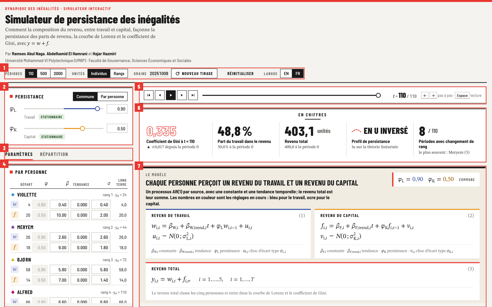

| N° | Zone | Contenu |
| --- | --- | --- |
| 1 | Réglages de la simulation | Nombre de périodes, unités d'analyse (individus ou rangs), graine avec **Nouveau tirage**, **Réinitialiser** et bouton de langue **EN / FR** |
| 2 | Persistance | $`\phi_L`$ et $`\phi_K`$, communs à tous ou réglés par personne, avec un indicateur de stationnarité pour chaque source |
| 3 | Onglets | **Paramètres** ou **Répartition** dans le panneau inférieur gauche |
| 4 | Paramètres par personne | Départ, $`\phi`$, $`\beta`$, tendance, $`\sigma`$ et niveau de long terme de chaque revenu |
| 5 | Barre des périodes | Choisit la période $`t`$ utilisée par le bandeau En chiffres et les figures 2 et 5 |
| 6 | En chiffres | Statistiques clés à la période $`t`$ |
| 7 | Le modèle | Équations (1) à (4) avec les valeurs en cours, et une carte par individu |

Chaque modification recalcule immédiatement toutes les figures.

### 4.1 Réglages de la simulation

- **Périodes** : 110, 500 ou 2 000. La figure 1 fait la moyenne sur 200, 60 ou 20 échantillons simulés respectivement.
- **Unités** : *Individus* suit les mêmes cinq personnes ; *Rangs* les reclasse selon leur revenu total à chaque période et suit des positions (section 2.6).
- **Graine** et **Nouveau tirage** : la graine fixe les chocs ; Nouveau tirage en tire une nouvelle.
- **Réinitialiser** : rétablit les réglages par défaut.
- **Langue** : **EN** ou **FR** fait passer tous les libellés, titres et lectures de l'anglais au français sans modifier les réglages ni les résultats. Le choix est mémorisé, et l'adresse `…/Inequality-Persistence-Simulator/?lang=fr` ouvre directement la version française. En français, les nombres s'écrivent avec une virgule décimale.

### 4.2 Persistance

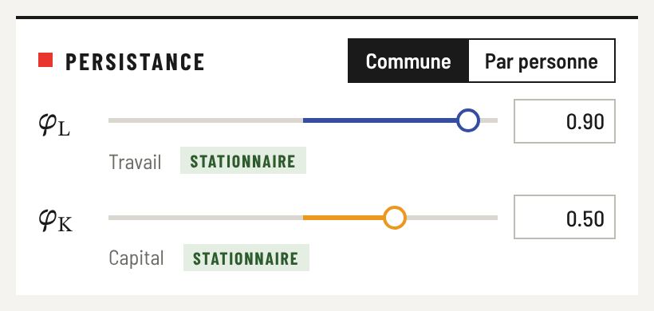

- **Commune** : un seul $`\phi_L`$ et un seul $`\phi_K`$ pour tous les individus, réglés avec les curseurs ou saisis dans les champs.
- **Par personne** : des valeurs individuelles de $`\phi_L`$ et $`\phi_K`$, saisies dans l'onglet Paramètres ; les curseurs sont alors inactifs. Le passage à Par personne recopie les valeurs communes pour chaque individu.
- L'indicateur placé sous chaque curseur affiche **Stationnaire** quand $`|\phi| < 1`$ et **Racine unitaire** quand $`|\phi| = 1`$.

### 4.3 Paramètres par personne

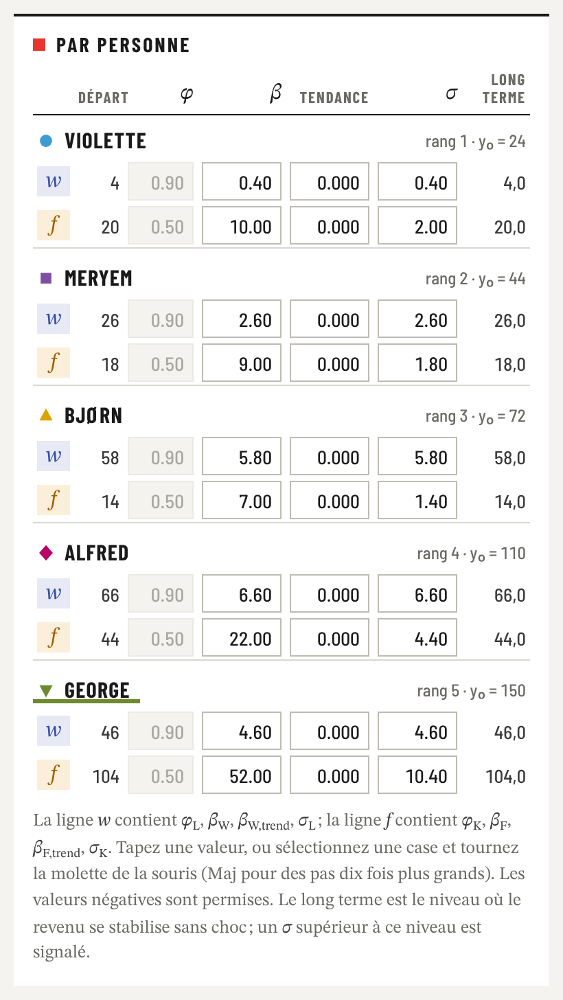

Chaque individu a une ligne **w** (travail) et une ligne **f** (capital).

| Colonne | Contenu |
| --- | --- |
| Départ | Valeur à la période 0, issue de la répartition (lecture seule) |
| $`\phi`$ | Persistance ; modifiable quand la persistance est réglée Par personne |
| $`\beta`$ | Constante |
| Tendance | Coefficient de $`t`$ ; le revenu dérive de tendance / $`(1-\phi)`$ par période |
| $`\sigma`$ | Écart type du choc ; signalé quand il dépasse le niveau de long terme |
| Long terme | $`\beta/(1-\phi)`$, le niveau atteint sans choc (à $`t = 0`$ en présence d'une tendance) |

Les valeurs se saisissent et se valident avec Entrée, ou se modifient avec la molette de la souris une fois le champ sélectionné (Maj pour des pas dix fois plus grands). Les valeurs négatives sont permises. Sélectionner un nom ouvre les séries de l'individu dans la figure 3.

### 4.4 Répartition et profils types

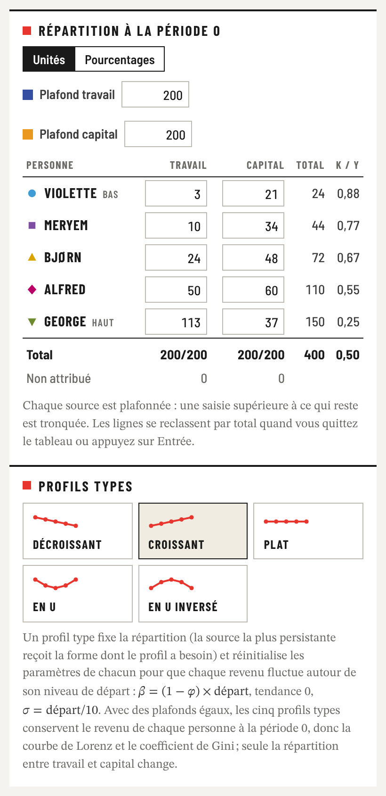

- **Plafond travail** et **Plafond capital** fixent le total d'unités de chaque source (200 par défaut) ; modifier un plafond rééchelonne la répartition.
- **Unités** ou **Pourcentages** : les dotations se saisissent en unités ou en pourcentage de chaque plafond. En mode Pourcentages, la colonne Total % fixe la part d'un individu dans l'ensemble du revenu et rééchelonne les autres.
- Chaque source est plafonnée : une saisie supérieure aux unités restantes est tronquée. Pour transférer des unités d'un individu à un autre, il faut d'abord réduire le donneur.
- Les lignes se reclassent par revenu total quand on quitte le tableau ou qu'on appuie sur Entrée, de sorte que le tableau va toujours du plus pauvre au plus riche à la période 0.
- Les **profils types** reproduisent cinq économies dans lesquelles chaque individu conserve le même revenu à la période 0 (24, 44, 72, 110 et 150 unités avec des plafonds égaux de 200), donc la même courbe de Lorenz et le même coefficient de Gini, 0,318. Seul le partage entre travail et capital diffère. La source la plus persistante reçoit la forme dont le profil a besoin, si bien que les profils types fonctionnent quelle que soit la source la plus persistante. Le profil type En U inversé est plus polarisé que la répartition de départ.

### 4.5 Le temps

La barre des périodes choisit la période $`t`$ affichée dans le bandeau En chiffres et dans les figures 2 et 5, et la repère sur les figures 3 et 4. Sur le tableau des figures, les flèches gauche et droite avancent d'une période (Maj pour dix), Début et Fin vont à la première et à la dernière période, et Espace lance ou suspend la lecture.

## 5. Lire les figures

Chaque figure comporte un titre qui énonce le résultat pour les réglages en cours, un sous-titre qui indique l'unité, une ligne de source, le graphique avec ses valeurs clés, et une ligne **Lecture** qui formule le résultat en mots. Le survol d'un graphique affiche les valeurs exactes.

### 5.1 En chiffres

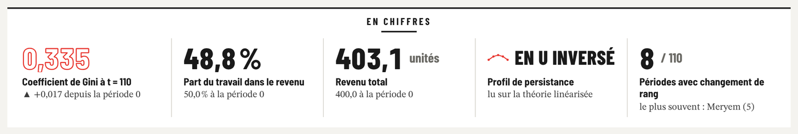

À la période choisie : le coefficient de Gini et sa variation depuis la période 0, la part du travail dans le revenu total, le revenu total, la forme du profil de persistance, et le nombre de périodes au cours desquelles au moins un individu a changé de rang, avec l'individu qui en a changé le plus souvent.

### 5.2 Le panneau du modèle

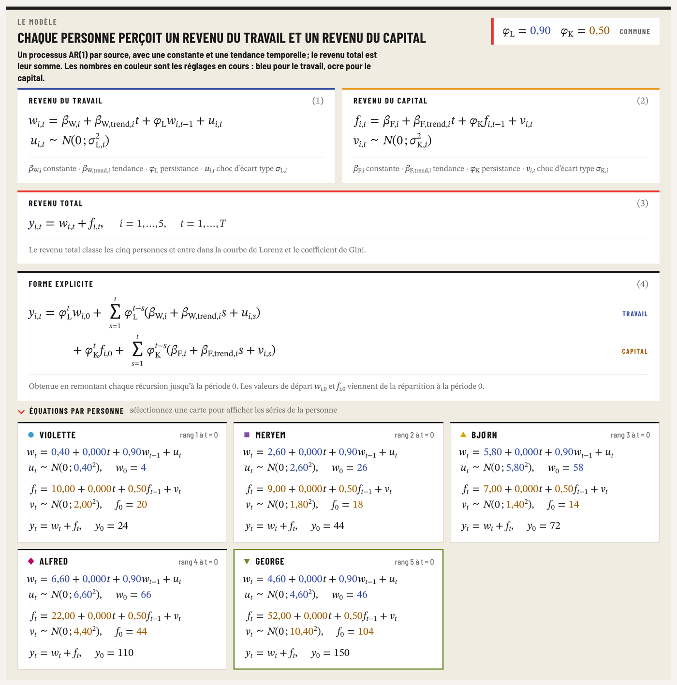

Les équations (1) à (4) en quatre blocs (revenu du travail, revenu du capital, revenu total, forme explicite), avec les valeurs en cours des paramètres de persistance. En dessous, une carte par individu reprend les mêmes équations avec ses paramètres et ses valeurs de départ ; sélectionner une carte ouvre les séries de l'individu dans la figure 3.

### 5.3 Figure 1 : profil de persistance


Pour chaque individu, du plus pauvre au plus riche à la période 0 :

- **Ligne et points rouges** : moyenne de $`\hat\rho(1)`$ sur les échantillons simulés, avec sa valeur.
- **Moustaches grises** : 5e et 95e centiles entre échantillons, mesure de la dispersion d'échantillonnage de $`\hat\rho(1)`$ sur $`T`$ périodes.
- **Ligne grise en pointillés avec losanges creux** : la théorie linéarisée de la section 2.4.
- **Lignes bleue et ocre en pointillés** : $`\phi_L`$ et $`\phi_K`$, quand la persistance est commune.

Le titre classe le profil comme croissant, décroissant, plat (étendue inférieure à 0,03), en U, en U inversé ou mixte. **Valeurs par personne** donne pour chaque individu sa part et son ratio de capital à la période 0, la moyenne simulée, l'intervalle de centiles et la valeur théorique.

### 5.4 Figure 2 : courbe de Lorenz et coefficient de Gini

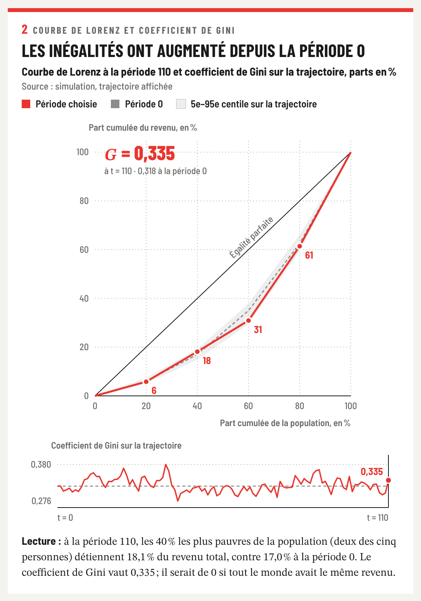

La courbe rouge est la courbe de Lorenz à la période $`t`$, les individus étant reclassés à cette période, avec les parts cumulées en pourcentage à chaque point. La courbe grise en pointillés est celle de la période 0, et la bande grise couvre les 5e à 95e centiles de chaque ordonnée sur la trajectoire. $`G`$ est le coefficient de Gini à $`t`$ ; le graphique du bas le suit sur toutes les périodes, avec une ligne en pointillés à sa valeur de période 0. Par défaut, $`G`$ vaut 0,318 à la période 0 et 0,335 à la période 110, et varie entre 0,276 et 0,380 sur la trajectoire ; les 40 % les plus pauvres détiennent 17,0 % du revenu à la période 0 et 18,1 % à la période 110.

### 5.5 Figure 3 : séries individuelles

**Une personne** présente les équations de l'individu choisi en quatre blocs, avec le niveau de long terme et la demi-vie d'un choc pour chaque source, le rang et la part du capital à la période 0, et la forme explicite avec ses propres valeurs.

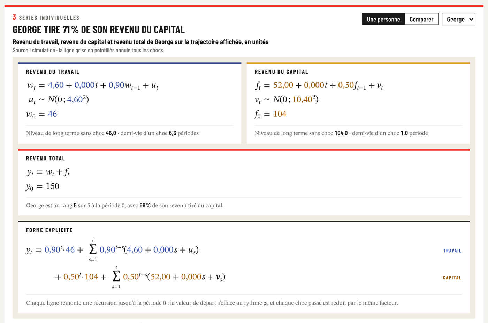

Le graphique trace le revenu total (rouge), le revenu du travail (bleu), le revenu du capital (ocre) et la trajectoire sans choc du revenu total (gris, en pointillés).

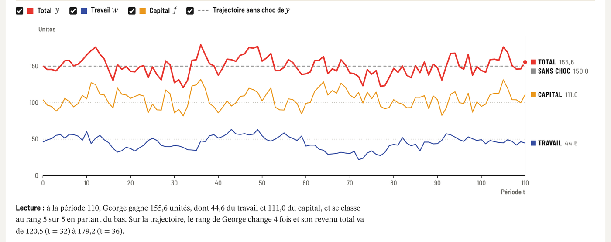

Le revenu du travail de George évolue par longues vagues autour de son niveau, tandis que son revenu du capital fluctue rapidement autour de 104 : les deux paramètres de persistance se lisent dans les séries elles-mêmes.

**Comparer** trace une même série (revenu total, du travail, du capital ou part) pour plusieurs individus, avec leurs trajectoires sans choc si on les sélectionne. Le tableau donne pour chaque individu $`\phi_L`$ et $`\phi_K`$, la valeur à $`t`$, la moyenne, l'écart type, l'étendue, le rang, le nombre de changements de rang et le $`\hat\rho(1)`$ de la part.

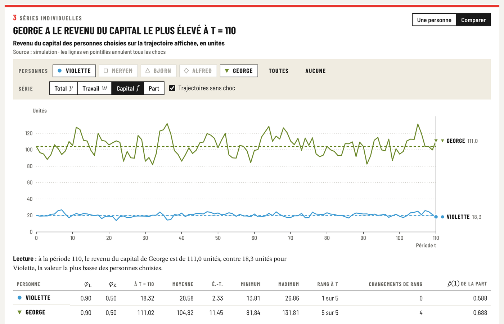

### 5.6 Figure 4 : parts de revenu dans le temps

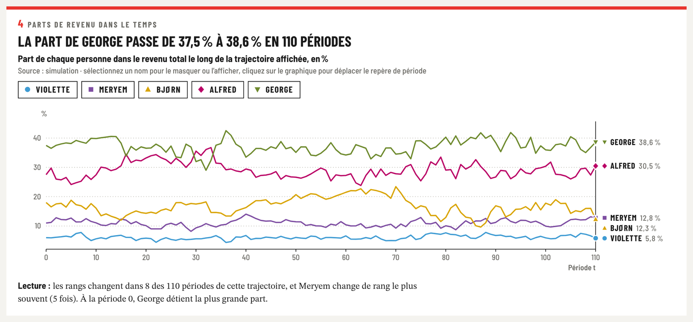

La part de chaque individu le long de la trajectoire affichée. Les croisements sont des changements de rang ; par défaut, Meryem et Bjørn se croisent cinq fois. En mode Rangs, chaque ligne est une position. Les étiquettes de noms sont partagées avec la vue Comparer de la figure 3.

### 5.7 Figure 5 : revenu par personne

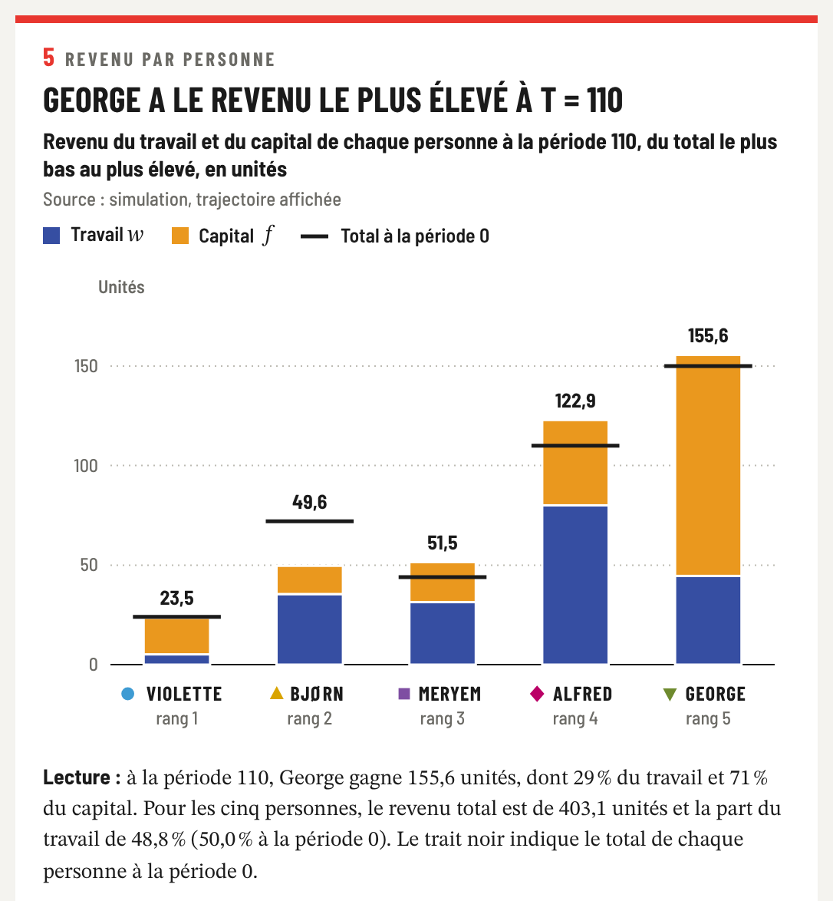

Revenu du travail (bleu) et du capital (ocre) à la période $`t`$, classés par revenu total, avec un trait noir au total de chaque individu à la période 0.

---

## 6. Expériences contrôlées

Chaque expérience part de **Réinitialiser** et modifie un seul élément de l'étalonnage. Les résultats sont ceux de la graine par défaut ; une autre graine déplace légèrement les chiffres sans changer les conclusions.

| N° | Expérience | Résultat |
| --- | --- | --- |
| 6.1 | Économie de départ | La persistance suit la composition du revenu |
| 6.2 | Persistances des sources inversées | Le profil s'inverse |
| 6.3 | Persistances des sources égales | La composition devient sans effet |
| 6.4 | Cinq économies aux revenus identiques | La composition engendre toutes les formes ; la courbe de Lorenz et le coefficient de Gini ne l'enregistrent pas |
| 6.5 | Chocs plus forts | La volatilité augmente, la persistance non |
| 6.6 | Positions de rang | Des changements de rang fréquents resserrent la persistance des positions |
| 6.7 | Tendances déterministes | Les tendances déplacent le niveau des inégalités, non leur persistance |
| 6.8 | Racine unitaire | Les écarts deviennent permanents |
| 6.9 | Persistance négative | Une source qui oscille réduit la persistance de toutes les parts |
| 6.10 | Longueur de l'échantillon | Les échantillons courts biaisent la persistance vers le bas mais en préservent l'ordre |
| 6.11 | Redistribution ponctuelle ou permanente | Un transfert dure autant que le revenu qu'il vise |
| 6.12 | Un sommet volatil | Un revenu volatil et vite résorbé au sommet réduit la persistance du haut et se diffuse |

### 6.1 Économie de départ

**Protocole.** Réglages par défaut : $`\phi_L = 0{,}90`$, $`\phi_K = 0{,}50`$, répartition de la section 3.2.


**Résultat.** Le profil est en U inversé.

| | Violette | Meryem | Bjørn | Alfred | George |
| --- | --- | --- | --- | --- | --- |
| $`\hat\rho(1)`$ simulé | 0,588 | 0,773 | 0,831 | 0,787 | 0,688 |
| Théorie linéarisée | 0,635 | 0,844 | 0,878 | 0,840 | 0,753 |

La composition qui le sous-tend apparaît dans la figure 5 à la période 0 : Bjørn, au milieu, détient 58 unités de travail et 14 de capital ; George, au sommet, 104 unités de capital ; Violette, en bas, 20 unités de capital et 4 de travail.

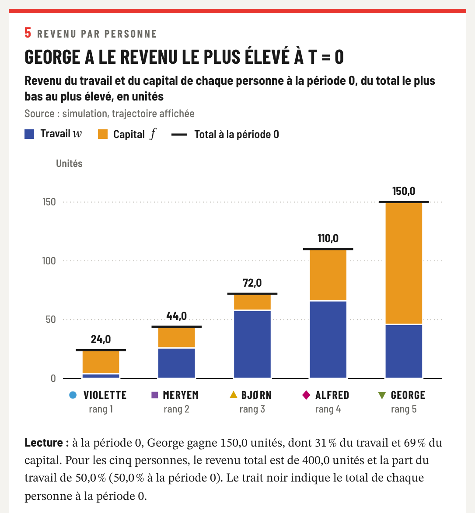

**Interprétation.** Le classement des persistances reproduit celui de la contribution du travail aux fluctuations de chaque individu (section 2.4). Le milieu, où domine le revenu du travail, reporte les écarts ; le bas et le sommet, exposés à des revenus vite résorbés, s'ajustent rapidement. Une part des hauts revenus qui bouge vite n'indique donc pas que ces revenus sont aléatoires ; elle est compatible avec des hauts revenus composés de sources qui reviennent vite à leur niveau.

### 6.2 Persistances des sources inversées

**Protocole.** Fixer $`\phi_L = 0{,}50`$ et $`\phi_K = 0{,}90`$.

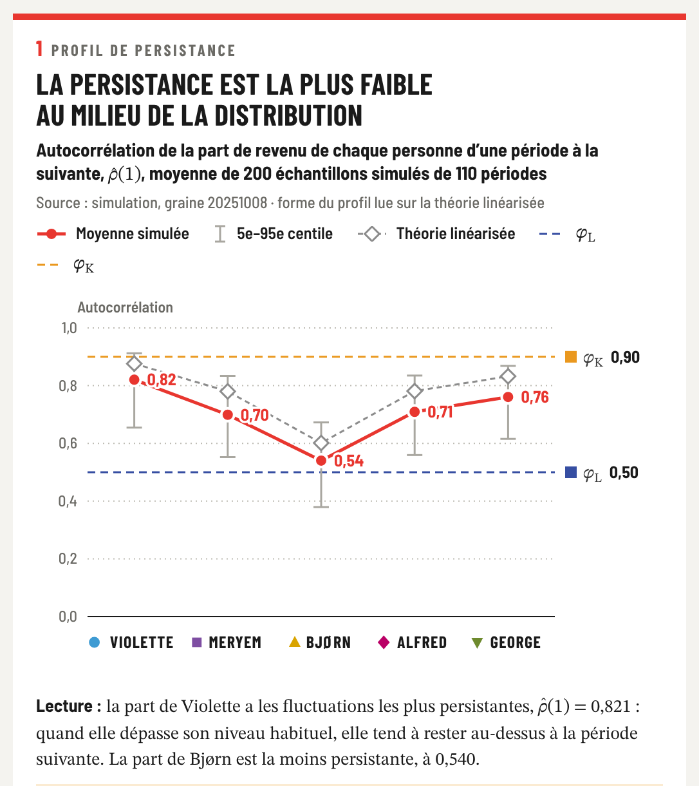

**Résultat.** Le profil devient en U, de 0,540 pour Bjørn à 0,821 pour Violette, George étant à 0,761. Les constantes n'ayant pas été modifiées (règle 2), les niveaux de long terme se déplacent : les revenus du travail se stabilisent au cinquième de leur départ ($`0{,}1/(1-0{,}5) = 0{,}2`$) et les revenus du capital au quintuple ($`0{,}5/(1-0{,}9) = 5`$). Le revenu total passe de 400 à 1 070, la part du travail tombe de 50 % à 3 %, et des composantes négatives apparaissent dans 22 des 111 périodes.

Pour maintenir chaque revenu autour de son départ, fixer $`\beta = (1-\phi)\times`$ départ sur chaque ligne :

| $`\beta`$ | Violette | Meryem | Bjørn | Alfred | George |
| --- | --- | --- | --- | --- | --- |
| Ligne w (0,5 × départ) | 2.00 | 13.00 | 29.00 | 33.00 | 23.00 |
| Ligne f (0,1 × départ) | 2.00 | 1.80 | 1.40 | 4.40 | 10.40 |

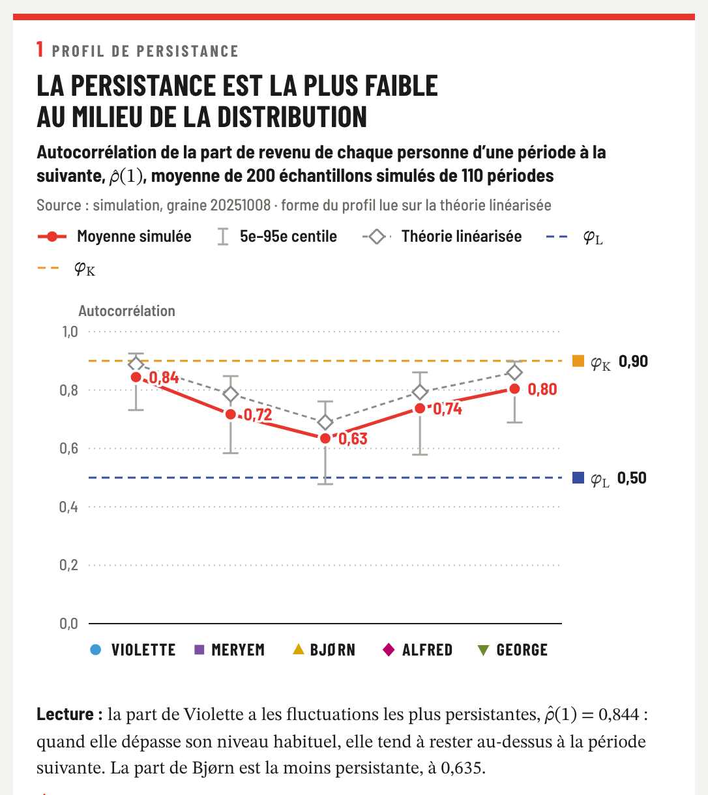

Le profil reste en U, de 0,635 pour Bjørn à 0,844 pour Violette, image inversée du profil par défaut ; aucun revenu ne devient négatif et les rangs changent dans 6 périodes.

**Interprétation.** La composition ne détermine le profil qu'en interaction avec l'ordre des persistances des sources. La même répartition produit des profils opposés sous des ordres opposés.

### 6.3 Persistances des sources égales

**Protocole.** Fixer $`\phi_L = \phi_K = 0{,}70`$.

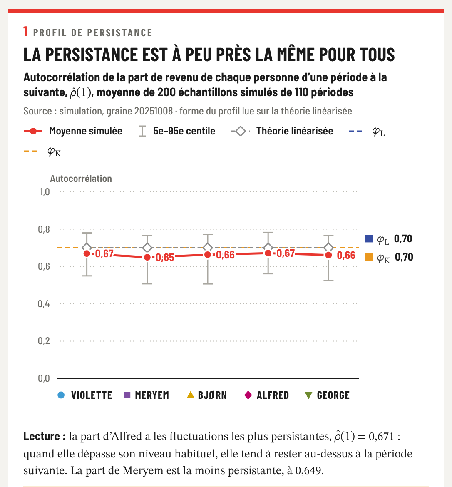

**Résultat.** Le profil est plat : toutes les parts sont comprises entre 0,649 et 0,671, et la ligne théorique vaut 0,700 pour chaque individu. Réancrer $`\beta`$ à 0,3 × départ donne 0,650 à 0,672.

**Interprétation.** C'est le cas témoin. Avec $`\phi_L = \phi_K = \phi`$, la formule de la section 2.4 se réduit à $`\phi`$ pour chaque individu, quelles que soient les pondérations. Des différences de persistance le long de la distribution renseignent donc sur des différences de persistance entre sources.

### 6.4 Cinq économies aux revenus identiques

**Protocole.** Avec $`\phi_L = 0{,}90`$ et $`\phi_K = 0{,}50`$, ouvrir l'onglet **Répartition** et choisir successivement chaque profil type. Les cinq économies attribuent à chaque individu le même revenu à la période 0 (24, 44, 72, 110 et 150 unités), donc la même courbe de Lorenz et le même coefficient de Gini, 0,318, et ne diffèrent que par le partage entre travail et capital.

| Économie | Unités de travail, individus 1 à 5 | Unités de capital, individus 1 à 5 |
| --- | --- | --- |
| Décroissant | 21, 39, 43, 53, 44 | 3, 5, 29, 57, 106 |
| Croissant | 3, 10, 24, 50, 113 | 21, 34, 48, 60, 37 |
| Plat | 12, 22, 36, 55, 75 | 12, 22, 36, 55, 75 |
| En U | 21, 13, 8, 28, 130 | 3, 31, 64, 82, 20 |
| En U inversé | 3, 39, 64, 79, 15 | 21, 5, 8, 31, 135 |

<table>
<tr>
<td>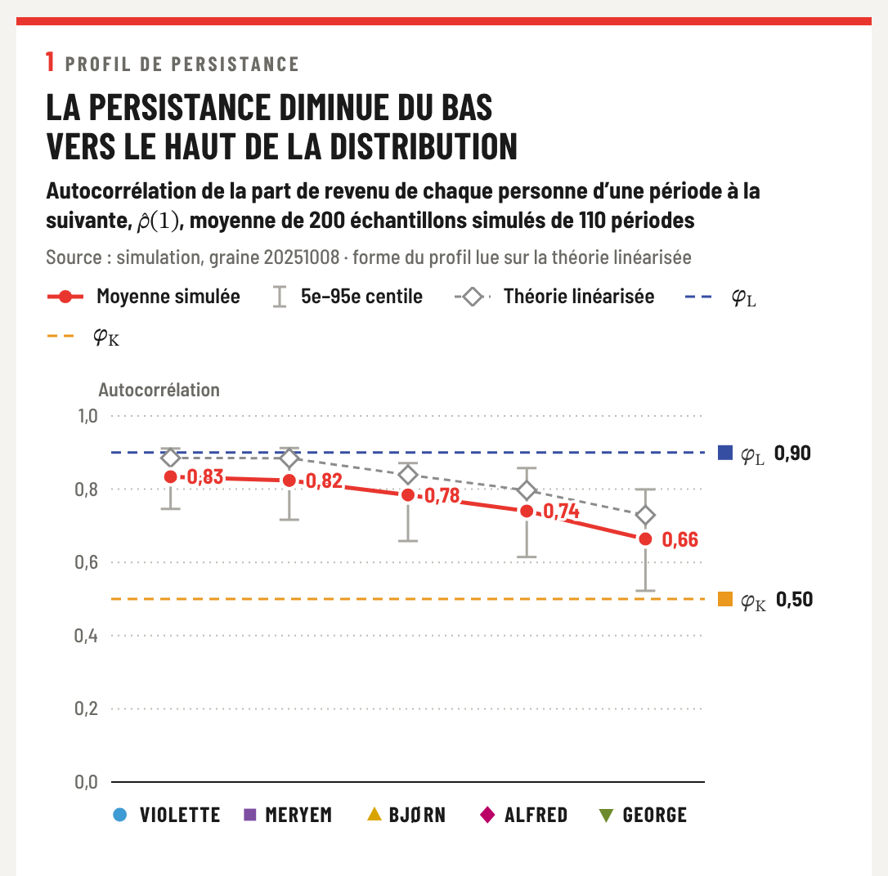</td>
<td>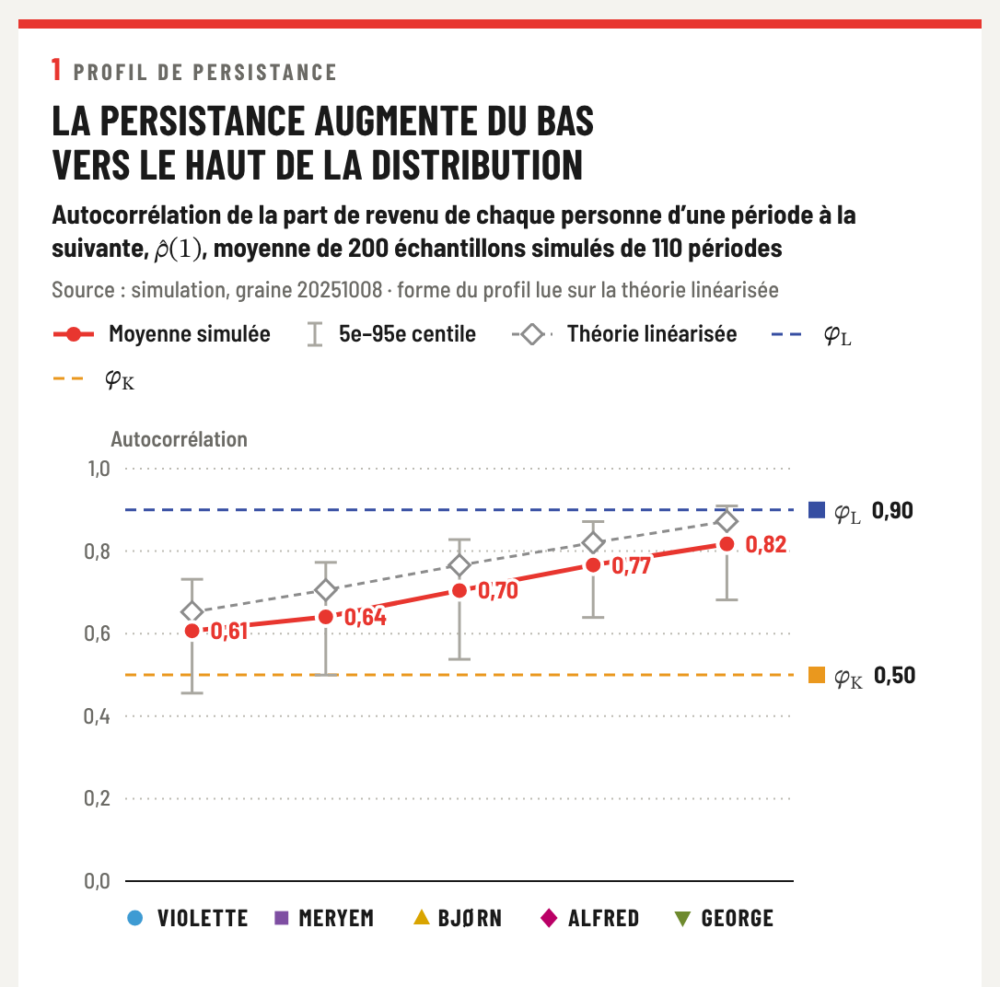</td>
</tr>
<tr>
<td>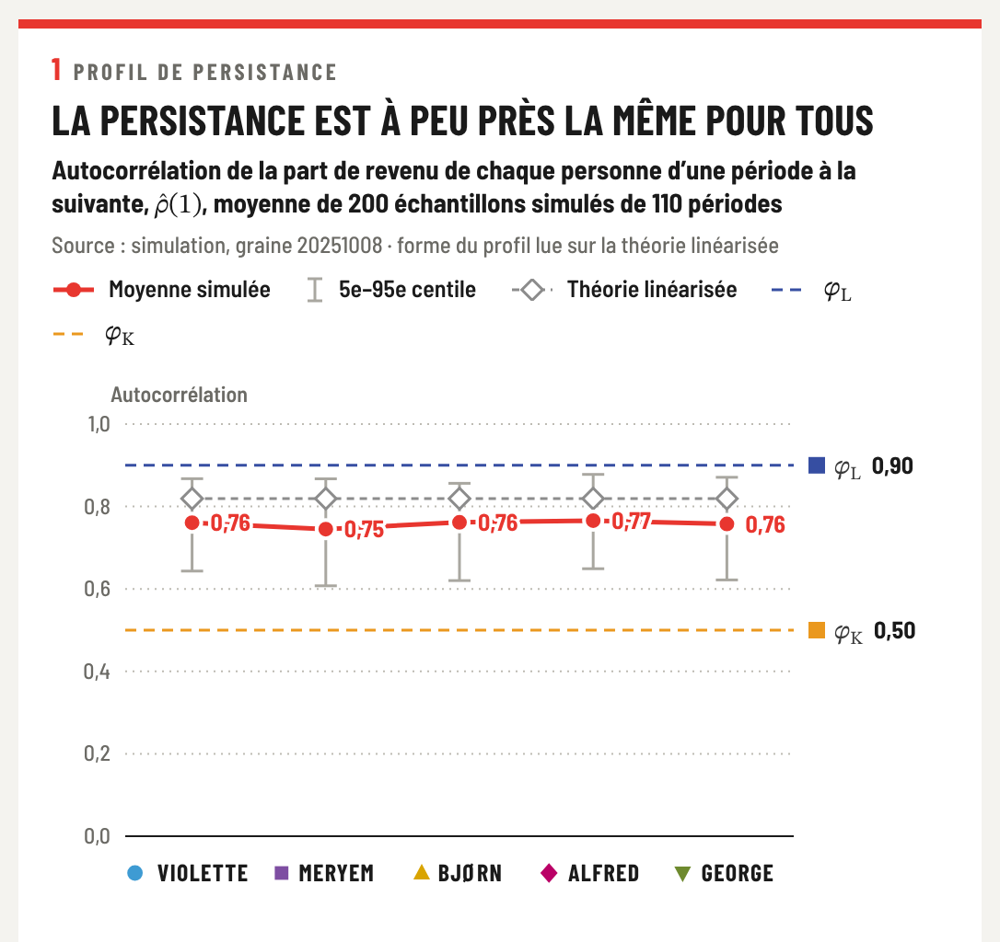</td>
<td>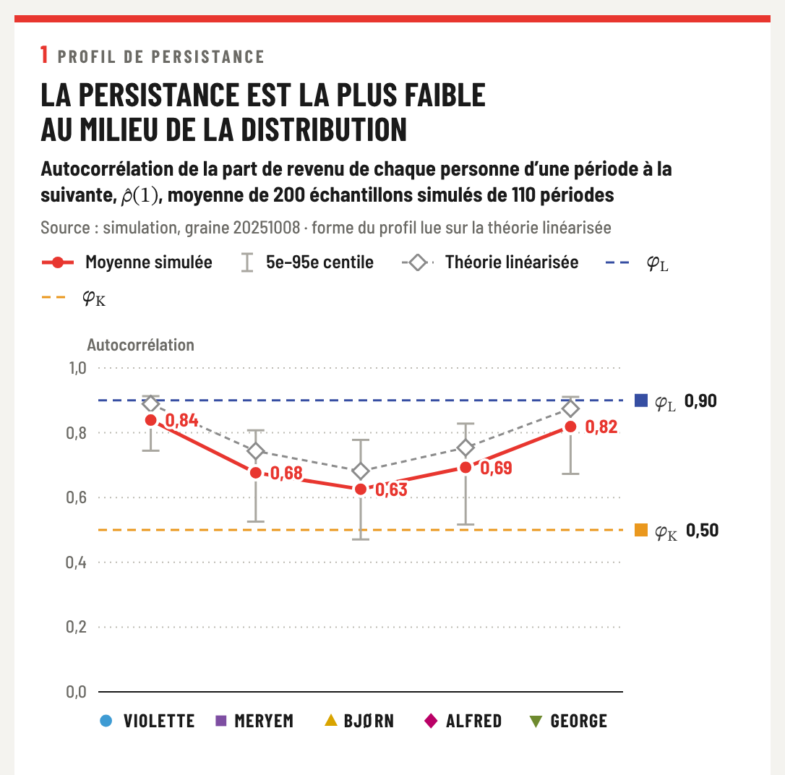</td>
</tr>
<tr>
<td>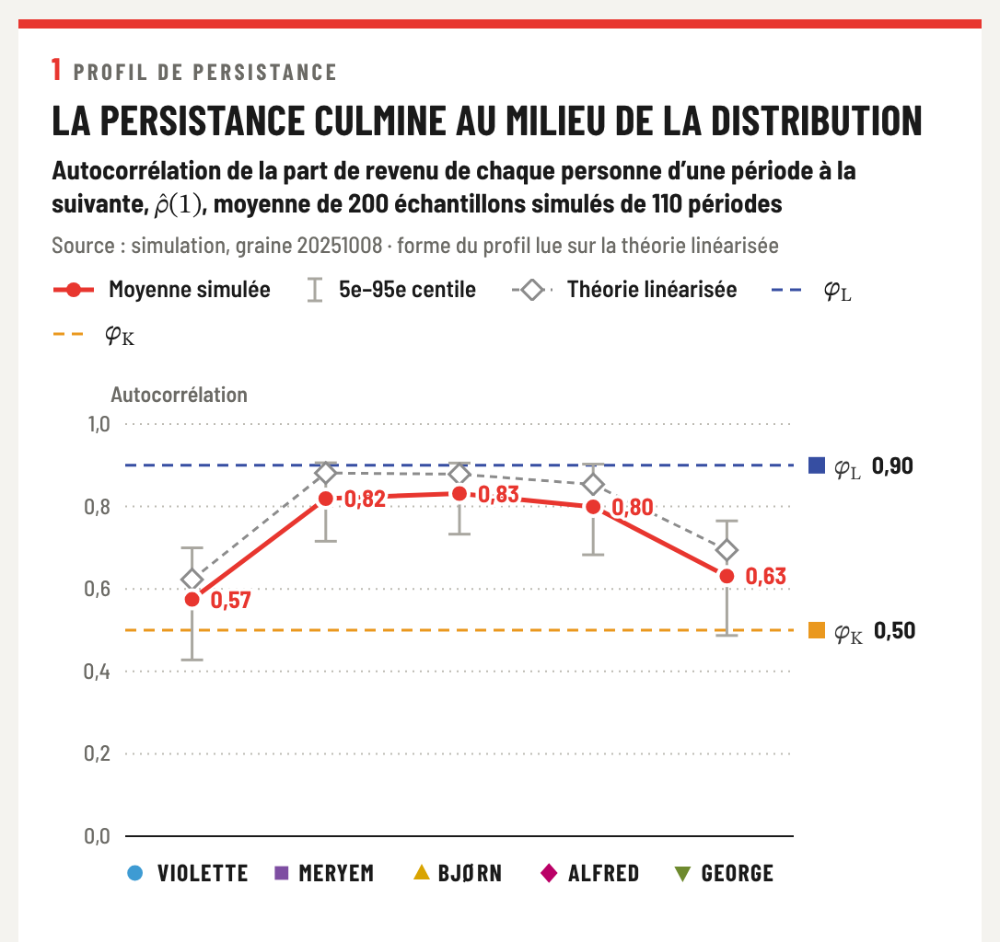</td>
<td></td>
</tr>
</table>

**Résultat.** Chaque économie produit le profil dont elle porte le nom.

| Économie | $`\hat\rho(1)`$ simulé, individus 1 à 5 | Théorie, étendue | Gini, période 0 | Gini, moyenne sur la trajectoire | Gini, 5e–95e centile | Gini, période 110 | Périodes avec changement de rang |
| --- | --- | --- | --- | --- | --- | --- | --- |
| Décroissant | 0,834 ; 0,824 ; 0,784 ; 0,740 ; 0,664 | 0,73–0,89 | 0,318 | 0,320 | 0,289–0,356 | 0,308 | 4 |
| Croissant | 0,607 ; 0,641 ; 0,704 ; 0,766 ; 0,817 | 0,65–0,87 | 0,318 | 0,317 | 0,276–0,352 | 0,317 | 20 |
| Plat | 0,761 ; 0,745 ; 0,762 ; 0,766 ; 0,758 | 0,82 | 0,318 | 0,319 | 0,289–0,348 | 0,314 | 6 |
| En U | 0,839 ; 0,677 ; 0,626 ; 0,693 ; 0,819 | 0,68–0,89 | 0,318 | 0,317 | 0,275–0,357 | 0,290 | 12 |
| En U inversé | 0,575 ; 0,819 ; 0,831 ; 0,799 ; 0,631 | 0,62–0,88 | 0,318 | 0,322 | 0,281–0,364 | 0,343 | 12 |

Chaque forme suit la part du travail d'un individu à l'autre. Dans l'économie en U inversé, le plus pauvre et le plus riche détiennent surtout du capital (12,5 % et 10 % de travail), tandis que les trois individus du milieu détiennent de 72 % à 89 % de travail. Quand chaque individu détient travail et capital dans les mêmes proportions, le profil est plat à la valeur théorique de 0,82. Les moyennes simulées se situent environ 0,05 à 0,07 sous la ligne théorique, du fait du biais d'échantillon fini de l'autocorrélation, orienté vers le bas (expérience 6.10). La persistance est mesurée ici pour des individus fixes ; l'écart avec des positions de rang est faible, puisque les rangs ne changent que dans 4 à 20 des 110 périodes.

**Interprétation.** Les cinq économies partagent la même courbe de Lorenz à la période 0, leurs coefficients de Gini moyens sur 110 périodes sont compris entre 0,317 et 0,322, et leurs intervalles de 5e à 95e centile se recouvrent presque entièrement. À la période 110, le coefficient de Gini diffère d'une économie à l'autre, de 0,290 à 0,343, mais cet écart est inférieur à l'étendue parcourue par chaque économie au fil du temps. Pourtant, la persistance linéarisée des parts individuelles va de 0,62 à 0,88 dans l'économie en U inversé et vaut uniformément 0,82 dans l'économie plate. La courbe de Lorenz et le coefficient de Gini n'enregistrent pas cette hétérogénéité (section 2.7).

### 6.5 Chocs plus forts : volatilité et persistance

**Protocole.** Multiplier chaque $`\sigma`$ par 3 dans l'onglet Paramètres.

| $`\sigma`$ | Violette | Meryem | Bjørn | Alfred | George |
| --- | --- | --- | --- | --- | --- |
| Ligne w | 1.20 | 7.80 | 17.40 | 19.80 | 13.80 |
| Ligne f | 6.00 | 5.40 | 4.20 | 13.20 | 31.20 |

<table>
<tr>
<td></td>
</tr>
<tr>
<td>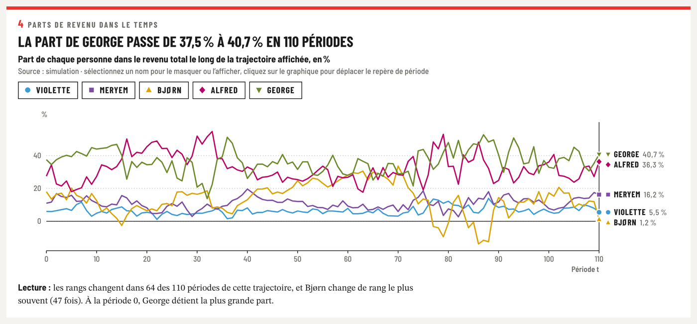</td>
</tr>
</table>

**Résultat.** Les parts oscillent trois fois plus largement et se croisent sans cesse : les rangs changent dans 64 périodes au lieu de 8, 47 fois pour Bjørn à lui seul, et le coefficient de Gini varie entre 0,237 et 0,662 au lieu de 0,276 et 0,380. Le profil de persistance est pratiquement inchangé, en U inversé de 0,581 à 0,820 contre 0,588 à 0,831, et la ligne théorique est identique. Des revenus deviennent négatifs dans 27 périodes.

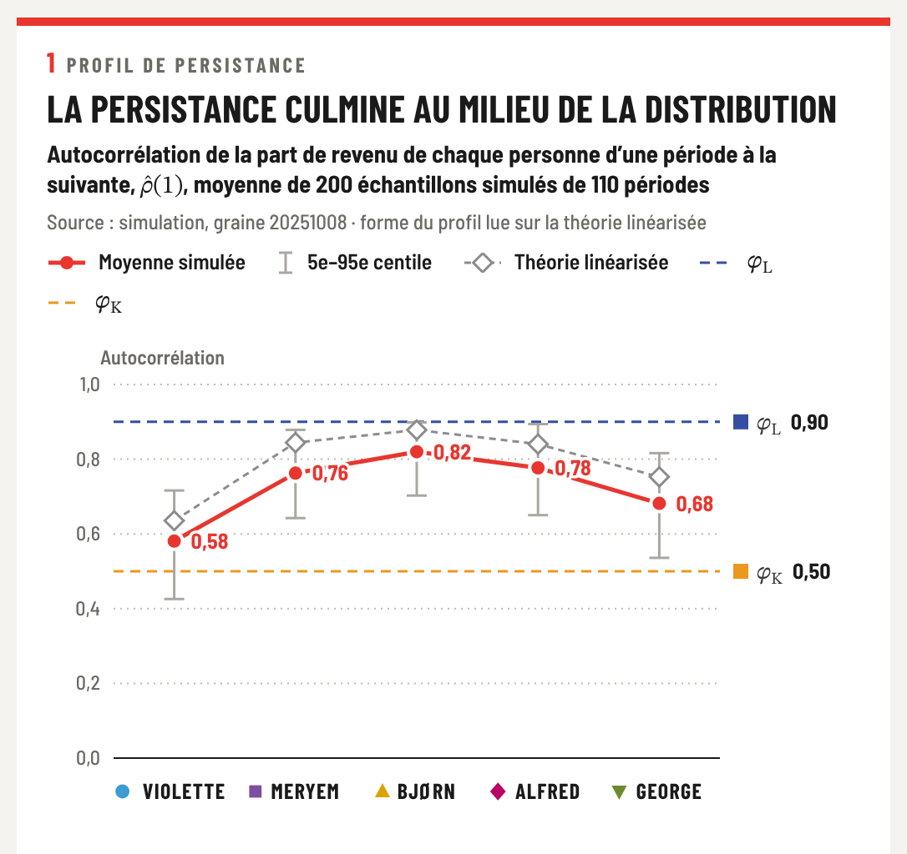

**Interprétation.** Une remise à l'échelle commune des chocs multiplie chaque écart sans changer son rythme de résorption. Les changements de rang, qui dépendent des chocs rapportés aux écarts de revenu, se multiplient à mesure que la volatilité augmente. Une distribution peut être très volatile alors que chaque écart dure exactement aussi longtemps qu'avant : persistance et volatilité doivent donc être mesurées séparément.

### 6.6 Positions de rang

**Protocole.** Conserver les chocs de 6.5 et régler **Unités** sur **Rangs**.

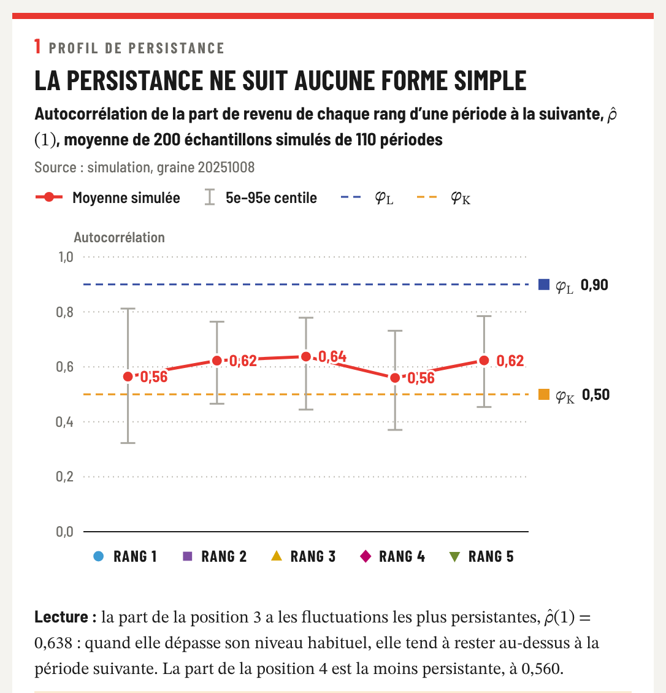

**Résultat.** La figure 1 représente désormais les positions de rang 1 à 5. Le profil devient *mixte*, toutes les positions étant comprises entre 0,560 et 0,638, plus plat et plus bas que les 0,581 à 0,820 des mêmes individus. La ligne théorique n'est pas affichée, puisqu'elle décrit des individus fixes. Avec les chocs par défaut (Réinitialiser, puis Rangs), le profil des positions est en U inversé de 0,587 à 0,821, proche du profil individuel, car les rangs ne changent que dans 8 périodes.

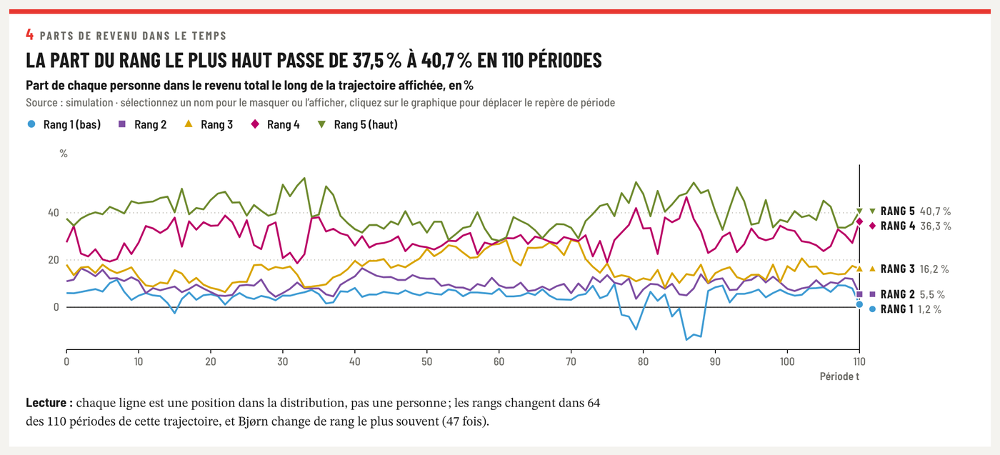

**Interprétation.** Une position de rang contient celui qui l'occupe. Quand les individus changent rarement de rang, une position correspond en pratique à un individu et sa persistance révèle la composition de celui-ci. Quand ils en changent souvent, une position hérite d'un mélange des sources de tous et les différences entre positions se resserrent. La persistance des parts de groupes de quantiles est une propriété des positions, et son interprétation exige des informations sur les entrées dans chaque groupe et les sorties.

### 6.7 Tendances déterministes

**Protocole A.** Sur la ligne **f** de George, fixer la tendance à **0.300** : son revenu du capital augmente de $`0{,}3/(1-0{,}5) = 0{,}6`$ unité par période.

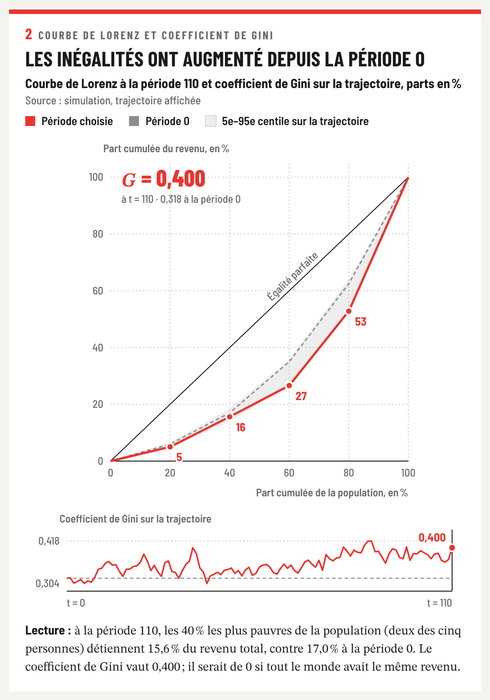

**Résultat A.** Le coefficient de Gini passe de 0,318 à 0,400 à la période 110, la part de George de 37,5 % à 47,2 % et le revenu total de 400 à 468,5, tandis que la part du travail recule de 50,0 % à 42,0 %.

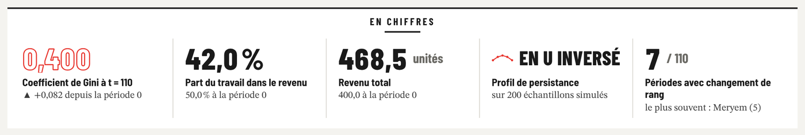

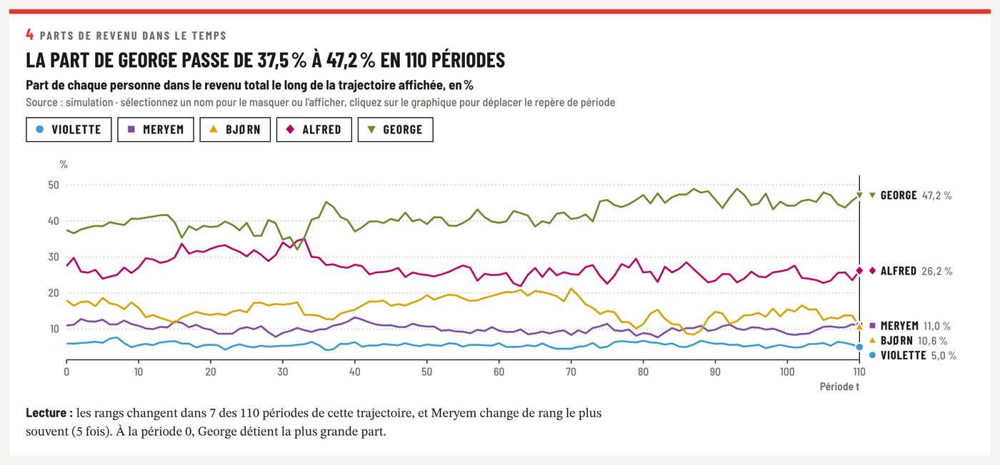

**Protocole B.** Réinitialiser ; sur les lignes **w** de Violette et de Meryem, fixer la tendance à **0.030** (0,3 unité par période).

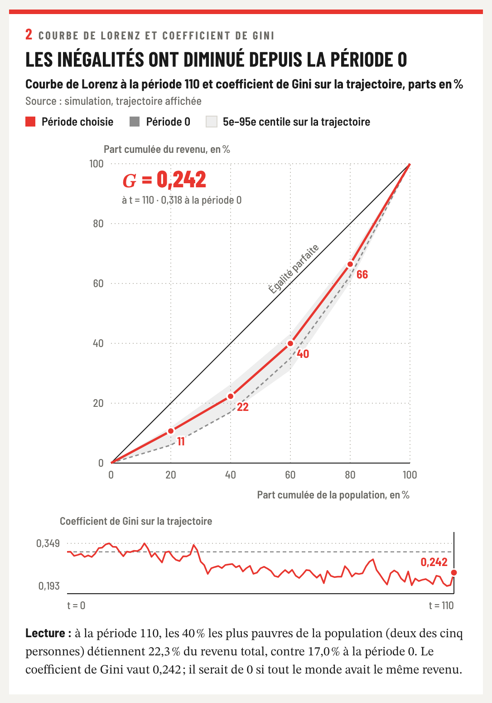

**Résultat B.** Le coefficient de Gini baisse de 0,318 à 0,242 à la période 110 ; la part de Violette passe de 6,0 % à 11,6 %, celle de Meryem de 11,0 % à 17,6 %, et la part du travail de 50,0 % à 55,5 %. Les rangs changent dans 23 périodes, car toutes deux rattrapent Bjørn.

Dans les deux cas, le profil reste en U inversé (0,580 à 0,833 dans le protocole A), et la ligne théorique n'est pas affichée parce qu'elle suppose des niveaux de long terme constants.

**Interprétation.** Tendances et persistance agissent sur des dimensions différentes : une tendance détermine la direction que prend la distribution, la persistance le comportement des écarts autour de cette trajectoire. Un revenu du capital qui croît plus vite au sommet élève la part du haut et le coefficient de Gini et réduit la part du travail, une version stylisée de la hausse récente des revenus du capital au sommet documentée par Gomez (2025). C'est le retrait de la composante déterministe (section 2.3) qui tient ces tendances à l'écart de la mesure de persistance.

### 6.8 Racine unitaire

**Protocole.** Fixer $`\phi_K = 1{,}00`$, puis $`\beta = 0`$ sur chaque ligne **f**. Avec $`\phi = 1`$, la constante devient une dérive ajoutée à chaque période : si elle reste inchangée, le revenu total passe de 400 à 11 532 en 110 périodes. Avec $`\beta = 0`$, le revenu du capital est une marche aléatoire pure.

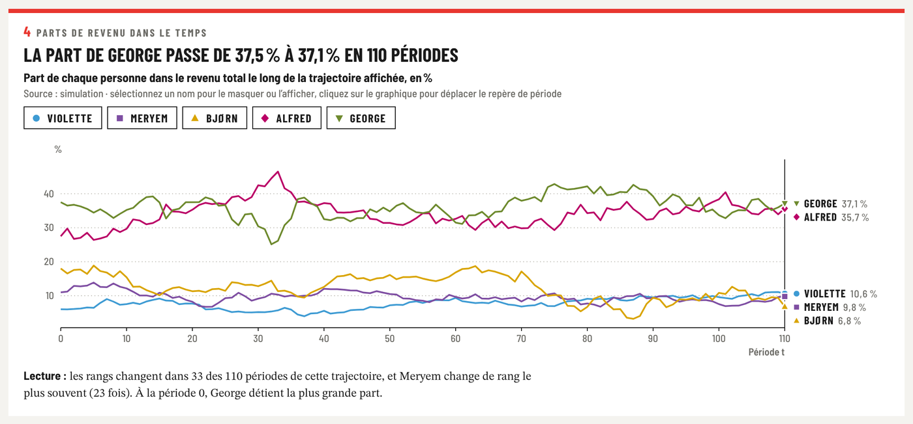

**Résultat.** Les parts errent sans revenir vers un niveau. La part de Bjørn tombe de 18,0 % à 6,8 % et celle de Violette monte de 6,0 % à 10,6 % ; les rangs changent dans 33 périodes ; le coefficient de Gini évolue entre 0,262 et 0,422 sans fluctuer autour d'un niveau.

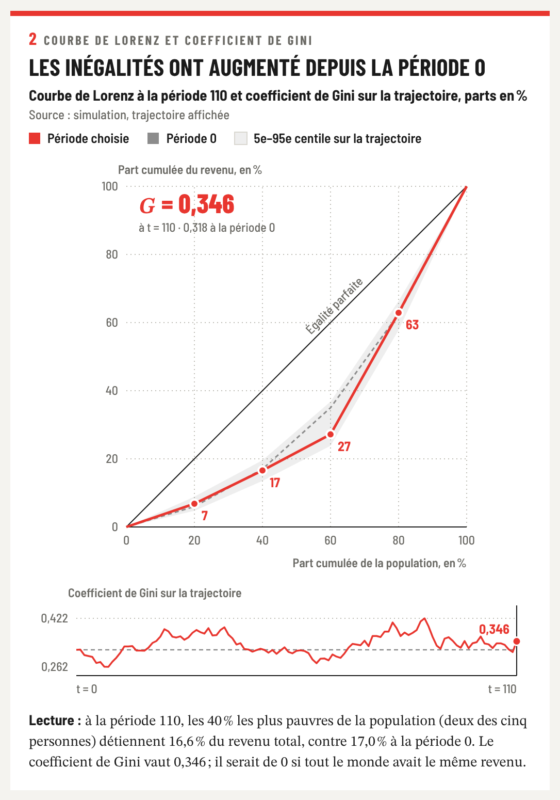

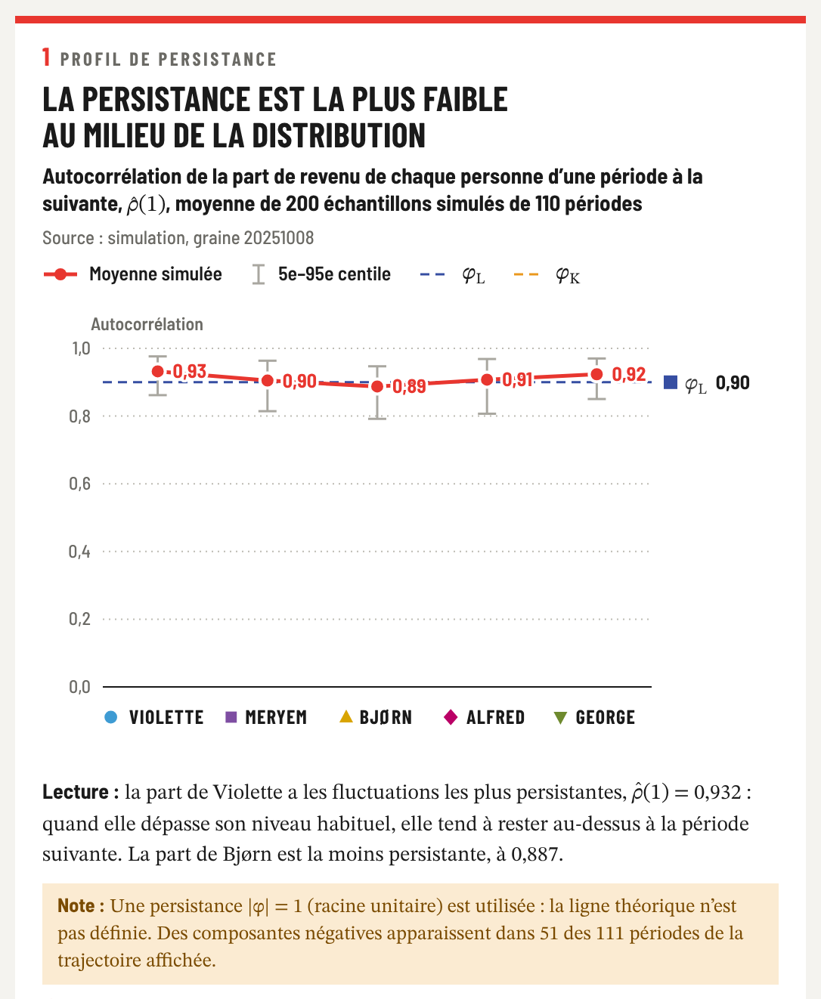

La persistance mesurée est élevée pour tous (0,887 à 0,932), le bas et le sommet, intensifs en capital, devenant les plus persistants. La ligne théorique n'est pas définie, et des revenus deviennent négatifs dans 51 des 111 périodes.

**Interprétation.** Avec une racine unitaire, un écart est permanent et la distribution n'a pas de niveau vers lequel revenir. Savoir si une part est stationnaire autour d'une trajectoire déterministe, éventuellement avec des ruptures structurelles, ou si elle contient une racine unitaire est donc une question préalable à toute mesure de la persistance (section 7).

### 6.9 Persistance négative

**Protocole.** Choisir **Par personne** dans l'encadré Persistance. Sur la ligne **f** de George, fixer $`\phi = -0{,}50`$ et $`\beta = 156{,}00`$ ($`1{,}5\times 104`$, ce qui maintient son revenu du capital autour de 104). Sélectionner le nom de George pour ouvrir ses séries.

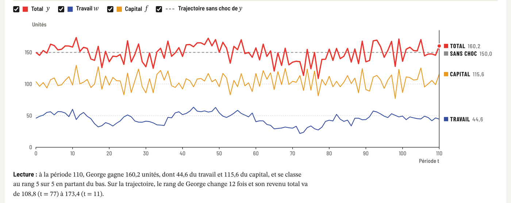

**Résultat.** Le revenu du capital de George alterne périodes hautes et basses. La persistance de sa part tombe de 0,688 à 0,305, et celle de toutes les autres parts baisse aussi (Violette de 0,588 à 0,517, Bjørn de 0,831 à 0,786). George change de rang 12 fois au lieu de 4.

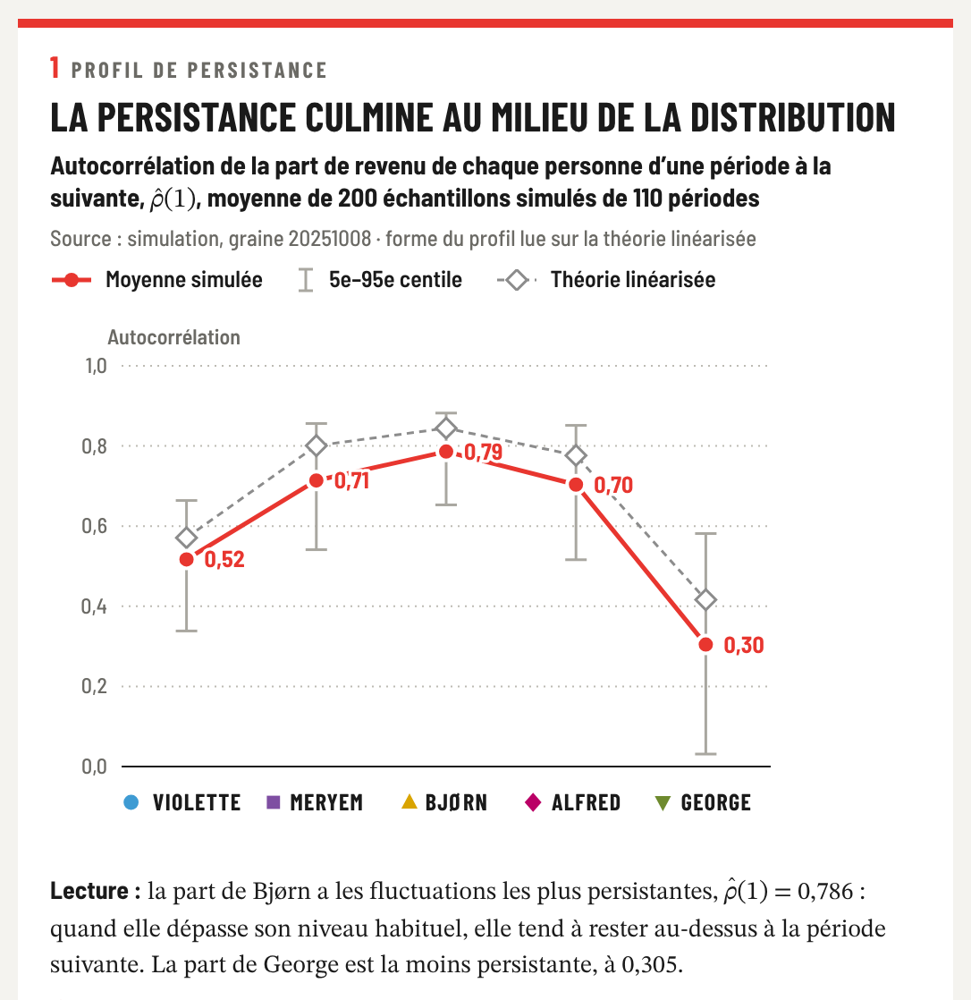

**Interprétation.** Une persistance négative représente une oscillation, comme lorsque le revenu réalisé une année épuise celui de l'année suivante. Les parts étant relatives, la dynamique d'un individu entre dans toutes les parts par l'intermédiaire du total (section 2.4, conséquence 3).

### 6.10 Longueur de l'échantillon

**Protocole.** Régler **Périodes** sur **2000**, puis sur **500**.

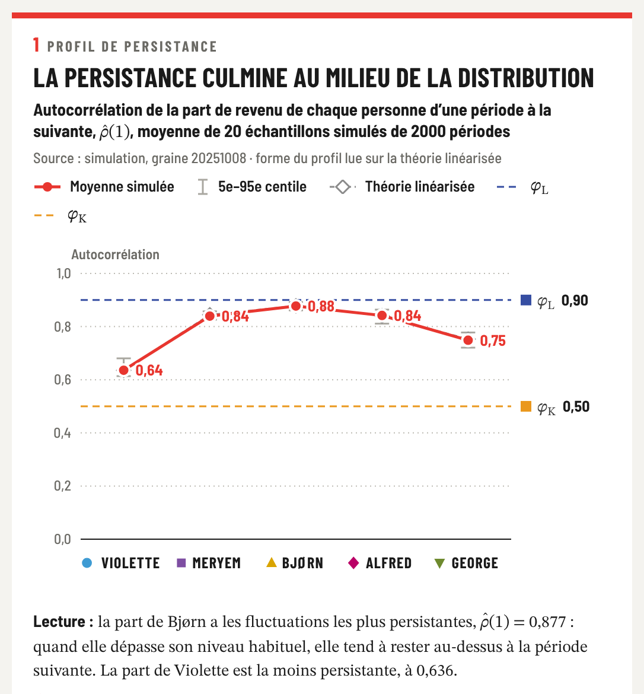

**Résultat.**

| | Violette | Meryem | Bjørn | Alfred | George |
| --- | --- | --- | --- | --- | --- |
| Théorie | 0,635 | 0,844 | 0,878 | 0,840 | 0,753 |
| Simulé, 2 000 périodes | 0,636 | 0,839 | 0,877 | 0,842 | 0,749 |
| Simulé, 500 périodes | 0,620 | 0,829 | 0,869 | 0,828 | 0,733 |
| Simulé, 110 périodes | 0,588 | 0,773 | 0,831 | 0,787 | 0,688 |

À 110 périodes, chaque estimation se situe 0,05 à 0,07 sous sa valeur théorique et l'intervalle de 5e à 95e centile a une largeur de 0,18 à 0,27 ; à 2 000 périodes, chaque estimation est à moins de 0,006 de la théorie.

**Interprétation.** L'autocorrélation empirique est biaisée vers zéro dans les échantillons courts, d'autant plus que la persistance est forte. Avec environ un siècle de données annuelles, les estimations de persistance sont à la fois biaisées et imprécises, mais la forme du profil est la même quelle que soit la longueur de l'échantillon. Les comparaisons de persistance le long de la distribution sont plus robustes que le niveau de chaque estimation.

### 6.11 Redistribution ponctuelle ou permanente

**Protocole A.** Ouvrir l'onglet **Répartition**, en Unités, et saisir **40** dans chaque case Capital, en commençant par George (104), puis Alfred (44), Bjørn, Meryem et Violette, afin qu'aucune saisie ne soit tronquée. À la validation, les lignes se reclassent, et George, désormais à 86 unités, passe au troisième rang derrière Bjørn (98) et Alfred (106).

<table>
<tr>
<td>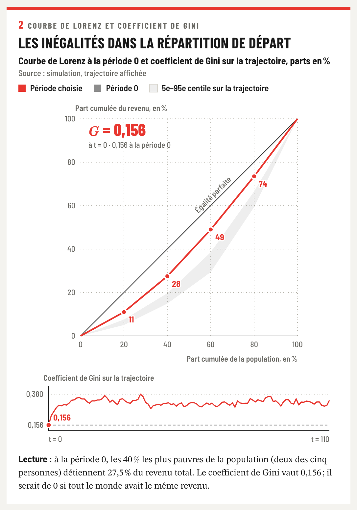</td>
<td>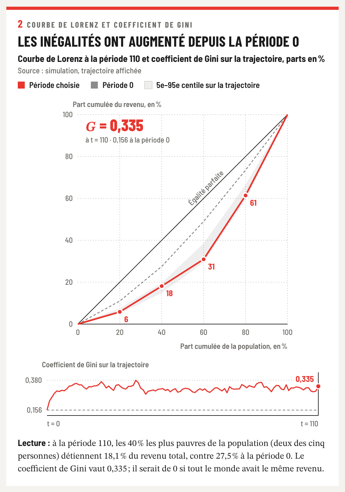</td>
</tr>
</table>

**Résultat A.** Le coefficient de Gini à la période 0 tombe de 0,318 à 0,156, et les 40 % les plus pauvres détiennent 27,5 % du revenu au lieu de 17,0 %. La trajectoire du Gini remonte ensuite rapidement : 0,224 après une période, 0,254 après deux, 0,295 après cinq, et 0,339 à la période 10, de retour sur la trajectoire par défaut. La répartition ne fixe que la période 0 (règle 3), et avec $`\phi_K = 0{,}5`$, la moitié de l'écart restant se résorbe à chaque période.

**Protocole B.** Conserver la répartition et fixer $`\beta = 20.00`$ sur chaque ligne **f** ($`(1-0{,}5)\times 40`$), de sorte que 40 devienne le revenu du capital de long terme de chacun.

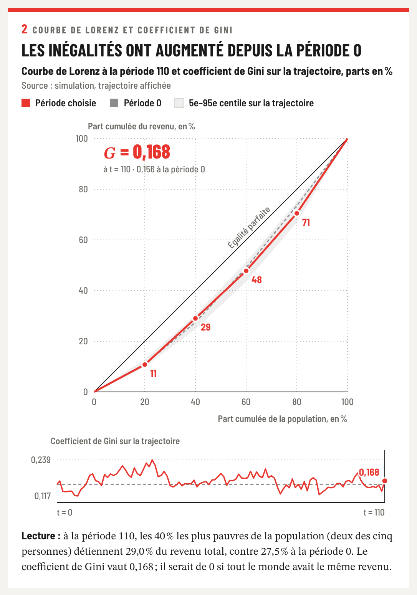

**Résultat B.** Le coefficient de Gini reste bas : 0,168 à la période 110, entre 0,117 et 0,239 sur la trajectoire. Les revenus étant plus proches, les rangs changent dans 50 périodes.

**Protocole C.** Réinitialiser et égaliser plutôt le revenu du **travail** : saisir 40 dans chaque case Travail, en réduisant d'abord Alfred (66), Bjørn (58) et George (46).

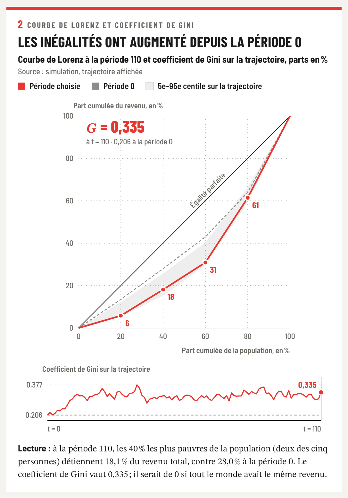

**Résultat C.** Le coefficient de Gini tombe de 0,318 à 0,206 à la période 0 et remonte bien plus lentement : 0,230 après cinq périodes, 0,297 après dix, 0,322 après vingt. La demi-vie d'un écart du revenu du travail est de 6,6 périodes, contre 1 période pour le capital.

**Interprétation.** L'effet d'une redistribution ponctuelle décroît au rythme de la persistance du revenu qu'elle vise. Un transfert de revenu vite résorbé s'efface en quelques périodes, une modification d'un revenu persistant dure des années, et seule une modification du processus sous-jacent (ici $`\beta`$ ; dans une économie, la capacité de gain, la détention du patrimoine ou les institutions) est permanente. Dans les protocoles A et B, la figure 1 indique *aucune forme simple* : la persistance de chaque individu est inchangée, mais George se trouve désormais au milieu du classement, et le profil est tracé dans l'ordre du classement. La forme d'un profil dépend de la place de chacun.

### 6.12 Un sommet volatil

**Protocole.** On suppose que le revenu du capital au sommet est plus volatil et moins persistant que les autres revenus du capital, comme lorsqu'il dépend du prix des actifs.

- A : sur la ligne **f** de George, fixer $`\sigma = 20.80`$ (le double de sa valeur par défaut).
- B : en outre, choisir **Par personne** et fixer pour le capital de George $`\phi = 0.30`$ et $`\beta = 72.80`$ ($`0{,}7\times 104`$).

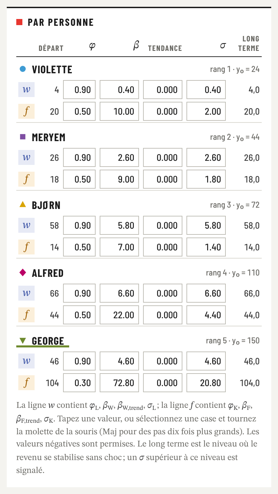

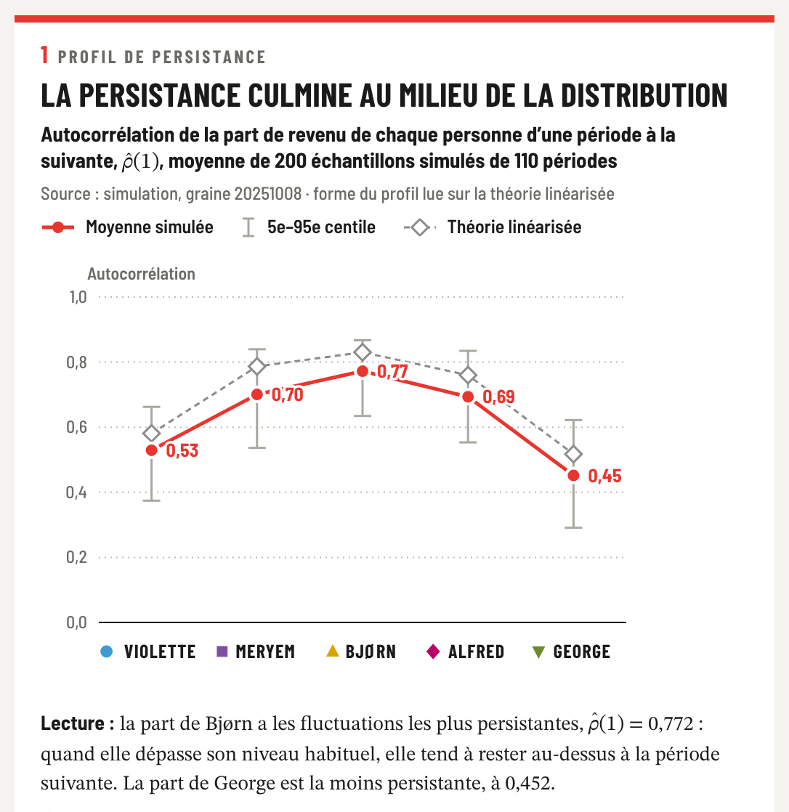

**Résultat.**

| | Violette | Meryem | Bjørn | Alfred | George |
| --- | --- | --- | --- | --- | --- |
| Par défaut | 0,588 | 0,773 | 0,831 | 0,787 | 0,688 |
| A : $`\sigma`$ du capital de George doublé | 0,563 | 0,725 | 0,789 | 0,726 | 0,568 |
| B : et son $`\phi`$ du capital à 0,30 | 0,529 | 0,701 | 0,772 | 0,693 | 0,452 |

La persistance de George tombe de 0,688 à 0,452, la variation la plus forte, et celle de toutes les autres parts baisse aussi.

**Interprétation.** Doubler la volatilité d'une source augmente son poids dans les fluctuations de la part (section 2.4, conséquence 2), et réduire sa persistance abaisse la valeur qu'elle apporte. Un revenu volatil et vite résorbé au sommet réduit donc la persistance de la part du haut et, par l'intermédiaire du total, celle de toutes les autres parts.

---

## 7. Du simulateur aux données de parts de revenu

Chaque expérience correspond à une étape de l'analyse empirique de la dynamique des parts de revenu, par exemple sur des séries longues de parts du revenu national avant impôt construites à partir de données fiscales et de comptabilité nationale (Piketty et Saez, 2003 ; Piketty, Saez et Zucman, 2018).

| Dans le simulateur | Dans les données de parts de revenu |
| --- | --- |
| Cinq individus | Une partition de la population en groupes de revenu |
| Rangs (6.6) | Des groupes de quantiles, dont les membres changent au fil du temps |
| Trajectoire sans choc (2.3) | Une composante déterministe : tendances et ruptures structurelles |
| Racine unitaire (6.8) | Des tests de racine unitaire, avec et sans ruptures |
| 110 périodes (6.10) | Environ un siècle d'observations annuelles |
| Composition à la période 0 (6.1, 6.4) | La décomposition du revenu de chaque groupe par source |
| Chocs × 3 (6.5) | La volatilité de chaque part, mesurée séparément |

Le simulateur conduit aux principes de méthode suivants.

- **Utiliser des groupes sans chevauchement.** Les groupes cumulés comme le Top 1 %, qui contient le Top 0,1 %, mélangent les dynamiques de leurs sous-groupes. Une partition de la distribution en tranches disjointes attribue chaque partie de la distribution à une seule série.
- **Retirer la composante déterministe avant de mesurer la persistance.** Des parts bornées entre zéro et un peuvent suivre une tendance pendant des décennies, et les institutions comme les chocs historiques déplacent leur niveau et leur pente à des dates identifiables. Des tendances et des ruptures non modélisées biaisent la persistance vers un et peuvent se faire passer pour des racines unitaires (Perron, 1989 ; Zivot et Andrews, 1992 ; Lamoureux et Lastrapes, 1990). La trajectoire sans choc du simulateur est l'exacte contrepartie de cette étape (6.7).
- **Tester la racine unitaire sur les séries stationnarisées.** Si une part contient une racine unitaire, son autocorrélation ne mesure pas une persistance autour d'une trajectoire (6.8).
- **Comparer la persistance entre groupes plutôt qu'en niveau.** Le niveau de persistance dépend de la spécification de la composante déterministe et est biaisé vers le bas sur des échantillons d'environ un siècle (6.10) ; l'ordre entre groupes est plus robuste.
- **Envisager une dynamique d'ordre supérieur.** Sur des données observées, des modèles autorégressifs d'ordre deux ou trois, choisis par un critère d'information, peuvent révéler des oscillations lorsque le revenu réalisé une année épuise celui de l'année suivante (6.9).
- **Séparer persistance et volatilité.** L'ampleur des fluctuations d'une part n'indique pas de manière fiable leur durée (6.5, 6.12).
- **Rattacher la persistance à la composition.** Les décompositions du revenu de chaque groupe en revenus du travail, des entreprises, du capital et de transfert (Gomez, 2025) indiquent quelle source porte les fluctuations d'un groupe ; comme le montre la formule de la section 2.4, ce qui compte est la source des fluctuations, et pas seulement celle du niveau.
- **Distinguer persistance intrinsèque et persistance héritée.** Une part peut sembler persistante uniquement parce qu'elle suit une variable elle-même persistante, comme la politique publique ou la conjoncture. Ajouter de telles covariables au modèle autorégressif, après le même retrait d'une composante déterministe, permet de vérifier si le profil est propre aux parts.
- **Tenir compte des changements de composition des groupes.** La persistance d'une part des hauts revenus combine la persistance des hauts revenus avec les entrées dans le haut de la distribution et les sorties (6.6).

## 8. Questions fréquentes

**Les chiffres diffèrent légèrement de ceux du guide.** Cliquer sur **Réinitialiser** rétablit la graine par défaut, 20251008. Après **Nouveau tirage**, tous les chiffres bougent légèrement, mais les formes demeurent.

**La ligne théorique n'est pas affichée.** Elle exige des individus fixes (Unités sur Individus), $`|\phi| < 1`$ pour chaque revenu, des tendances nulles et un revenu total de long terme positif. La note sous la figure 1 indique la condition qui n'est pas remplie.

**Une note signale des composantes négatives.** Un revenu est devenu négatif pendant ce nombre de périodes. Cela se produit quand les chocs sont forts par rapport au revenu (6.5), avec une racine unitaire (6.8), ou quand une modification de $`\phi`$ déplace les niveaux de long terme (6.2).

**Les revenus dérivent après une modification de $`\phi`$.** La constante n'a pas changé, si bien que le niveau de long terme $`\beta/(1-\phi)`$, lui, a changé (règle 2). Fixer $`\beta = (1-\phi)\times`$ départ ou choisir un profil type.

**Une saisie de répartition a été réduite.** Chaque source est plafonnée ; réduire d'abord une autre saisie ou relever le plafond.

**Les champs de persistance de l'onglet Paramètres sont inactifs.** Ils ne sont actifs que lorsque la persistance est réglée **Par personne**.

**La figure 1 indique « aucune forme simple ».** Le profil est tracé du plus pauvre au plus riche à la période 0. Une répartition qui place un individu intensif en capital au milieu (6.11) produit un profil ni monotone ni en U ; **Valeurs par personne** donne les chiffres.

**La page est lente à 2 000 périodes.** Chaque modification recalcule 20 échantillons de 2 000 périodes ; utiliser 110 périodes pour explorer.

**Les valeurs saisies utilisent un point décimal.** Les champs de saisie suivent la convention du navigateur ; les valeurs affichées dans les figures et les textes utilisent la virgule décimale en français.

## 9. Notations

| Symbole ou terme | Définition |
| --- | --- |
| $`w_{i,t}`$, $`f_{i,t}`$, $`y_{i,t}`$ | Revenu du travail, du capital et revenu total de l'individu $`i`$ à la période $`t`$ |
| $`S_{i,t}`$ | Part de revenu, $`y_{i,t}/\sum_j y_{j,t}`$ |
| $`\phi_L`$, $`\phi_K`$ | Persistance (coefficient autorégressif) du revenu du travail et du capital |
| $`\beta_{W,i}`$, $`\beta_{F,i}`$ | Constantes du revenu du travail et du capital |
| $`\beta_{W,trend,i}`$, $`\beta_{F,trend,i}`$ | Coefficients de la tendance temporelle |
| $`u_{i,t}`$, $`v_{i,t}`$ | Chocs normaux sur le revenu du travail et du capital |
| $`\sigma_{L,i}`$, $`\sigma_{K,i}`$ | Écarts types des chocs |
| $`\gamma`$ | Variance stationnaire d'une source, $`\sigma^2/(1-\phi^2)`$ |
| $`\hat\rho_i(1)`$ | Autocorrélation empirique d'ordre un de l'écart d'une part à sa trajectoire sans choc |
| $`\rho_i(1)`$ | Sa valeur théorique linéarisée, formule de la section 2.4 |
| $`L_t(p)`$, $`G_t`$ | Courbe de Lorenz et coefficient de Gini à la période $`t`$ |
| Niveau de long terme | $`\beta/(1-\phi)`$ |
| Demi-vie | $`\ln 0{,}5/\ln\phi`$, nombre de périodes nécessaires pour que la moitié d'un écart s'efface |
| Racine unitaire | $`|\phi| = 1`$ : les écarts ne s'effacent jamais |
| Trajectoire sans choc | Trajectoire d'un revenu ou d'une part lorsque tous les chocs sont nuls |
| Rang | Une position dans la distribution, quel que soit son occupant |
| Part du travail | Revenu du travail divisé par le revenu total |

## 10. Limites du modèle

- L'économie compte cinq individus : la courbe de Lorenz a cinq segments et le coefficient de Gini ne peut dépasser 0,8.
- Les chocs sont indépendants entre individus et entre sources : il n'y a ni choc agrégé ni corrélation entre les chocs sur le travail et sur le capital d'un même individu.
- Chaque source suit un processus AR(1) ; les dynamiques d'ordre supérieur et les ruptures structurelles ne sont pas modélisées.
- Les chocs sont normaux, si bien que des revenus peuvent devenir négatifs.
- Il n'y a pas de comportements : les individus n'épargnent pas, n'investissent pas et ne réagissent ni aux prix ni à la fiscalité, et la composition est fixée de manière exogène.
- Deux sources en représentent plusieurs. Les transferts en bas de la distribution et les profits des sociétés au sommet sont tous deux représentés par la source la moins persistante, et le revenu des entreprises individuelles, qui peut se comporter davantage comme un revenu du travail, n'a pas de processus propre.

Ces restrictions sont délibérées : le simulateur isole le lien entre la composition du revenu et la persistance des parts de revenu dans des conditions contrôlées, et n'estime rien à partir de données.

## 11. Références

- Alvaredo, F., Chancel, L., Piketty, T., Saez, E., et Zucman, G. (2018). *World Inequality Report 2018*. Belknap Press of Harvard University Press.
- Engle, R. F. (2001). GARCH 101: The use of ARCH/GARCH models in applied econometrics. *Journal of Economic Perspectives*, 15(4), 157–168.
- Gomez, M. (2025). Macro perspectives on income inequality. *Journal of Economic Perspectives*, 39(2), 127–148.
- Gottschalk, P., et Moffitt, R. (2009). The rising instability of U.S. earnings. *Journal of Economic Perspectives*, 23(4), 3–24.
- Granger, C. W. J., et Morris, M. J. (1976). Time series modelling and interpretation. *Journal of the Royal Statistical Society, Series A*, 139(2), 246–257.
- Lamoureux, C. G., et Lastrapes, W. D. (1990). Persistence in variance, structural change, and the GARCH model. *Journal of Business & Economic Statistics*, 8(2), 225–234.
- Perron, P. (1989). The great crash, the oil price shock, and the unit root hypothesis. *Econometrica*, 57(6), 1361–1401.
- Piketty, T., et Saez, E. (2003). Income inequality in the United States, 1913–1998. *Quarterly Journal of Economics*, 118(1), 1–39.
- Piketty, T., Saez, E., et Zucman, G. (2018). Distributional national accounts: Methods and estimates for the United States. *Quarterly Journal of Economics*, 133(2), 553–609.
- Zivot, E., et Andrews, D. W. K. (1992). Further evidence on the great crash, the oil-price shock, and the unit-root hypothesis. *Journal of Business & Economic Statistics*, 10(3), 251–270.

## 12. Crédits

Le simulateur a été développé par **Ramses Abul Naga**, **Abdelhamid El Hamrani** et **Hajar Hazmiri** à la Faculté de Gouvernance, Sciences Économiques et Sociales (FGSES) de l'Université Mohammed VI Polytechnique (UM6P). Le [README](../README.md#francais) indique comment le citer, et la [référence technique](TECHNICAL.md), en anglais, détaille sa mise en œuvre.
