# Inequality Persistence Simulator: User Guide

**How to use the simulator to understand the dynamics of inequality, with guided experiments and worked examples.**

This guide walks you through every part of the simulator, explains what each figure shows, and then runs twelve experiments that each isolate one mechanism behind the dynamics of inequality. Every number and screenshot in this guide comes from the simulator itself, at its default seed (20251008) unless stated otherwise, so you can reproduce each result exactly.

You need nothing but a browser. Open [`index.html`](../index.html) from this repository, or use the online version at [https://abdelhamidelhamrani777.github.io/Inequality-Persistence-Simulator/](https://abdelhamidelhamrani777.github.io/Inequality-Persistence-Simulator/). A first reading takes about an hour; each experiment takes five to ten minutes.

## Contents

1. [Why this simulator](#1-why-this-simulator)
2. [Key ideas in ten minutes](#2-key-ideas-in-ten-minutes)
3. [Getting started](#3-getting-started)
4. [The controls in detail](#4-the-controls-in-detail)
5. [Reading the results](#5-reading-the-results)
6. [Guided experiments](#6-guided-experiments)
7. [From the simulator to real data](#7-from-the-simulator-to-real-data)
8. [Exercises](#8-exercises)
9. [Troubleshooting and frequently asked questions](#9-troubleshooting-and-frequently-asked-questions)
10. [Glossary](#10-glossary)
11. [Limits of the model](#11-limits-of-the-model)
12. [Credits](#12-credits)

---

## 1. Why this simulator

Inequality has two dimensions.

- **Its level**: how unequally income is shared at a given moment. The Lorenz curve and the Gini coefficient measure it.
- **Its dynamics**: how the distribution moves over time. When one group's share of income rises above its usual level, does it fall back the next year, or does the gap last? How large are the swings? Do people change places?

Most public discussion is about the first dimension. This simulator is about the second, and about one mechanism in particular: **the persistence of an income share depends on the mix of income sources behind it**. Labor income (wages and salaries) and capital income (dividends, interest, rents, capital gains) do not behave alike. Wages tend to move slowly, anchored by contracts, institutions and careers. Capital income tends to move fast, driven by asset prices and the timing of payouts. A group that lives mostly on wages will therefore see its share of income move slowly; a group that lives mostly on capital will see its share jump around and revert quickly.

The simulator comes from a collective research effort at the Faculty of Governance, Economics and Social Sciences (FGSES) of Mohammed VI Polytechnic University: two master's theses on U.S. pre-tax income shares, Hajar Hazmiri's on their persistence and Abdelhamid El Hamrani's on their volatility, brought together in a joint working paper, *Modeling the Persistence of Income Shares and the Lorenz Curve* (Abul Naga, El Hamrani and Hazmiri, 2026). Across fifteen income bands over 1914–2023, the working paper finds that persistence has an inverted-U profile: the first-order autoregressive coefficient is about 0.8 in the middle of the distribution, where labor provides 82–86% of income, against 0.30 for the bottom 5% and 0.24 for the top 0.001%. The simulator lets you build that result from first principles, then break it, reverse it and test it.

It is a laboratory with five hypothetical people: **Violette, Meryem, Bjørn, Alfred and George**. It illustrates mechanisms; it does not estimate anything from data.

## 2. Key ideas in ten minutes

### 2.1 Income shares

A person's **income share** is their income divided by the total income of the economy. If George earns 150 units and the five people together earn 400, George's share is 37.5%. Shares remove the overall size of the economy and keep only how it is divided. Inequality statistics such as "the top 10% income share" are shares.

### 2.2 The Lorenz curve and the Gini coefficient

Line people up from the poorest to the richest. The **Lorenz curve** plots the cumulative share of the population (horizontal axis) against the cumulative share of income they hold (vertical axis). If everyone earned the same, the curve would be the diagonal, the line of perfect equality. The further the curve sags below the diagonal, the more unequal the distribution.

The **Gini coefficient**, written $`G`$, is twice the area between the diagonal and the Lorenz curve. It is 0 when everyone has the same income. With five people, it cannot exceed 0.8, which is reached when one person holds everything.

### 2.3 Persistence

In the simulator, each source of income follows an **autoregressive process of order one**, or AR(1): this period's value is a constant, plus a fraction $`\phi`$ of last period's value, plus a random shock.

```math
w_t = \beta + \phi\, w_{t-1} + u_t
```

The coefficient $`\phi`$ (phi) is the **persistence** of the source, between −1 and 1.

- Near 1, a shock fades slowly: income that rises above its usual level stays high for a long time.
- Near 0, a shock disappears at once: each period is almost independent of the last.
- Below 0, income overshoots: a high period tends to be followed by a low one.
- At exactly 1 or −1, a shock never fades. This is a **unit root**.

A convenient way to read $`\phi`$ is the **half-life** of a shock, the number of periods it takes for half of the shock to disappear, $`\ln 0.5 / \ln \phi`$:

| $`\phi`$ | 0.50 | 0.70 | 0.80 | 0.90 | 0.95 | 0.99 |
| --- | --- | --- | --- | --- | --- | --- |
| Half-life (periods) | 1.0 | 1.9 | 3.1 | 6.6 | 13.5 | 69.0 |

The persistence of an **income share** is measured by its first-order autocorrelation, $`\hat\rho(1)`$: the correlation between the share's deviation from its usual path in one period and its deviation in the next. This is the number Figure 1 plots.

### 2.4 Why composition drives the persistence of a share

A person's income is the sum of two sources with different persistence, so the persistence of their share is a blend of the two. The blend is weighted by how much each source contributes to the **fluctuations** of the share, not by how much it contributes to the level of income. A source that is small but very volatile can dominate the movements of a share.

At the default settings, labor has persistence 0.90 and capital 0.50. The table below shows, for each person, the share of their own income variance that comes from labor, and the persistence of their share measured by the simulator:

| Person | Capital share of income at period 0 | Labor's share of income variance | Simulated persistence of the share |
| --- | --- | --- | --- |
| Bjørn | 19% | 98.5% | 0.831 |
| Alfred | 40% | 89.9% | 0.787 |
| Meryem | 41% | 89.2% | 0.773 |
| George | 69% | 43.6% | 0.688 |
| Violette | 83% | 13.6% | 0.588 |

The ranking is exact: the more a person's fluctuations come from persistent labor income, the more persistent their share. Bjørn lives almost entirely on wages and has the most persistent share; Violette lives mostly on capital income and has the least persistent one. A share also moves when *other* people's incomes move, because the total changes, which is why no share reaches exactly 0.90.

### 2.5 Persistence, volatility and mobility are different things

| Concept | Question it answers | Where to see it |
| --- | --- | --- |
| Persistence | How long does a deviation last? | Figure 1 |
| Volatility | How large are the swings? | Figures 3 and 4, the Gini path in Figure 2 |
| Mobility | Do people change places in the ranking? | Rank changes in the In figures strip and Figure 4 |

Experiment 6.5 shows that you can triple volatility, leave persistence almost unchanged, and multiply mobility by eight.

## 3. Getting started

### 3.1 The screen

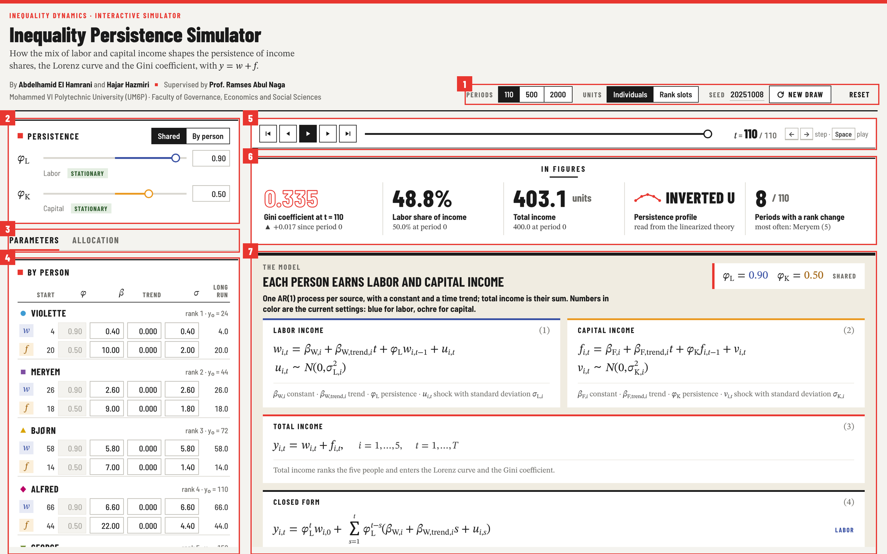

| # | Area | What it holds |
| --- | --- | --- |
| 1 | Run settings | Number of periods, units (individuals or rank slots), random seed with **New draw**, and **Reset** |
| 2 | Persistence | $`\phi_L`$ for labor and $`\phi_K`$ for capital, shared by everyone or set by person |
| 3 | Tabs | Switch the lower left panel between **Parameters** and **Allocation** |
| 4 | Parameters by person | Constant, trend, shock size and persistence of each person's labor and capital income |
| 5 | Period bar | Moves through time; it controls the In figures strip, Figure 2 and Figure 5 |
| 6 | In figures | The key numbers at the selected period |
| 7 | The model | The equations, with the current numbers for each person |

Below the model come Figures 1 to 5 and a Notes panel. Everything recomputes as soon as you change a value.

### 3.2 The default economy

At start-up the five people hold 400 units of income at period 0: 200 units of labor income and 200 of capital income, split as follows.

| Person | Labor | Capital | Total | Capital share |
| --- | --- | --- | --- | --- |
| Violette | 4 | 20 | 24 | 0.83 |
| Meryem | 26 | 18 | 44 | 0.41 |
| Bjørn | 58 | 14 | 72 | 0.19 |
| Alfred | 66 | 44 | 110 | 0.40 |
| George | 46 | 104 | 150 | 0.69 |

Labor persistence is 0.90 and capital persistence 0.50. Each income fluctuates around its own starting value, with a shock whose standard deviation is a tenth of that value. The allocation is capital-heavy at the bottom and at the top, and labor-heavy in the middle; section 6.1 shows what that produces.

### 3.3 Three rules to know before experimenting

These three rules explain almost every surprise you may meet.

1. **Changing $`\phi`$ does not change $`\beta`$.** The constant $`\beta`$ was set so that each income settles at its starting value, given the current $`\phi`$. If you change $`\phi`$, the long-run level $`\beta/(1-\phi)`$ moves, and incomes drift toward a new level. Watch the **Long run** column of the Parameters tab.
2. **The allocation only sets period 0.** Editing the Allocation table changes where incomes start, not where they settle. If you do not change $`\beta`$ too, incomes return to their old long-run levels at a speed set by $`\phi`$ (experiment 6.11 uses this).
3. **Presets re-anchor everything.** A profile preset sets a new allocation and resets every person's parameters so that each income fluctuates around its new start: $`\beta = (1-\phi)\times`$ start, trend 0, $`\sigma = `$ start/10.

Two more facts help:

- Every change reuses **the same random shocks**, so a difference between two settings comes from the parameters alone. **New draw** changes the shocks.
- **Reset** returns every setting, including the seed, to its starting value. Every experiment below starts from Reset.

## 4. The controls in detail

### 4.1 Run settings

- **Periods**: 110, 500 or 2000. Figure 1 averages over 200, 60 or 20 simulated samples respectively. 110 periods matches the length of a century of annual data.
- **Units**: *Individuals* follows the same five people over time. *Rank slots* re-sorts people by income every period and follows positions instead: the poorest, the second poorest, and so on (see experiment 6.6).
- **Seed** and **New draw**: the seed fixes the random shocks; New draw picks a new one.
- **Reset**: back to the defaults.

### 4.2 Persistence

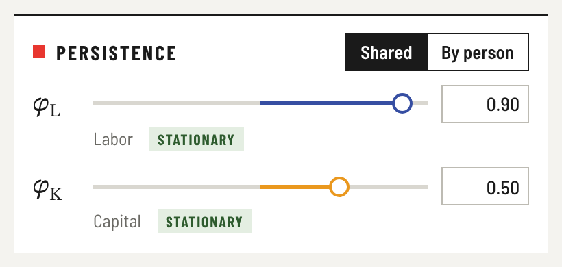

- **Shared**: one $`\phi_L`$ and one $`\phi_K`$ for everyone, set with the sliders or typed in the fields.
- **By person**: each person gets their own $`\phi_L`$ and $`\phi_K`$, typed in the Parameters tab. The sliders are paused. When you switch to By person, everyone starts from the shared values.
- The tag under each slider says **Stationary** when $`|\phi| < 1`$ and **Unit root** at 1 or −1.

### 4.3 Parameters by person

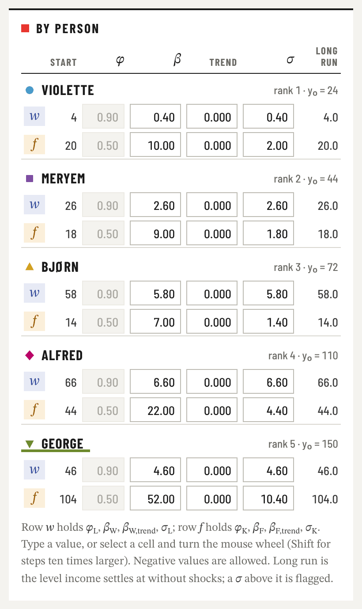

Each person has two rows: **w** for labor and **f** for capital.

| Column | Meaning |
| --- | --- |
| Start | Starting value, from the allocation (read only) |
| $`\phi`$ | Persistence; editable only when persistence is set By person |
| $`\beta`$ | Constant added each period |
| Trend | Coefficient on time $`t`$; the income drifts by trend / $`(1-\phi)`$ per period |
| $`\sigma`$ | Standard deviation of the shock; flagged in ochre when larger than the long-run level |
| Long run | The level the income settles at without shocks, $`\beta/(1-\phi)`$ (at $`t=0`$ when there is a trend) |

To enter a value, type it and press Enter, or select a field and turn the mouse wheel; hold Shift for steps ten times larger. A field reacts to the wheel only once it is selected, so scrolling the panel never changes a value by accident. Negative values are allowed. Clicking a name opens that person's series in Figure 3.

### 4.4 Allocation and presets

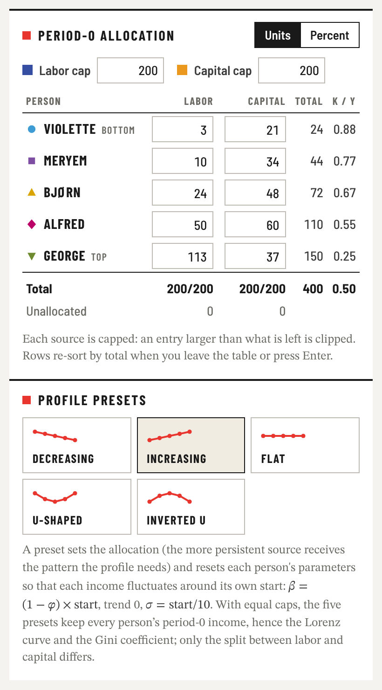

- **Labor cap** and **Capital cap** set the total units of each source (200 by default). Changing a cap rescales the allocation.
- **Units** or **Percent**: enter holdings as units, or as a percentage of each cap. In Percent mode, the Total % column sets a person's share of all income, and the others are rescaled to keep each source at its cap.
- Each source is capped: an entry larger than what is left is clipped. To move units from one person to another, **lower the donor first**, then raise the recipient.
- Rows re-sort by total income when you leave the table or press Enter, so the bottom row is always the richest at period 0.
- **Profile presets** set an allocation that produces each of the five profile shapes, and re-anchor all parameters (rule 3). The more persistent source receives the pattern the shape needs, so presets work whichever source you make more persistent.

### 4.5 Moving through time

The period bar sets the period $`t`$ shown in the In figures strip, Figure 2 and Figure 5, and marks it on Figures 3 and 4. Use the buttons, drag the slider, or click any time chart. On the figure board, the left and right arrow keys step one period (Shift for ten), Home and End jump to the ends, and Space plays or pauses.

## 5. Reading the results

Each figure follows the same grammar: a title that states the result at the current settings and updates as you change them, a subtitle that ends with the unit, a source line, the chart with its key values written on it, and a **Reading** line that puts the result into words. Hover over any chart to see exact values.

### 5.1 In figures


Five numbers at the selected period: the Gini coefficient (in red outline) with its change since period 0; the labor share of total income; total income; the shape of the persistence profile; and the number of periods in which at least one person changed rank, with the person who moved most often.

### 5.2 The model

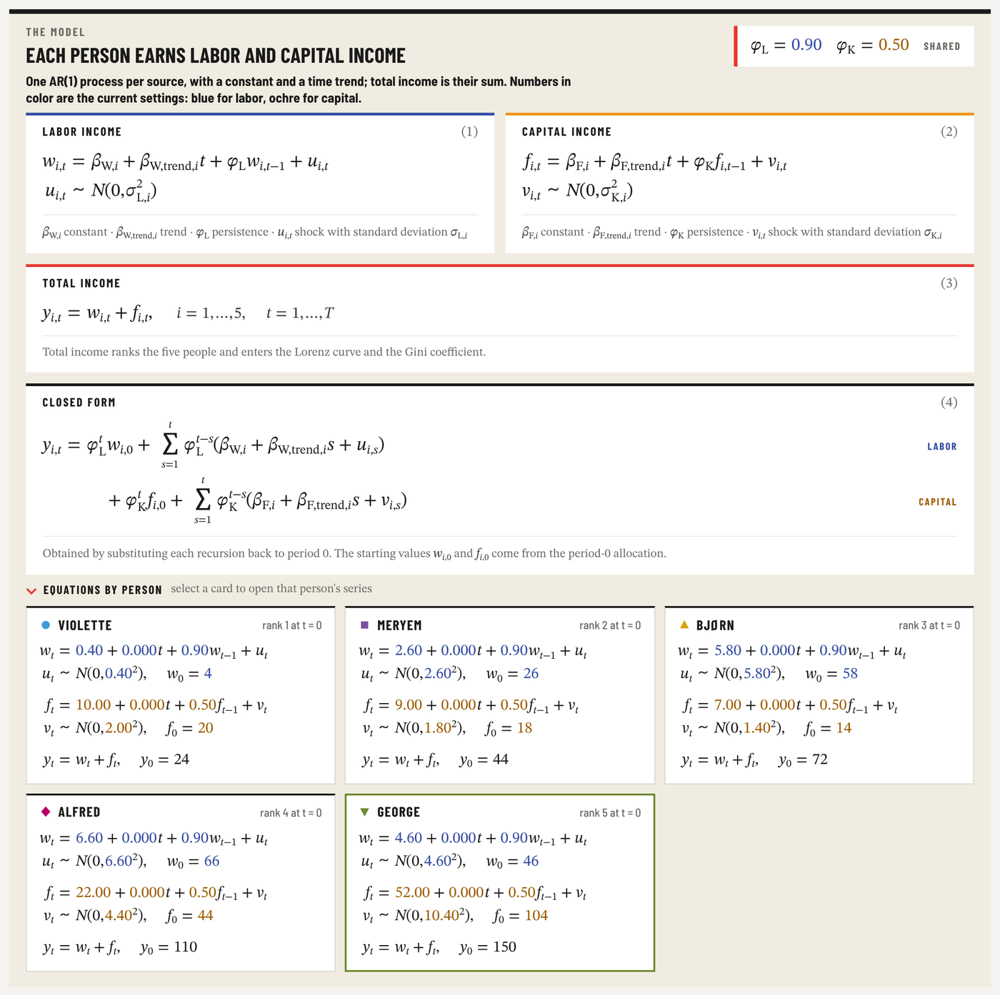

Four blocks give the equations of the model:

```math
\begin{aligned}
w_{i,t} &= \beta_{W,i} + \beta_{W,trend,i}\, t + \phi_L\, w_{i,t-1} + u_{i,t}, & u_{i,t} &\sim N\!\left(0,\sigma_{L,i}^2\right) \\
f_{i,t} &= \beta_{F,i} + \beta_{F,trend,i}\, t + \phi_K\, f_{i,t-1} + v_{i,t}, & v_{i,t} &\sim N\!\left(0,\sigma_{K,i}^2\right) \\
y_{i,t} &= w_{i,t} + f_{i,t}
\end{aligned}
```

and the **closed form**, obtained by substituting each recursion back to period 0:

```math
y_{i,t} = \phi_L^{t}\, w_{i,0} + \sum_{s=1}^{t} \phi_L^{t-s}\left(\beta_{W,i} + \beta_{W,trend,i}\, s + u_{i,s}\right) + \phi_K^{t}\, f_{i,0} + \sum_{s=1}^{t} \phi_K^{t-s}\left(\beta_{F,i} + \beta_{F,trend,i}\, s + v_{i,s}\right)
```

The closed form says that income today is the sum of two fading memories: the starting value, discounted by $`\phi^t`$, and every past shock, discounted by $`\phi^{t-s}`$. The higher $`\phi`$, the longer the memory. Below the equations, one card per person shows the same equations with that person's numbers; selecting a card opens their series in Figure 3.

### 5.3 Figure 1: the persistence profile

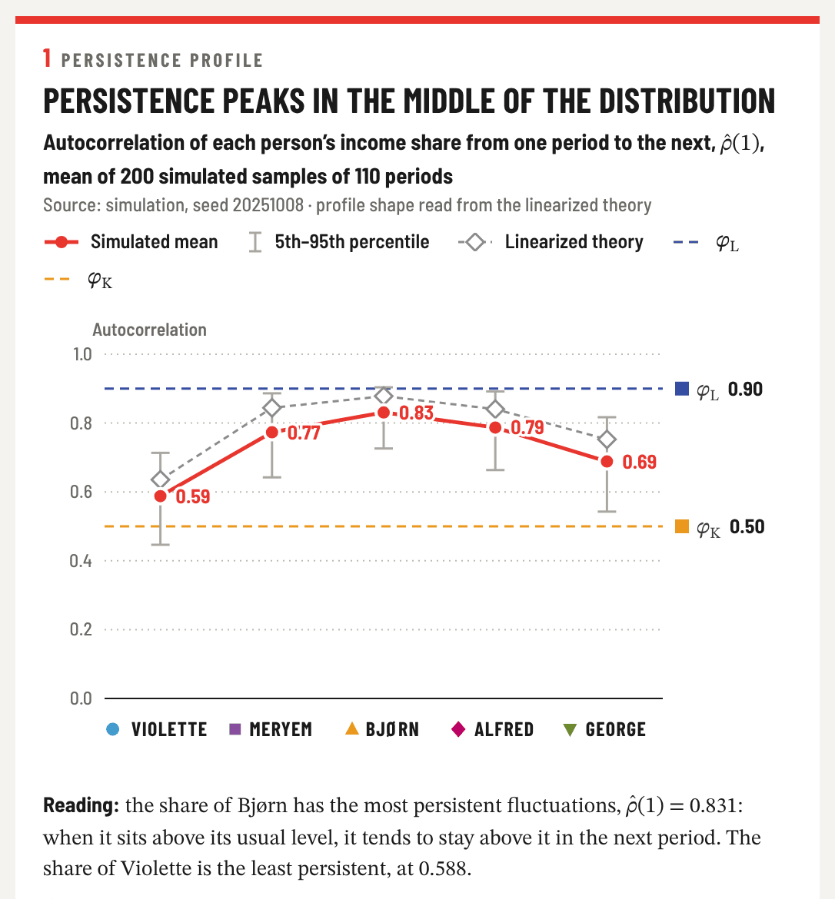

The central figure. For each person, from the poorest at period 0 (left) to the richest (right):

- **Red line and dots**: the simulated persistence $`\hat\rho(1)`$ of the person's share, averaged over the simulated samples, with its value written beside each dot.
- **Grey whiskers**: the 5th to 95th percentiles across samples, a measure of how precisely 110 periods pin down persistence.
- **Grey dashed line with hollow diamonds**: the linearized theory, a formula that predicts persistence from the parameters. It is shown for fixed individuals when every $`|\phi|`$ is below 1 and every trend is zero.
- **Blue and ochre dashed lines**: $`\phi_L`$ and $`\phi_K`$, when persistence is shared. Every share's persistence lies between them.

The title names the shape: *peaks in the middle* (inverted U), *lowest in the middle* (U-shaped), *rises* or *falls from the bottom to the top*, *about the same for everyone* (flat, a range below 0.03), or *no simple pattern* (mixed). Under the chart, **Values by person** opens a table with each person's share and capital ratio at period 0, the simulated mean, the percentile band and the theory value.

### 5.4 Figure 2: Lorenz curve and Gini coefficient

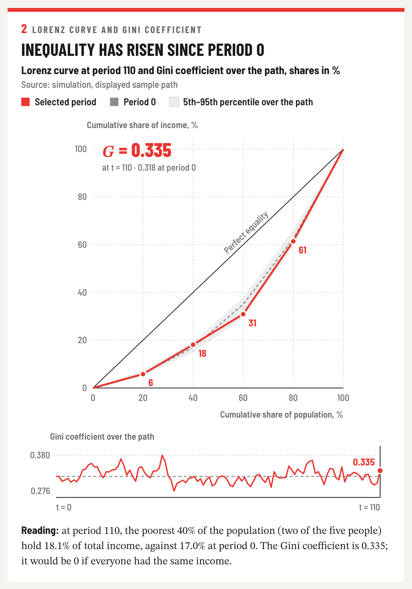

- The **red curve** is the Lorenz curve at the selected period, with people re-ranked by income in that period; the numbers at each point are cumulative shares in %.
- The **grey dashed curve** is period 0; the **grey band** is the 5th to 95th percentile of each point over the whole path.
- $`G`$ is the Gini coefficient at the selected period, with its period-0 value beneath.
- The small chart traces $`G`$ over all periods, with a dashed line at its period-0 value. It is the quickest way to see whether inequality drifts, cycles or stays put.

At the defaults, the Gini coefficient is 0.318 at period 0 and 0.335 at period 110, and moves between 0.276 and 0.380 along the path. The poorest 40% (Violette and Meryem) hold 17.0% of income at period 0 and 18.1% at period 110.

### 5.5 Figure 3: individual series

**One person** shows the chosen person's equations, in four blocks, then their incomes over time.

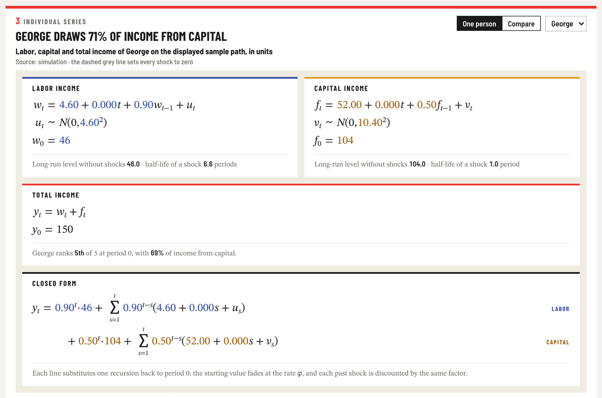

The Labor and Capital blocks give the equation, the shock law and the starting value, then the long-run level and the half-life of a shock. The Total block gives the person's rank and capital share at period 0, and the Closed form block writes the person's closed form with their own numbers.

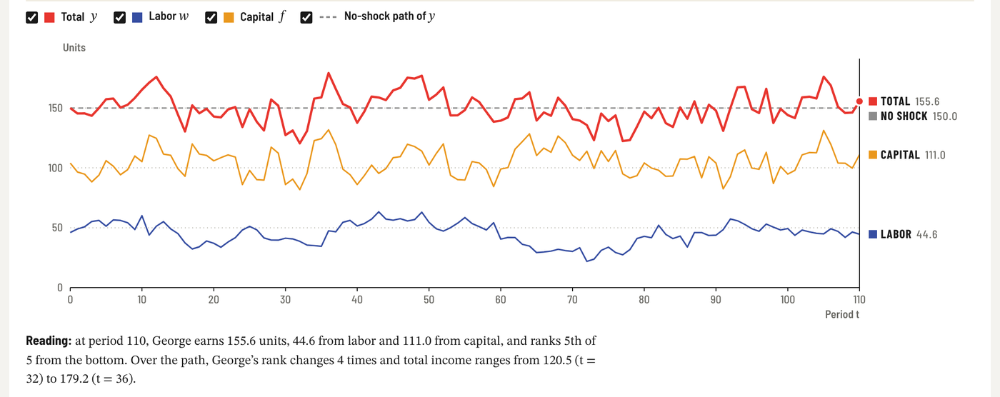

Total income is red, labor blue, capital ochre, and the grey dashed line is total income with every shock set to zero. Each line is named at its right end with its last value. George's labor income wanders in long swings; his capital income jitters around 104. This is persistence made visible.

**Compare** draws several people on one chart. Choose who appears with the name chips, which series to compare (total, labor, capital or share), and whether to add the no-shock paths. A table gives each person's persistence parameters, value at $`t`$, mean, standard deviation, range, rank and rank changes.

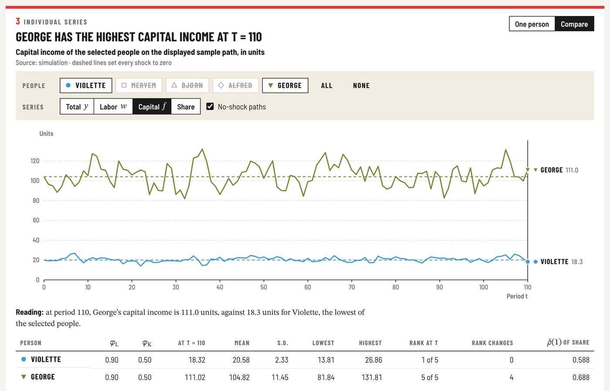

### 5.6 Figure 4: income shares over time

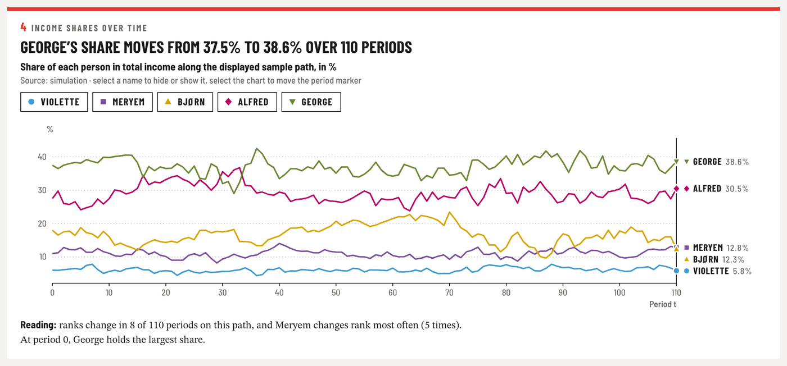

Every person's share of total income along the displayed path, named at the right end with the final share. The title follows the person who starts at the top. The name chips hide or show people and are shared with the Compare view of Figure 3. Where two lines cross, two people swap ranks; at the defaults, Meryem and Bjørn cross five times.

### 5.7 Figure 5: income by person

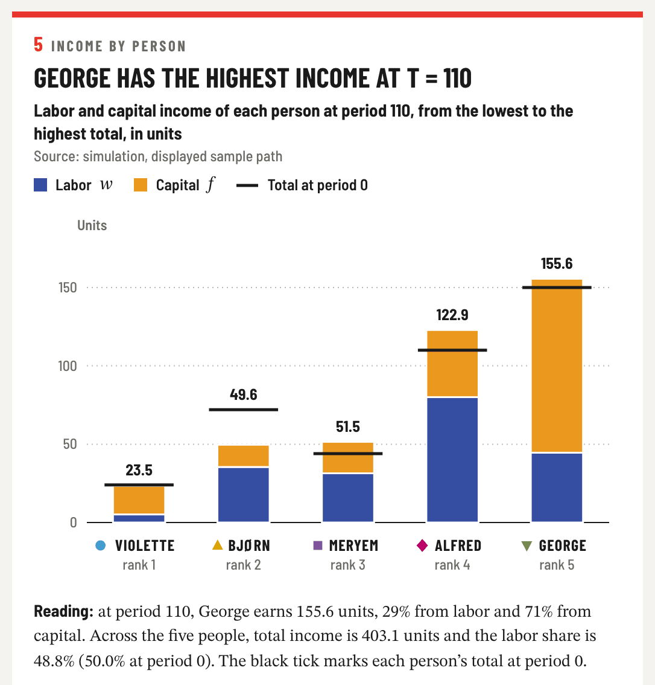

Stacked bars of labor (blue) and capital (ochre) income at the selected period, from the lowest to the highest total, so people swap places when their incomes cross. The black tick marks each person's total at period 0. The value above each bar is total income. Move the period bar to watch people overtake each other.

---

## 6. Guided experiments

Each experiment starts from **Reset**, changes one thing, and reports what the simulator shows. The numbers are those of the default seed; with another seed, they move slightly, but the conclusions hold.

| # | Experiment | The lesson in one line |
| --- | --- | --- |
| 6.1 | The default economy | Persistence follows the income mix |
| 6.2 | Swap which source is persistent | The profile flips |
| 6.3 | Same persistence for both sources | Composition no longer matters |
| 6.4 | Five compositions, five profiles | Who holds what decides the shape |
| 6.5 | Bigger shocks | Volatility and mobility rise; persistence does not |
| 6.6 | People or positions | Rank-based data blur the profile when people move |
| 6.7 | Diverging trends | Trends change the level of inequality, not its persistence |
| 6.8 | Shocks that never fade | With a unit root, inequality has no anchor |
| 6.9 | Overshooting capital | Negative persistence makes a share jump back and forth |
| 6.10 | How much data you need | Short samples understate persistence |
| 6.11 | Redistribution: one-off or permanent | A transfer lasts as long as the income it touches |
| 6.12 | A volatile top | Volatile capital at the top lowers top persistence and spills over |

### 6.1 The default economy: persistence peaks in the middle

**Question.** With labor more persistent than capital, whose income share is the most persistent?

**Steps.** Click **Reset** and read Figure 1.


**What you see.** An inverted U. From the bottom to the top, the simulated persistence of each share is:

| | Violette | Meryem | Bjørn | Alfred | George |
| --- | --- | --- | --- | --- | --- |
| Simulated $`\hat\rho(1)`$ | 0.588 | 0.773 | 0.831 | 0.787 | 0.688 |
| Linearized theory | 0.635 | 0.844 | 0.878 | 0.840 | 0.753 |

**Why.** Figure 5 at period 0 shows the composition behind it: Bjørn, in the middle, holds 58 units of labor and 14 of capital; George, at the top, holds 104 units of capital; Violette, at the bottom, holds 20 units of capital and only 4 of labor.

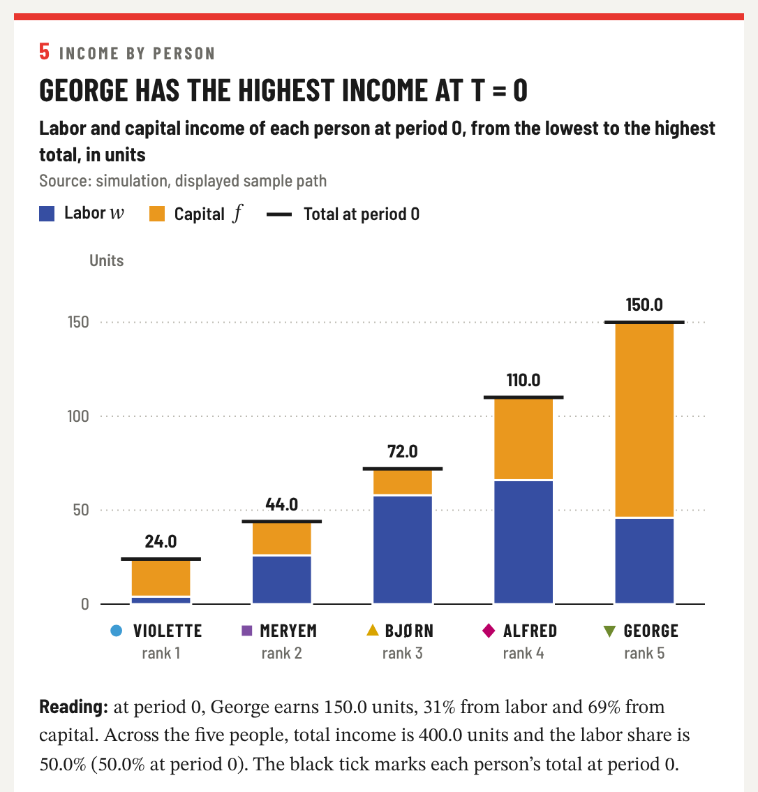

As section 2.4 showed, the ranking of persistence follows exactly the share of each person's fluctuations that comes from labor. The middle is anchored by wages; the bottom and the top are exposed to fast-reverting capital income.

**What it tells us about inequality.** The shape of the profile reflects the income composition behind it. A top share that moves quickly, rising in one year and falling the next, is not evidence that top incomes are random. It may simply reflect that top incomes are made of capital. This is the mechanism the theses and the working paper put forward for U.S. data.

### 6.2 Swap which source is persistent

**Question.** What if capital, not labor, were the slow-moving source?

**Steps.** Reset. In the Persistence card, type **0.50** for $`\phi_L`$ and **0.90** for $`\phi_K`$.

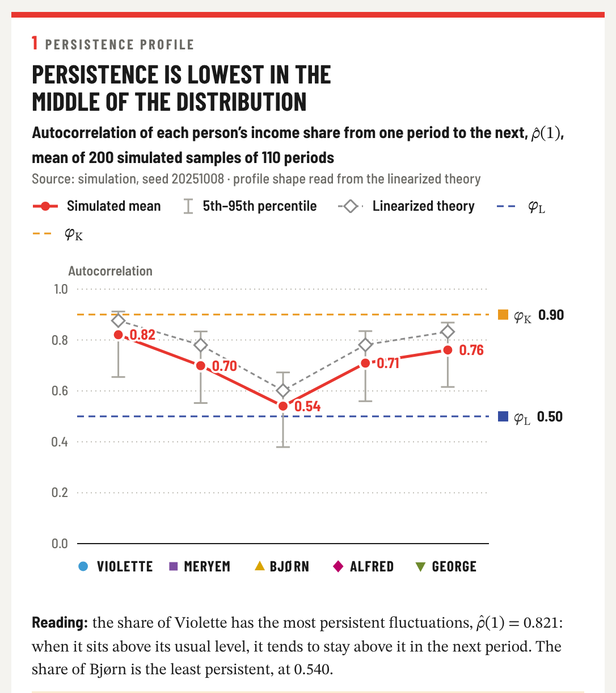

**What you see.** The title now reads *Persistence is lowest in the middle of the distribution*. The profile is U-shaped, from 0.540 for Bjørn to 0.821 for Violette, with George at 0.761. The capital-heavy bottom and top are now the most persistent.

You will also notice a warning: *Negative components appear in 22 of 111 periods*. This is rule 1 at work. The constants $`\beta`$ were set for the old persistence, so the long-run levels have moved: labor incomes now settle at a fifth of their start ($`0.1/(1-0.5) = 0.2`$) and capital incomes at five times their start ($`0.5/(1-0.9) = 5`$). Total income climbs from 400 to 1,070 and the labor share falls from 50% to 3%. Look at the Long run column to see it.

**The clean version.** To keep every income around its starting level, also type $`\beta = (1-\phi)\times`$ start in each row of the Parameters tab:

| β to type | Violette | Meryem | Bjørn | Alfred | George |
| --- | --- | --- | --- | --- | --- |
| w row (0.5 × start) | 2.00 | 13.00 | 29.00 | 33.00 | 23.00 |
| f row (0.1 × start) | 2.00 | 1.80 | 1.40 | 4.40 | 10.40 |

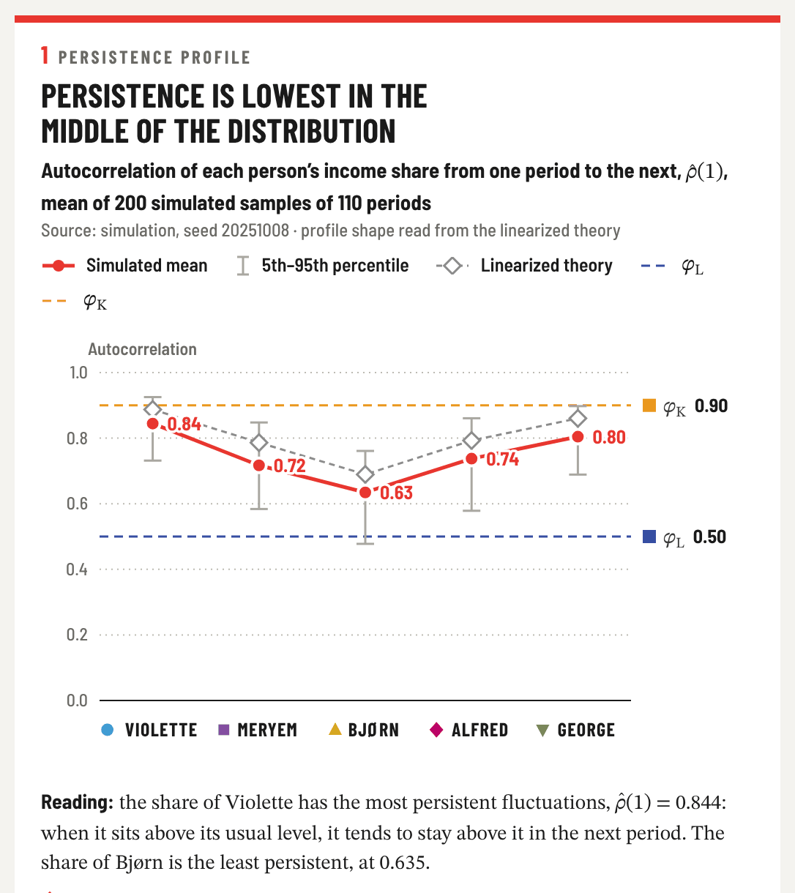

The profile is still U-shaped, now from 0.635 for Bjørn to 0.844 for Violette, the mirror image of the default. No incomes turn negative, and ranks change in only 6 periods.

**What it tells us.** Composition alone does not fix the profile; it is the interaction between who holds what and how persistent each source is. The same allocation produces opposite profiles under opposite persistence.

### 6.3 Same persistence for both sources

**Question.** Does composition still matter if labor and capital are equally persistent?

**Steps.** Reset. Type **0.70** for both $`\phi_L`$ and $`\phi_K`$.

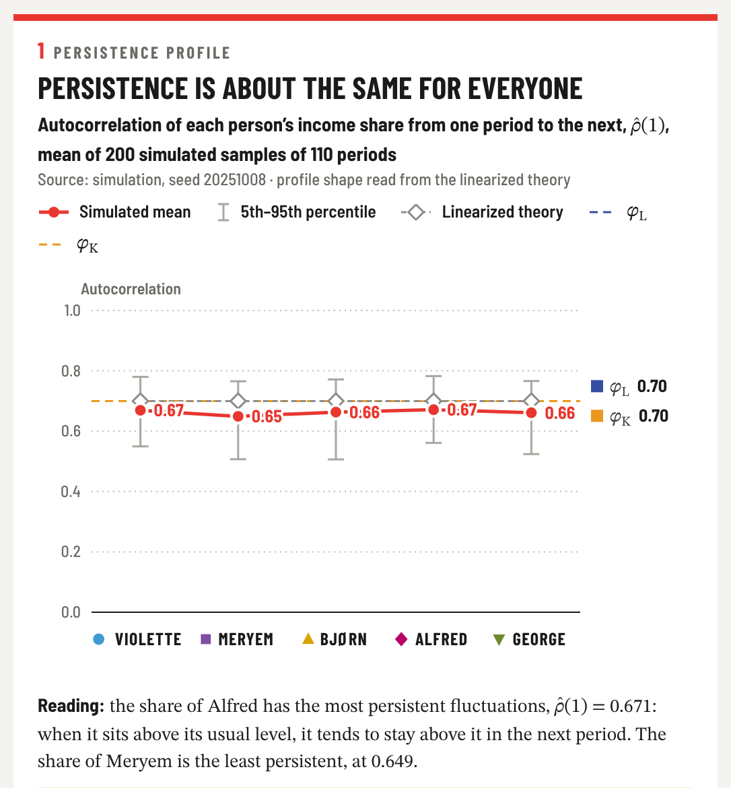

**What you see.** The title reads *Persistence is about the same for everyone*. Every share sits between 0.649 and 0.671, and the theory line is flat at exactly 0.700 for everyone. (The levels drift as in 6.2; re-anchoring $`\beta`$ to 0.3 × start gives the same flat profile, from 0.650 to 0.672.)

**What it tells us.** This is the control case. When both sources have the same persistence, every blend of them has that persistence too, and income composition becomes irrelevant for dynamics. Differences in persistence along the distribution are therefore evidence that the income sources differ in persistence.

### 6.4 Five compositions, five profiles

**Question.** How much can composition alone change the profile, holding persistence fixed at 0.90 for labor and 0.50 for capital?

**Steps.** Reset. Open the **Allocation** tab and click each preset in turn.

<table>
<tr>
<td>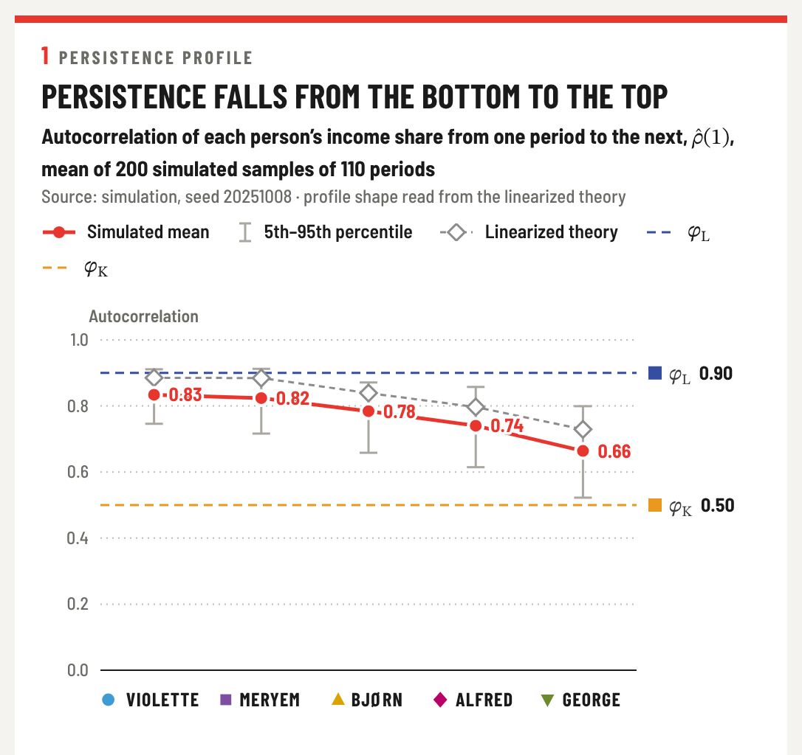</td>
<td>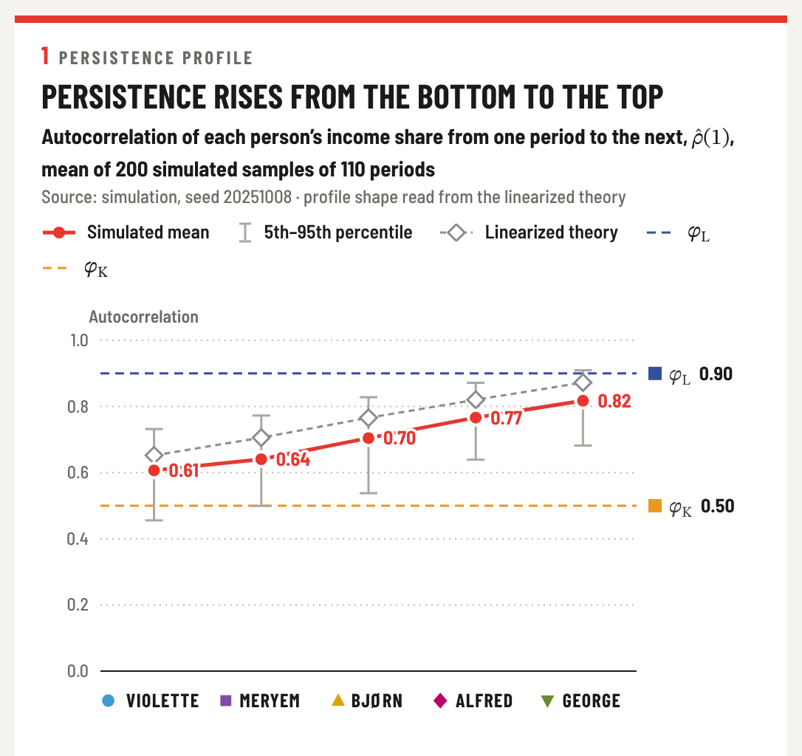</td>
</tr>
<tr>
<td>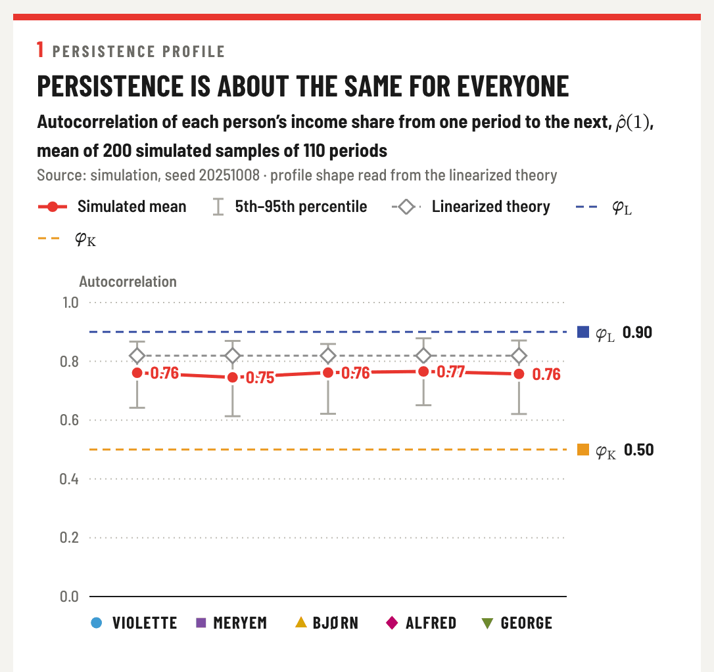</td>
<td>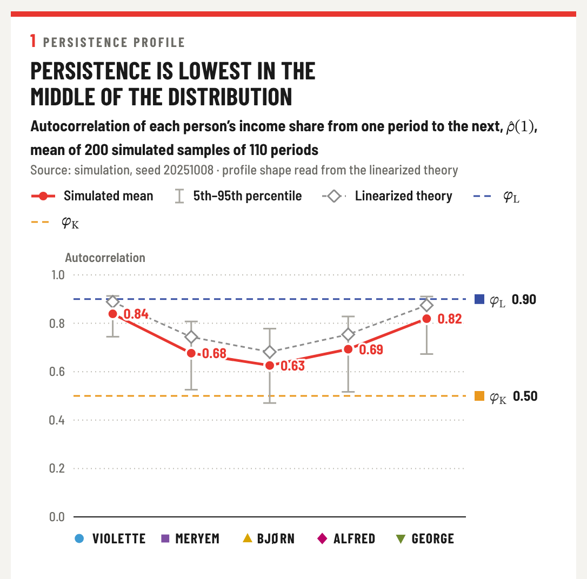</td>
</tr>
<tr>
<td>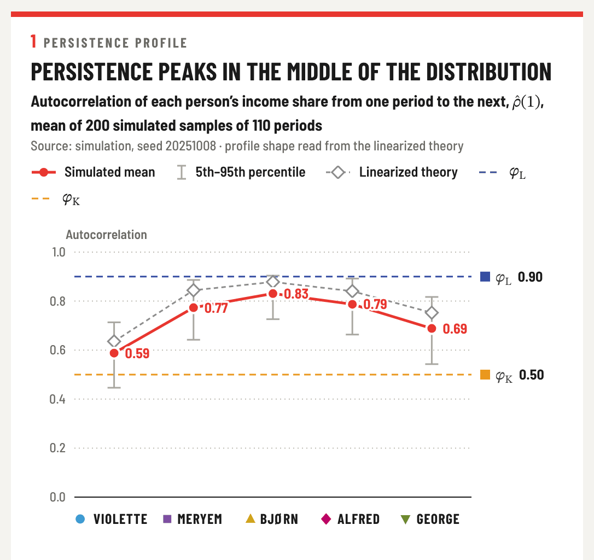</td>
<td></td>
</tr>
</table>

**What you see.**

| Preset | Labor, from bottom to top | Capital, from bottom to top | Persistence, bottom to top | Gini at period 0 |
| --- | --- | --- | --- | --- |
| Decreasing | 20, 28, 40, 52, 60 | 4, 16, 36, 60, 84 | 0.834 falling to 0.719 | 0.308 |
| Increasing | 4, 10, 20, 46, 120 | 28, 36, 40, 44, 52 | 0.615 rising to 0.810 | 0.324 |
| Flat | 16, 24, 36, 50, 74 | 16, 24, 36, 50, 74 | 0.745 to 0.766 | 0.284 |
| U-shaped | 18, 12, 12, 38, 120 | 6, 28, 48, 60, 58 | 0.830, 0.672, 0.643, 0.738, 0.798 | 0.366 |
| Inverted U | 4, 26, 58, 66, 46 | 20, 18, 14, 44, 104 | 0.588, 0.773, 0.831, 0.787, 0.688 | 0.318 |

**Why.** In each case, the people with the most capital relative to labor have the least persistent shares.

- *Decreasing*: the capital ratio rises with income, from 0.17 for Violette to 0.58 for George, so persistence falls from bottom to top. This resembles an economy where the rich own the capital.
- *Increasing*: the reverse; the bottom lives mainly on capital income and the top mainly on wages.
- *Flat*: everyone has exactly half labor and half capital. Incomes are still unequal (Gini 0.284), yet every share has the same persistence: the theory line sits at 0.819 for everyone.

**What it tells us.** The level of inequality and its dynamics are separate. The five presets have similar Gini coefficients (0.28 to 0.37) but completely different persistence profiles. Two countries with the same Gini can therefore have very different inequality dynamics, depending on who earns what kind of income.

### 6.5 Bigger shocks: volatility, persistence and mobility

**Question.** If every income became three times more volatile, would inequality become less persistent?

**Steps.** Reset. In the Parameters tab, multiply every $`\sigma`$ by 3:

| σ to type | Violette | Meryem | Bjørn | Alfred | George |
| --- | --- | --- | --- | --- | --- |
| w row | 1.20 | 7.80 | 17.40 | 19.80 | 13.80 |
| f row | 6.00 | 5.40 | 4.20 | 13.20 | 31.20 |

<table>
<tr>
<td></td>
</tr>
<tr>
<td>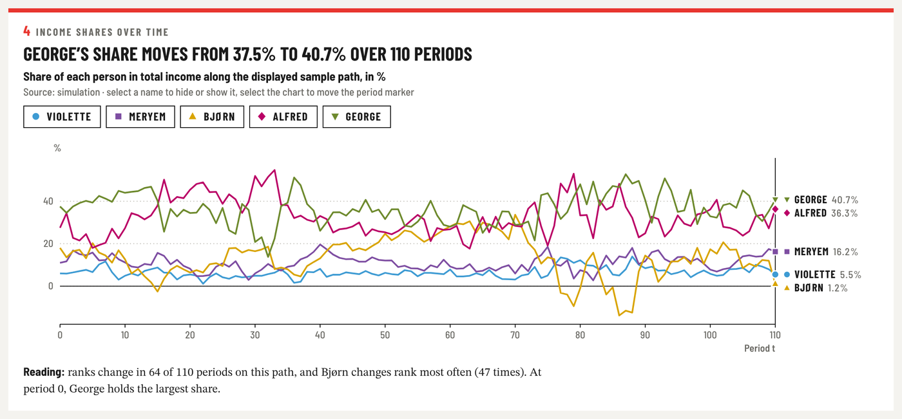</td>
</tr>
</table>

**What you see.** Figure 4 changes dramatically: the shares swing three times wider, and the lines cross constantly. Ranks change in **64** periods instead of 8, and Bjørn alone changes rank 47 times. The Gini coefficient now moves between 0.237 and 0.662, instead of 0.276 to 0.380. Yet Figure 1 barely moves:

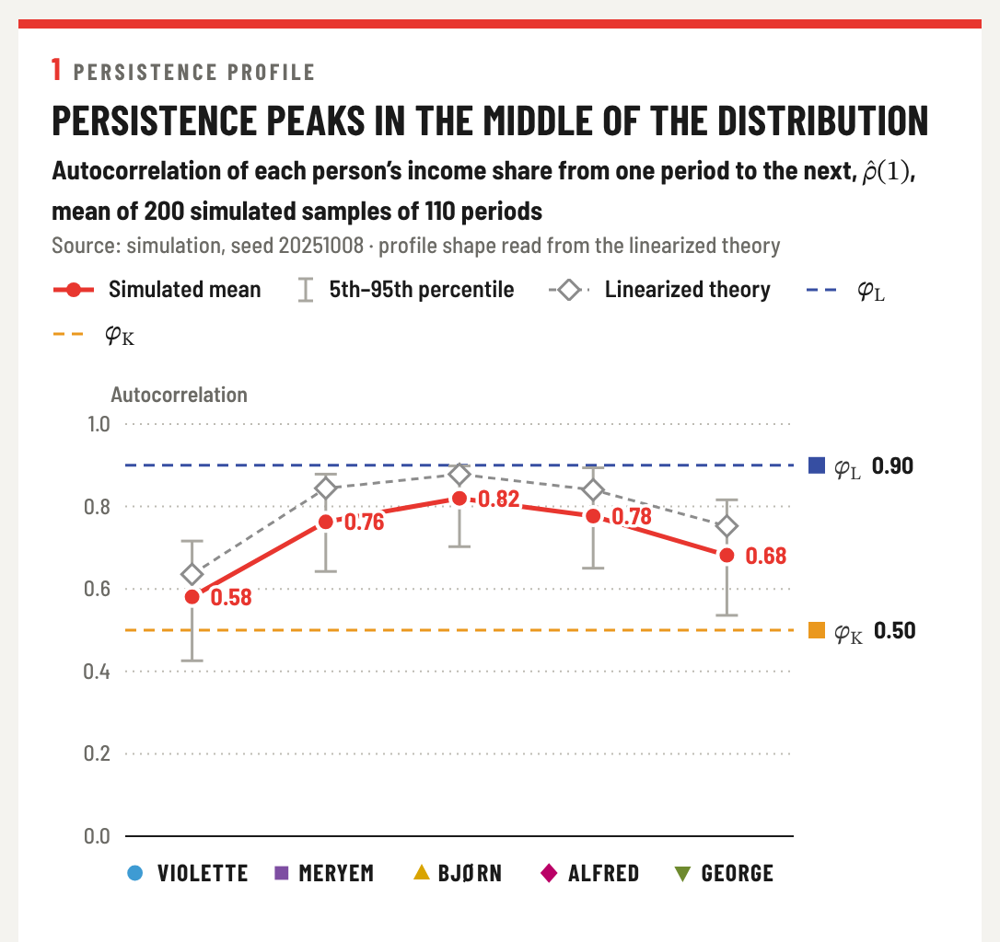

The profile is still an inverted U, from 0.581 to 0.820 (against 0.588 to 0.831), and the theory line is identical.

**Why.** Persistence measures how long a deviation lasts relative to its size. Scaling every shock by the same factor scales every deviation, but does not change how fast it fades. Mobility, by contrast, depends on the size of shocks relative to the gaps between people: bigger shocks make people overtake each other more often.

**What it tells us.** Volatile inequality is not the same as transient inequality. A distribution can be very volatile, with large year-to-year swings and frequent rank reversals, while each deviation lasts exactly as long as before. Measuring one dimension tells you nothing about the others. With shocks this large, some incomes also turn negative (the note under Figure 1 counts 27 periods), a reminder that large shocks on small incomes are not realistic.

### 6.6 People or positions: rank slots

**Question.** Real inequality data, such as top income shares, follow positions in the distribution (the top 1%, the bottom 50%), not the same people over time. Does that change what we measure?

**Steps.** Keep the shocks from 6.5 (or redo them). In the top bar, set **Units** to **Rank slots**.

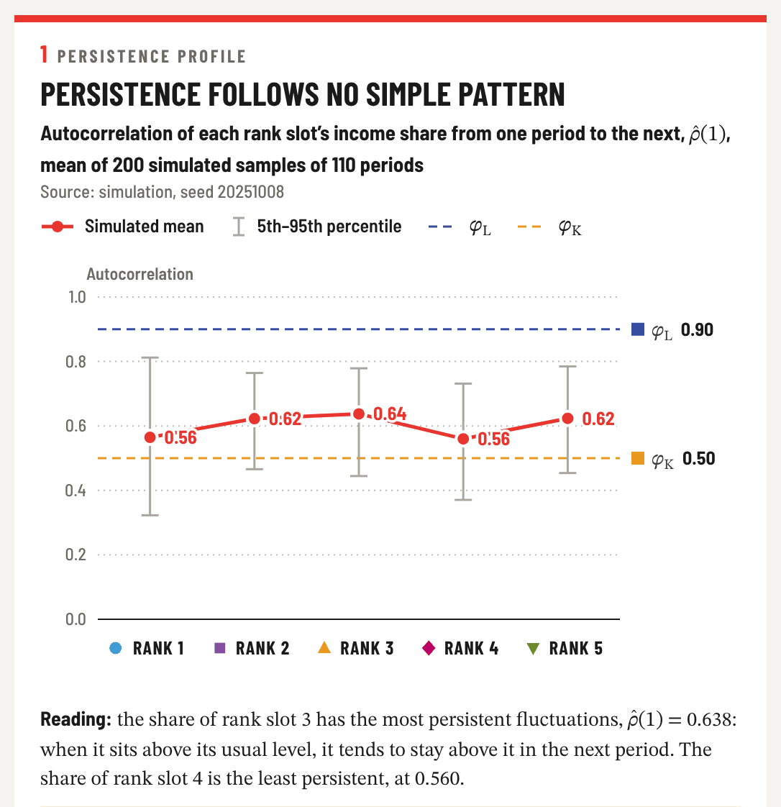

**What you see.** Figure 1 now plots ranks 1 to 5 instead of names. The profile becomes *Mixed*, with every slot between 0.560 and 0.638, much flatter and lower than the 0.581 to 0.820 of the same people. The theory line disappears, because it describes fixed people.

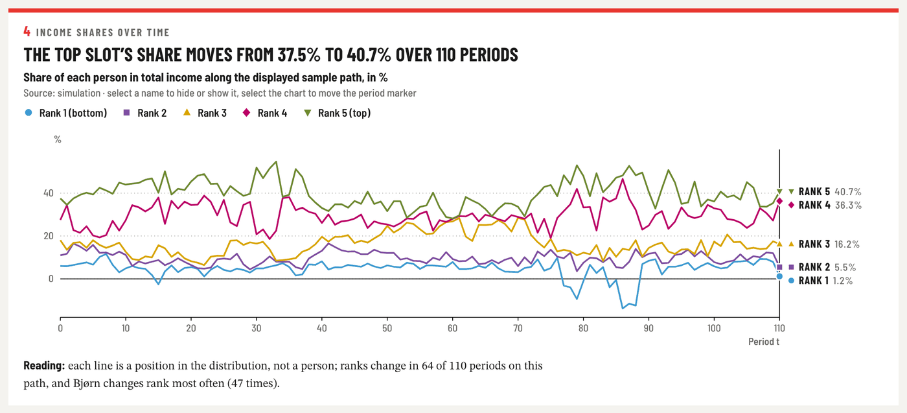

Now go back to the default shocks (Reset, then Rank slots again): the slot profile is an inverted U from 0.587 to 0.821, almost identical to the individual one, because ranks change in only 8 periods.

**Why.** A rank slot holds whoever occupies that position. When people rarely move, a slot is effectively a person. When people move often, the share of the third slot is Bjørn's one year and Alfred's the next, so the slot inherits a blend of everyone's income sources and the differences between slots wash out.

**What it tells us.** Persistence measured on quantile groups is a property of positions, not of people. When mobility is low, it reveals the income composition of each group; when mobility is high, it understates the differences between groups. Reading the persistence of top income shares requires knowing how often people enter and leave the top.

### 6.7 Diverging trends: capital at the top, wages at the bottom

**Question.** What happens to inequality when one income source grows faster than the others?

**Steps, part A.** Reset. In George's **f** row, set **Trend** to **0.300**. George's capital income now grows by 0.3 / (1 − 0.5) = 0.6 units per period.

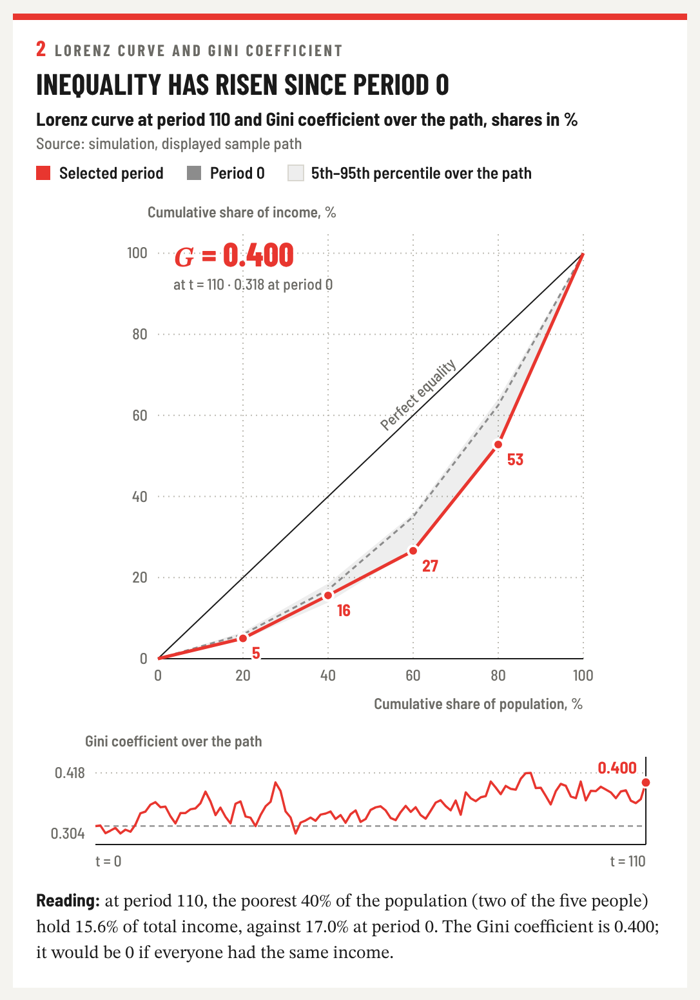

**What you see.** The Gini path climbs steadily, from 0.318 to 0.400 at period 110. George's share rises from 37.5% to 47.2%, the labor share of income falls from 50.0% to 42.0%, and total income grows from 400 to 468.5. The In figures strip summarizes it:

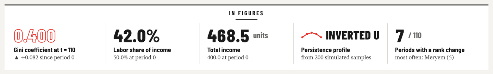

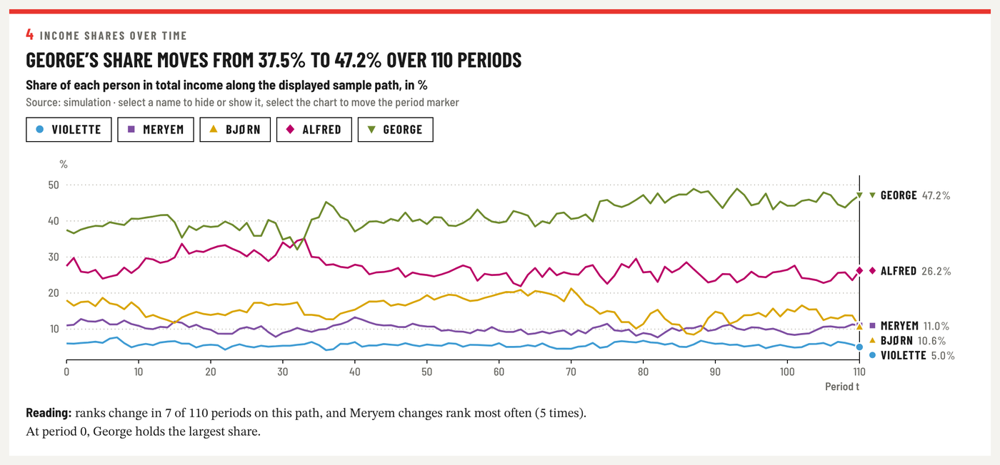

**Steps, part B.** Reset. In Violette's and Meryem's **w** rows, set **Trend** to **0.030**. Their labor incomes now grow by 0.03 / (1 − 0.9) = 0.3 units per period.

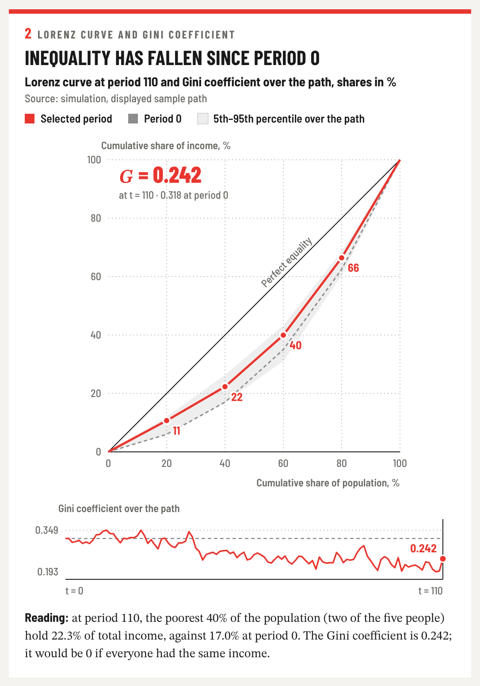

**What you see.** Inequality falls: the Gini coefficient drops from 0.318 to 0.242 at period 110. Violette's share rises from 6.0% to 11.6%, Meryem's from 11.0% to 17.6%, and the labor share rises from 50.0% to 55.5%. Because the two catch up with Bjørn, ranks now change in 23 periods.

In both cases, Figure 1 keeps its inverted U (0.580 to 0.833 in part A), and the theory line is hidden: it assumes stable long-run levels, which a trend rules out.

**What it tells us.** Trends and persistence act on different dimensions. A trend changes where inequality is heading; persistence governs how deviations around that path behave. When capital income at the top grows faster than the rest of the economy, the top share and the Gini coefficient rise and the labor share falls, a stylized version of the dynamics discussed in the literature on top incomes. Wage growth at the bottom does the opposite.

### 6.8 Shocks that never fade: a unit root

**Question.** What if capital shocks were permanent?

**Steps.** Reset. Set $`\phi_K`$ to **1.00**. Then, in each **f** row, set $`\beta`$ to **0**.

The second step matters. With $`\phi = 1`$, the constant no longer sets a level: it becomes a **drift** added every period. If you leave $`\beta`$ at its value, capital income grows by $`\beta`$ every period, and total income explodes from 400 to 11,532 in 110 periods. Setting $`\beta`$ to 0 gives a pure random walk.

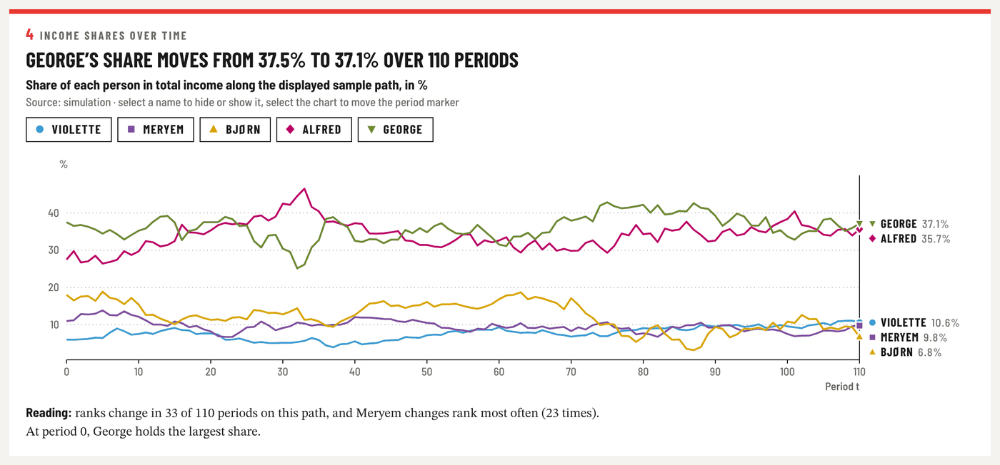

**What you see.** Shares wander without returning anywhere. George and Alfred trade the top place several times; Bjørn's share falls from 18.0% to 6.8%, while Violette's rises from 6.0% to 10.6%. Ranks change in 33 periods. The Gini path no longer fluctuates around a level; it moves between 0.262 and 0.422.

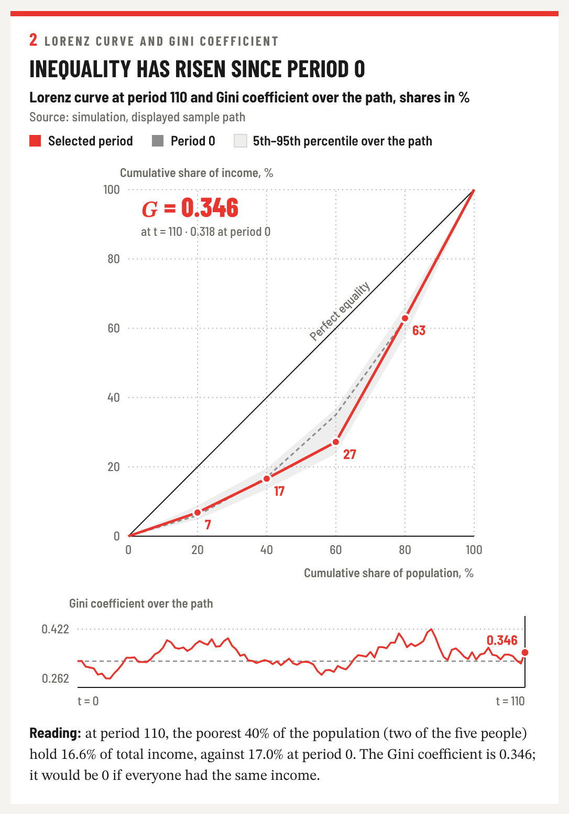

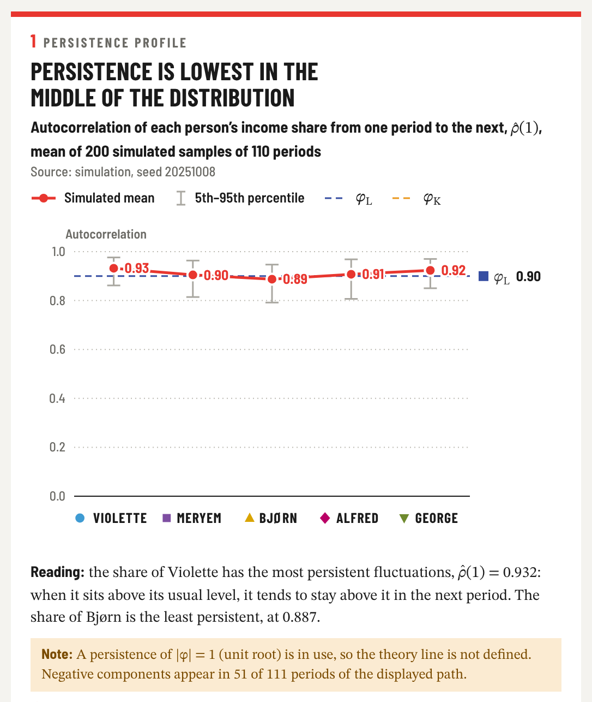

Figure 1 shows very high persistence for everyone (0.887 to 0.932), with the capital-heavy bottom and top now the most persistent. The note explains that the theory line is undefined, and that incomes turn negative in 51 of 111 periods: a random walk has no floor.

**What it tells us.** With a unit root, a shock to inequality is permanent: there is no "normal" distribution to return to, and the distribution can drift anywhere. Whether income shares are stationary or contain a unit root is therefore a central empirical question, and the reason the theses test the stationarity of each income share before measuring persistence.

### 6.9 Overshooting: negative persistence

**Question.** What does a persistence below zero look like?

**Steps.** Reset. In the Persistence card, choose **By person**. In George's **f** row, set $`\phi`$ to **−0.50** and $`\beta`$ to **156.00** (that is, 1.5 × 104, which keeps his capital income around 104). Then click George's name to open his series in Figure 3.

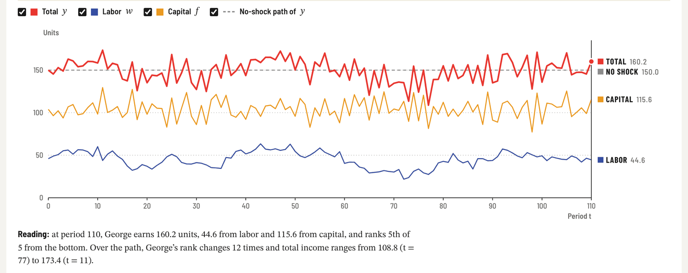

**What you see.** George's capital income now zigzags: a high period is followed by a low one, and the other way round. His share's persistence falls from 0.688 to 0.305, and the persistence of everyone else falls too (Violette from 0.588 to 0.517, Bjørn from 0.831 to 0.786), because George's zigzag moves the total that every share is divided by. George changes rank 12 times instead of 4.

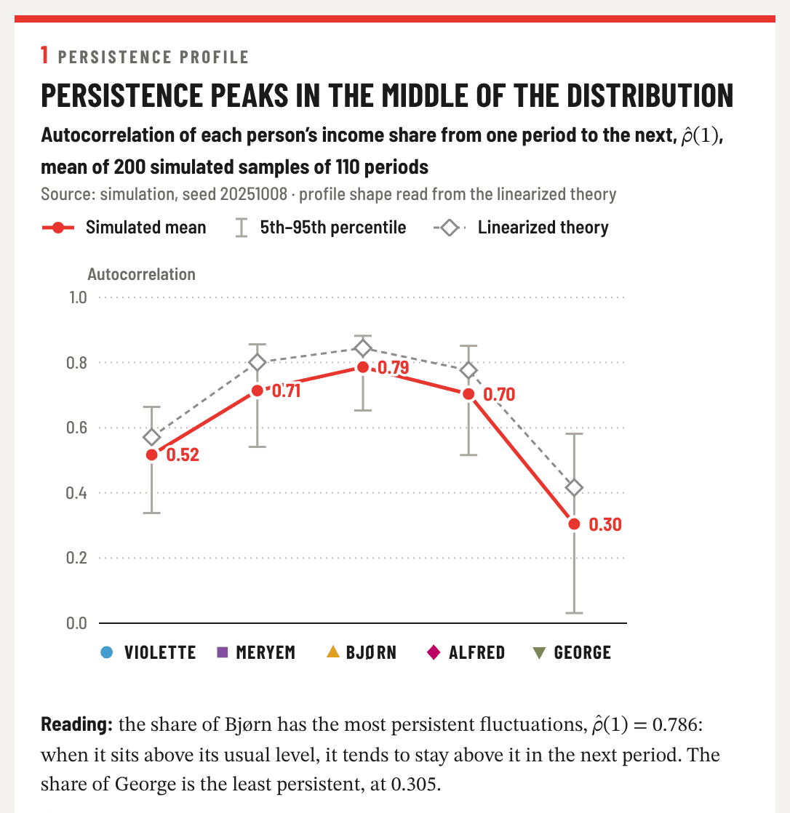

**What it tells us.** Negative persistence describes overshooting, for example income that tends to be realized in alternate years. It also illustrates a general point: income shares are relative, so one person's dynamics affect everyone's shares.

### 6.10 How much data do you need?

**Question.** How precisely do 110 years of data measure persistence?

**Steps.** Reset. Set **Periods** to **2000** and wait a few seconds.

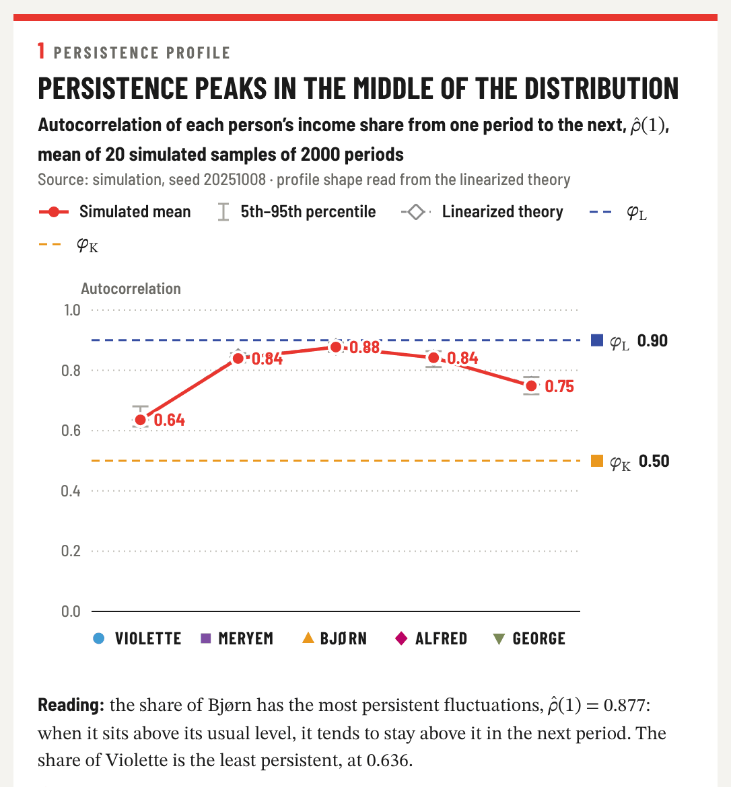

**What you see.** The red line now sits on the theory line, and the whiskers shrink.

| | Violette | Meryem | Bjørn | Alfred | George |
| --- | --- | --- | --- | --- | --- |
| Theory | 0.635 | 0.844 | 0.878 | 0.840 | 0.753 |
| Simulated, 2000 periods | 0.636 | 0.839 | 0.877 | 0.842 | 0.749 |
| Simulated, 500 periods | 0.620 | 0.829 | 0.869 | 0.828 | 0.733 |
| Simulated, 110 periods | 0.588 | 0.773 | 0.831 | 0.787 | 0.688 |

**Why.** The sample autocorrelation is biased downward in short samples, and the bias is larger when persistence is high. At 110 periods, every estimate falls 0.05 to 0.07 below its true value, and the 5th to 95th percentile band is between 0.18 and 0.27 wide. At 2000 periods, every estimate is within 0.006 of the theory.

**What it tells us.** With a century of annual data, persistence estimates are both biased toward zero and imprecise. The *shape* of the profile is robust: it is an inverted U at every sample length. Comparisons across the distribution are therefore more reliable than the level of any single estimate.

### 6.11 Redistribution: one-off or permanent

**Question.** If we equalize capital income once, how long does the effect last? And what if we equalize labor income instead?

**Steps, part A.** Reset. Open the **Allocation** tab, in Units. Type **40** in every Capital cell, starting with George (104), then Alfred (44), then Bjørn, Meryem and Violette, so that no entry is clipped. Press Enter: the rows re-sort, and George, now on 86 units, moves to third place behind Bjørn (98) and Alfred (106).

<table>
<tr>
<td>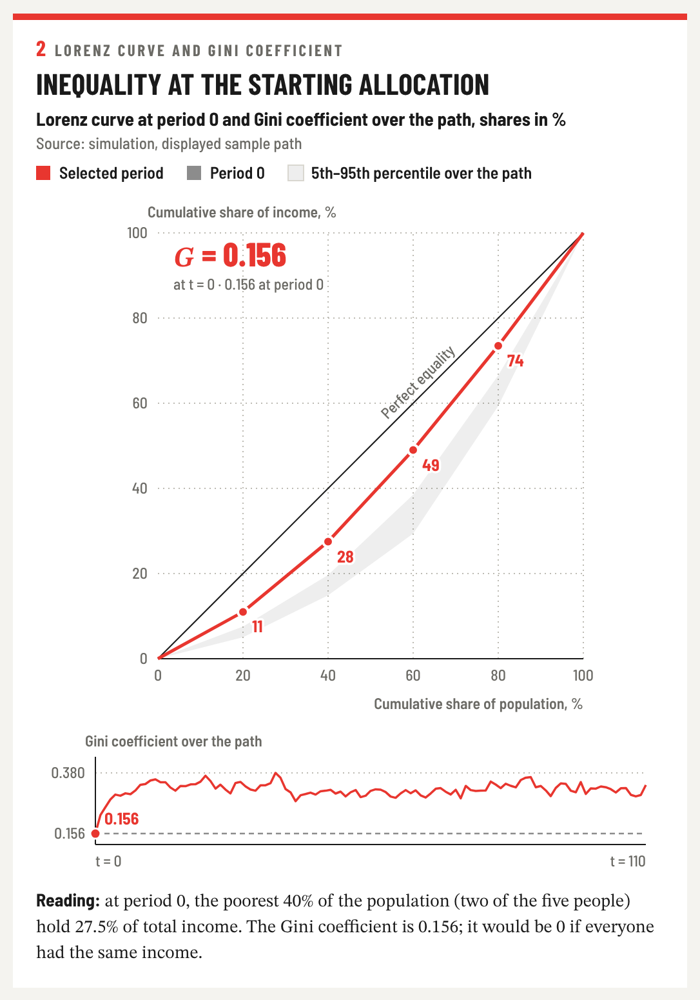</td>
<td>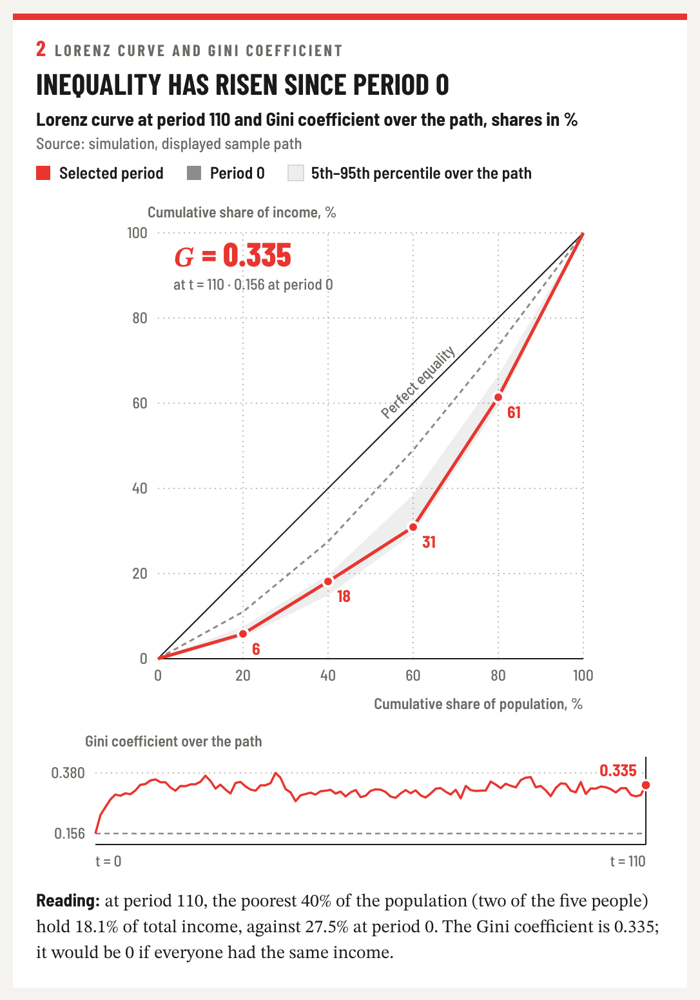</td>
</tr>
</table>

**What you see.** At period 0, the Gini coefficient halves, from 0.318 to 0.156, and the poorest 40% hold 27.5% of income instead of 17.0% (left). But the Gini path in the small chart shoots back up: 0.224 after one period, 0.254 after two, 0.295 after five. By period 10 it is exactly back on the default path (0.339). At period 110, nothing is left (right).

**Why.** The allocation only sets period 0 (rule 2). Each capital income returns to its old long-run level, and with $`\phi_K = 0.5`$, half of the gap closes every period.

**Steps, part B.** Keep the allocation and, in the Parameters tab, set $`\beta`$ to **20.00** in every **f** row ($`(1-0.5)\times 40`$), so that 40 becomes everyone's long-run capital income.

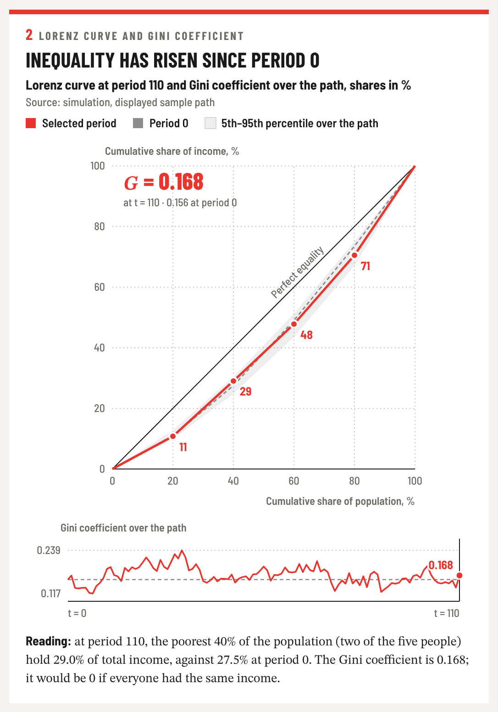

The Gini coefficient now stays low for good: 0.168 at period 110, between 0.117 and 0.239 along the path. With incomes closer together, ranks change in 50 periods.

**Steps, part C.** Reset, and equalize **labor** instead: type 40 in every Labor cell, lowering Alfred (66), Bjørn (58) and George (46) first, then raising Meryem and Violette.

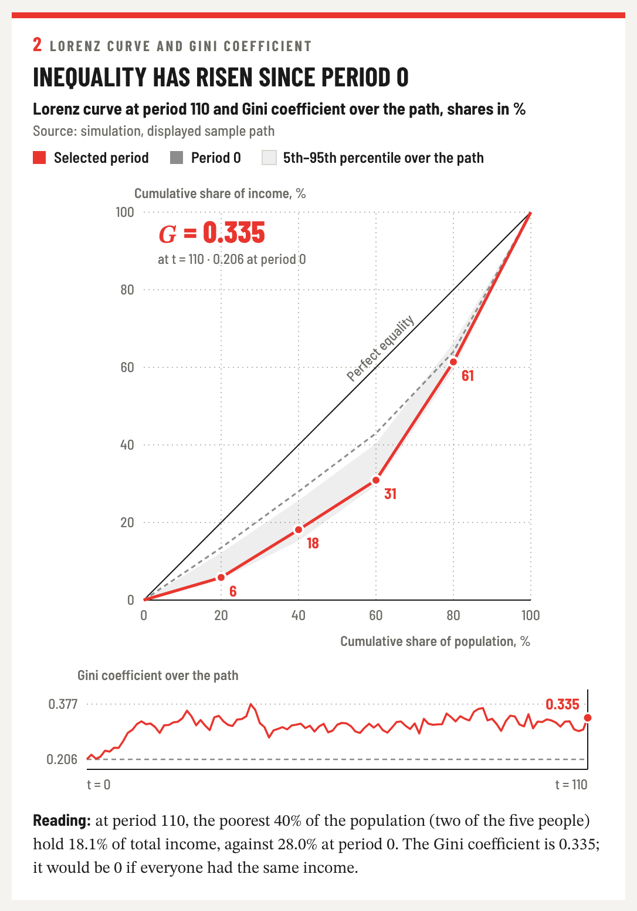

The Gini coefficient falls from 0.318 to 0.206 at period 0 and recovers far more slowly: 0.230 after five periods, 0.297 after ten, 0.322 after twenty. Labor shocks have a half-life of 6.6 periods, against 1 period for capital.

**What it tells us.** The effect of a one-off redistribution lasts as long as the income it touches is persistent. A one-off transfer of fast-reverting income fades within a few periods; a change to persistent income lasts for years; only a change in the underlying process (here $`\beta`$, in reality earning capacity, ownership or institutions) is permanent. Note also that, in parts A and B, Figure 1 reads *no simple pattern*: each person's persistence is unchanged, but George now stands in the middle of the ranking, and the profile is plotted in ranking order. The shape of a profile depends on who stands where.

### 6.12 A volatile top

**Question.** Suppose top capital income is more volatile and less persistent than other capital income, as when it is driven by asset prices. What happens to the persistence of the top share?

**Steps.** Reset.

- Part A: in George's **f** row, set $`\sigma`$ to **20.80** (twice its default).
- Part B: also choose **By person** in the Persistence card, and in George's **f** row set $`\phi`$ to **0.30** and $`\beta`$ to **72.80** ($`0.7\times 104`$, to keep his capital around 104).

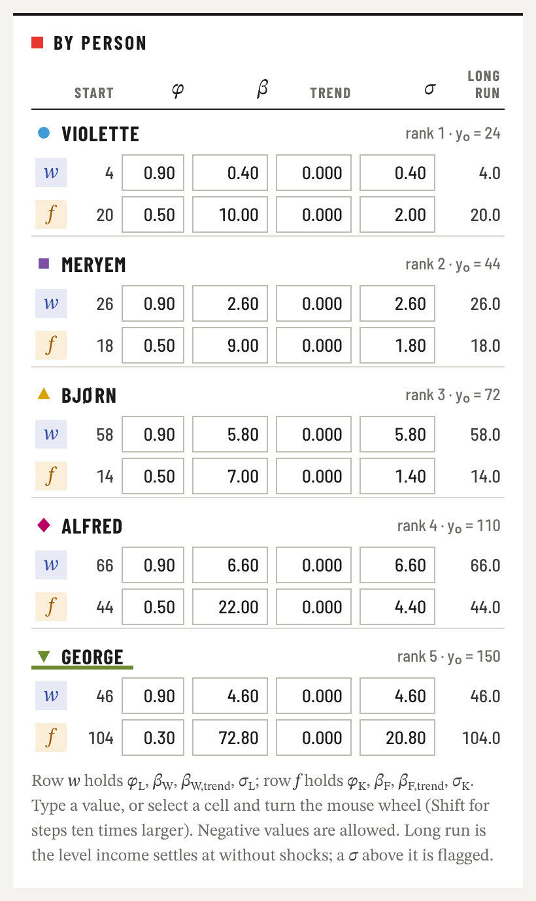

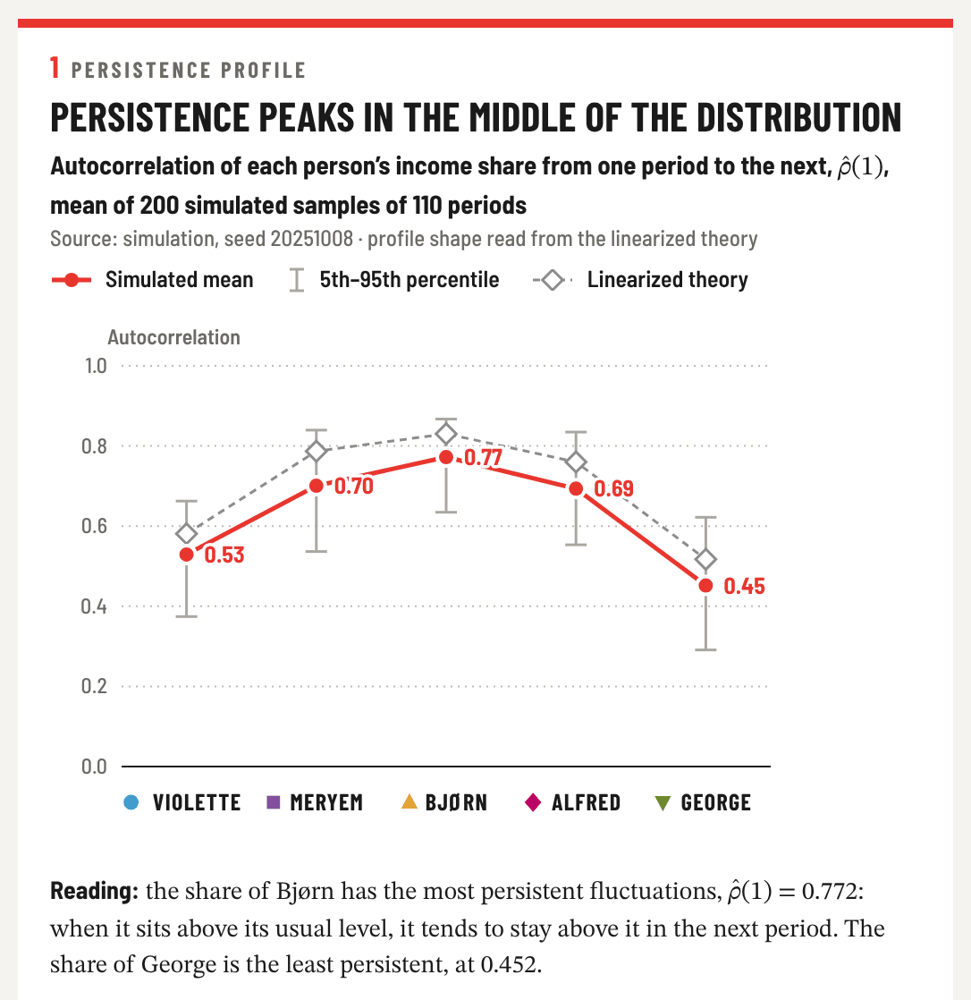

**What you see.**

| | Violette | Meryem | Bjørn | Alfred | George |
| --- | --- | --- | --- | --- | --- |
| Default | 0.588 | 0.773 | 0.831 | 0.787 | 0.688 |
| A: George's capital σ doubled | 0.563 | 0.725 | 0.789 | 0.726 | 0.568 |
| B: and his capital φ at 0.30 | 0.529 | 0.701 | 0.772 | 0.693 | 0.452 |

George's persistence falls from 0.688 to 0.452, the steepest drop of anyone, and the inverted U becomes more pronounced at the top. Everyone else's persistence also falls, because George's large, quickly reverting swings move the total that every share is divided by.

**What it tells us.** Volatile, quickly reverting income at the top lowers the persistence of the top share, and, through the total, spills over to every other share. This is consistent with the finding that persistence is weakest in the very top band of the U.S. distribution (0.24 for the top 0.001%), the only band in which corporate profits make up a majority of income.

---

## 7. From the simulator to real data

The simulator is a stylized model, but each experiment maps onto a question you can ask of real inequality data, such as the income shares of the World Inequality Database used in the theses and the working paper.

| In the simulator | In real data |
| --- | --- |
| Five people | Quantile groups (bottom 50%, middle 40%, top 10%, top 1% and so on) |
| Rank slots (6.6) | Shares of fixed quantiles, whose members change over time |
| 110 periods (6.10) | About a century of annual observations, with small-sample bias |
| Composition at period 0 (6.1, 6.4) | Labor and capital composition of each group, documented in the literature |
| Unit root (6.8) | Stationarity tests on each share |
| Trend (6.7) | Long-run rises or falls in top shares and in the capital share |

Some guidance for reading real evidence with the simulator in mind:

- **Compare shapes, not levels.** Short samples bias every persistence estimate toward zero (6.10), but they preserve the ordering across groups.
- **Check stationarity first.** If a share has a unit root, its autocorrelation is not a measure of persistence around a level (6.8).
- **Account for mobility.** Persistence of a top share mixes the persistence of top incomes with entries and exits from the top (6.6).
- **Separate trends from persistence.** Remove the long-run movement before measuring persistence; the simulator does this by subtracting the no-shock path (6.7).

The default configuration reproduces the central finding of the theses and the working paper: persistence peaks in the middle of the distribution, where labor income dominates, and is weakest at both ends. In the data, the volatility of the shares is U-shaped across the distribution while their persistence is an inverted U, which is why Abdelhamid El Hamrani's thesis studies volatility separately; experiments 6.5 and 6.12 show why the two must not be confused. Experiment 6.4 mirrors another result of the working paper: economies with the same Lorenz curve and similar Gini coefficients can have completely different persistence profiles.

## 8. Exercises

Each exercise starts from Reset. Try to predict the result before you run it.

**1. The most persistent share.** At the defaults, whose share is the most persistent, and what single number from section 2.4 explains it?

<details><summary>Answer</summary>

Bjørn, at 0.831. 98.5% of his income variance comes from labor income, whose persistence is 0.90, more than anyone else.
</details>

**2. Make the profile increase without a preset.** Using only the Allocation table, how would you make persistence rise from bottom to top?

<details><summary>Answer</summary>

Give the bottom more capital relative to labor, and the top more labor relative to capital, while keeping each source at 200 units. The Increasing preset does exactly this (labor 4, 10, 20, 46, 120 and capital 28, 36, 40, 44, 52). Remember rule 2: if you edit the table yourself, the parameters keep their old long-run levels, so click the preset afterwards or re-anchor $`\beta`$ to see the clean result.
</details>

**3. Equal persistence at 0.90.** Set $`\phi_K`$ to 0.90 (leaving $`\phi_L`$ at 0.90). What shape do you expect, and where is the theory line?

<details><summary>Answer</summary>

Flat, with the theory line at 0.90 for everyone: when both sources share the same persistence, every share has that persistence (6.3). The simulated values sit between 0.832 and 0.851, below 0.90 because of the small-sample bias (6.10).
</details>

**4. How long does a transfer last?** Before running 6.11, predict which fades faster, a one-off equalization of capital or of labor, and by roughly how much.

<details><summary>Answer</summary>

Capital, much faster. Half the remaining gap closes every period with $`\phi_K = 0.5`$ (half-life 1 period), against every 6.6 periods with $`\phi_L = 0.9`$. In the simulator, the Gini coefficient is back on its default path after about 10 periods for capital, but still below it after 20 periods for labor.
</details>

**5. Doubling every shock.** Multiply every $`\sigma`$ by 2. What happens to Figure 1, to the number of rank changes and to the Gini path?

<details><summary>Answer</summary>

Figure 1 barely changes (0.586 to 0.827) and the theory line is identical, because persistence does not depend on the scale of shocks. Rank changes rise from 8 to 44 periods and the Gini path widens to 0.251 to 0.481, because bigger shocks make people overtake each other more often (6.5).
</details>

**6. Why do rank slots flatten the profile?** In 6.6, why is the slot profile flatter when shocks are large?

<details><summary>Answer</summary>

With large shocks, people move between slots often, so each slot's share is made of different people's incomes over time. Each slot then inherits a blend of everyone's income sources, and the differences in composition between slots wash out.
</details>

**7. Wage growth for the middle.** Give Bjørn's w row a trend of 0.030. What happens to the Gini coefficient and to the labor share?

<details><summary>Answer</summary>

Bjørn's labor income rises by 0.03 / (1 − 0.9) = 0.3 units per period, so his no-shock income grows from 72 to about 102 by period 110. He stays third, but closes part of the gap with Alfred (110) and George (150). The labor share rises from 50.0% to 52.4%, and the Gini coefficient at period 110 is 0.310 instead of 0.335: income growth in the middle, toward the top, narrows inequality. If the trend were large enough for Bjørn to overtake George, his further growth would start to widen it again.
</details>

**8. The unit-root trap.** Set $`\phi_K = 1`$ without changing $`\beta`$. Why does total income explode, and why does the theory line disappear?

<details><summary>Answer</summary>

With $`\phi = 1`$, the equation becomes $`f_t = \beta + f_{t-1} + v_t`$: $`\beta`$ is added every period, so capital income grows without limit (George's by 52 units per period). The theory line needs a finite long-run level and a finite variance, which a unit root does not have (6.8).
</details>

## 9. Troubleshooting and frequently asked questions

**My numbers differ slightly from the guide.** Click **Reset**: it restores the default seed, 20251008. After **New draw**, the shocks change and every number moves a little, while the shapes stay the same.

**The theory line has disappeared.** It is shown only for fixed individuals (Units set to Individuals), when every $`|\phi|`$ is below 1, every trend is zero, and total long-run income is positive. The note under Figure 1 says which condition fails.

**A note says that negative components appear.** Some income became negative in that many periods of the displayed path. It happens when shocks are large relative to the level of income (6.5), with a unit root (6.8), or when a change of $`\phi`$ moves the long-run levels (6.2). The model allows it; real incomes rarely do.

**I changed $`\phi`$ and incomes drift away.** That is rule 1: $`\beta`$ did not change, so the long-run level $`\beta/(1-\phi)`$ did. Re-anchor by typing $`\beta = (1-\phi)\times`$ start, or click a preset.

**I typed a value in the Allocation table and it was reduced.** Each source is capped. Lower someone else's entry first, or raise the cap.

**The rows of the Allocation table moved.** They re-sort by total income when you leave the table or press Enter, so that the table always runs from the poorest to the richest at period 0.

**The persistence fields in the Parameters tab are greyed out.** They are active only when the Persistence card is set to **By person**.

**The title of Figure 1 says "no simple pattern".** The profile is plotted from the poorest to the richest at period 0. If an allocation moves a capital-heavy person into the middle (as in 6.11), the shape is no longer monotone or U-shaped. Open **Values by person** for the numbers.

**The page is slow with 2000 periods.** Each change recomputes 20 samples of 2000 periods. Wait a second or two, or use 110 periods while exploring.

**The mouse wheel does not change a value.** Select the field first (click in it); the wheel acts only on the selected field.

## 10. Glossary

| Symbol or term | Meaning |
| --- | --- |
| $`w_{i,t}`$ | Labor income of person $`i`$ in period $`t`$ |
| $`f_{i,t}`$ | Capital income of person $`i`$ in period $`t`$ |
| $`y_{i,t}`$ | Total income, $`w_{i,t} + f_{i,t}`$ |
| $`\phi_L`$, $`\phi_K`$ | Persistence of labor and capital income |
| $`\beta_{W,i}`$, $`\beta_{F,i}`$ | Constants of labor and capital income |
| $`\beta_{W,trend,i}`$, $`\beta_{F,trend,i}`$ | Trend coefficients on time |
| $`u_{i,t}`$, $`v_{i,t}`$ | Shocks to labor and capital income, normally distributed |
| $`\sigma_{L,i}`$, $`\sigma_{K,i}`$ | Standard deviations of the shocks |
| $`\hat\rho(1)`$ | First-order autocorrelation of an income share, the measure of persistence |
| $`G`$ | Gini coefficient |
| Long-run level | $`\beta/(1-\phi)`$, the level an income settles at without shocks |
| Half-life | Periods needed for half of a shock to fade, $`\ln 0.5/\ln\phi`$ |
| Unit root | $`\phi = 1`$ or $`-1`$: shocks never fade |
| Labor share | Labor income divided by total income |
| Rank slot | A position in the distribution (poorest, second poorest and so on), whoever holds it |
| No-shock path | The path of income with every shock set to zero |
| Linearized theory | A first-order approximation of each share's persistence, computed from the parameters |

## 11. Limits of the model

- The economy has five people, so the Lorenz curve has five segments, and the Gini coefficient cannot exceed 0.8.
- Shocks are independent across people and across sources. There is no aggregate shock, such as a recession that hits everyone, and no correlation between a person's labor and capital shocks.
- Each source follows an AR(1) process; richer dynamics, such as cycles or structural breaks, are not modelled.
- Incomes can become negative, since shocks are normally distributed.
- The model has no behavior: people do not save, invest, work more or respond to taxes. Composition is set by hand, not explained.

These limits are deliberate: the simulator isolates one mechanism, the link between income composition and the persistence of income shares, so that it can be seen clearly.

## 12. Credits

The simulator was developed by **Abdelhamid El Hamrani** and **Hajar Hazmiri**, under the supervision of **Prof. Ramses Abul Naga**, at the Faculty of Governance, Economics and Social Sciences (FGSES) of Mohammed VI Polytechnic University (UM6P). See the [README](../README.md) for the method notes, how to cite the simulator, and related work.
