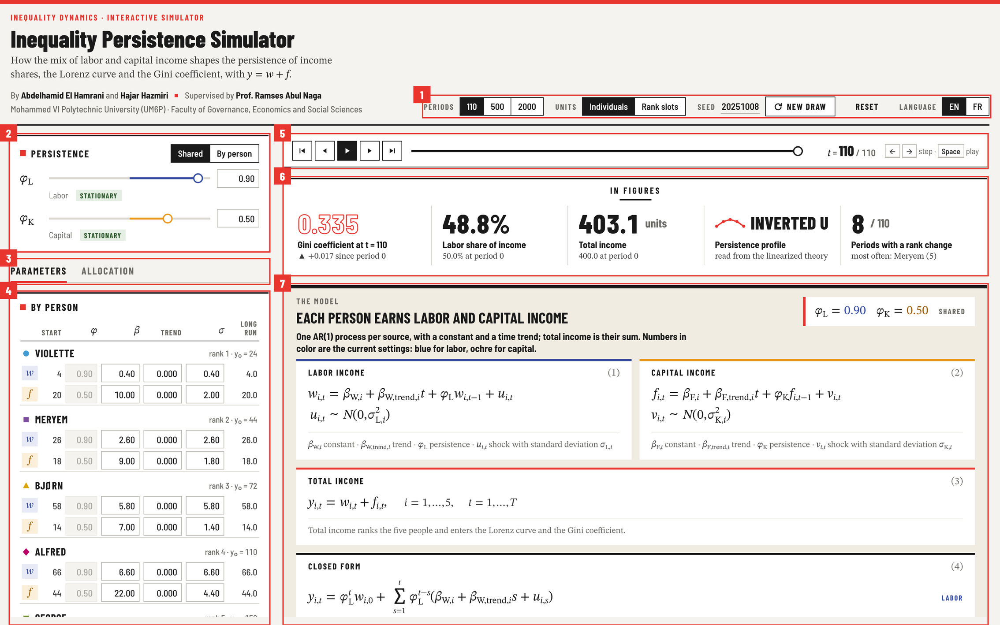
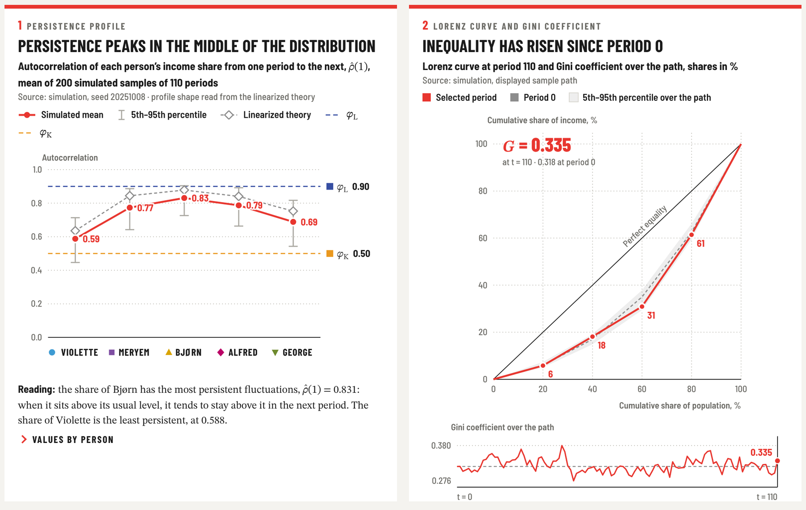
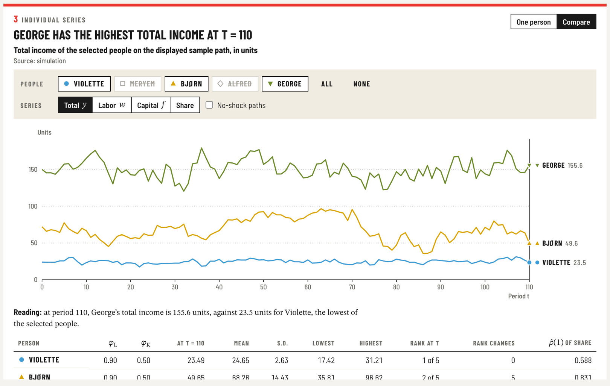

# Inequality Persistence Simulator: technical reference

This page collects the technical details of the simulator: the full model, every control, how each figure is built and the method behind the numbers. For a gentle introduction, start with the [project page](../README.md); for step-by-step experiments, see the [user guide](GUIDE.md).

## Contents

- [The model](#the-model)
- [The interface](#the-interface)
- [Controls reference](#controls-reference)
- [Reading the figures](#reading-the-figures)
- [Worked examples](#worked-examples)
- [Method notes](#method-notes)
- [Running the simulator](#running-the-simulator)

## The model

Five individuals, Violette, Meryem, Bjørn, Alfred and George, each earn labor income $`w`$ and capital income $`f`$. Each source follows an AR(1) process augmented with a constant and a time trend, and total income $`y`$ is their sum.

```math
w_{i,t} = \beta_{W,i} + \beta_{W,trend,i}\, t + \phi_{L}\, w_{i,t-1} + u_{i,t}, \qquad u_{i,t} \sim N\!\left(0, \sigma_{L,i}^{2}\right) \qquad (1)
```

```math
f_{i,t} = \beta_{F,i} + \beta_{F,trend,i}\, t + \phi_{K}\, f_{i,t-1} + v_{i,t}, \qquad v_{i,t} \sim N\!\left(0, \sigma_{K,i}^{2}\right) \qquad (2)
```

```math
y_{i,t} = w_{i,t} + f_{i,t}, \qquad i = 1, \dots, 5, \qquad t = 1, \dots, T \qquad (3)
```

Recursive substitution gives the closed form, with the starting values $`w_{i,0}`$ and $`f_{i,0}`$ taken from the period-0 allocation.

```math
y_{i,t} = \phi_L^{t}\, w_{i,0} + \sum_{s=1}^{t} \phi_L^{t-s}\left(\beta_{W,i} + \beta_{W,trend,i}\, s + u_{i,s}\right) + \phi_K^{t}\, f_{i,0} + \sum_{s=1}^{t} \phi_K^{t-s}\left(\beta_{F,i} + \beta_{F,trend,i}\, s + v_{i,s}\right) \qquad (4)
```

The income share of each individual is their total income divided by the total of all five.

```math
S_{i,t} = \frac{y_{i,t}}{\sum_{j=1}^{5} y_{j,t}}
```

Without shocks and with a zero trend, each source settles at its long-run level $`\beta / (1-\phi)`$. With a trend, it settles on a line whose slope is the trend coefficient divided by $`1-\phi`$.

| Symbol | Meaning | Set in |
| --- | --- | --- |
| $`w`$, $`f`$, $`y`$ | Labor, capital and total income of a person, in units | Simulated |
| $`w_{0}`$, $`f_{0}`$ | Starting labor and capital income at period 0 | Allocation tab |
| $`\phi_L`$, $`\phi_K`$ | Persistence of labor and of capital income, between −1 and 1 | Persistence card, or Parameters tab when set by person |
| $`\beta_W`$, $`\beta_F`$ | Constant added to labor or capital income each period | Parameters tab |
| $`\beta_{W,trend}`$, $`\beta_{F,trend}`$ | Coefficient on the time trend $`t`$ | Parameters tab |
| $`\sigma_L`$, $`\sigma_K`$ | Standard deviation of the labor or capital shock | Parameters tab |
| $`u`$, $`v`$ | Normal shocks, independent across people, sources and periods | Random seed in the top bar |
| $`S`$ | Income share of a person in total income | Simulated |
| $`T`$ | Number of simulated periods | Top bar |

## The interface

The screen is split into a parameter panel on the left and a figure board on the right. Each side scrolls on its own, so settings and results stay in view together. On a phone the two stack into a single column.



| # | Area | What it holds |
| --- | --- | --- |
| 1 | Run settings | Number of periods $`T`$, units (individuals or rank slots), the random seed with **New draw**, **Reset**, and the **EN / FR** language switch |
| 2 | Persistence | **Shared** or **By person**, then a slider and a field for $`\phi_L`$ and $`\phi_K`$, with a stationarity tag for each source |
| 3 | Panel tabs | Switches the lower left panel between **Parameters** and **Allocation** |
| 4 | Parameters by person | For each person, a $`w`$ row (labor) and an $`f`$ row (capital) with start, $`\phi`$, $`\beta`$, trend, $`\sigma`$ and the long-run level |
| 5 | Period bar | First, previous, play, next and last buttons, the period slider and the current period $`t`$. It stays pinned while you scroll |
| 6 | In figures | Gini coefficient, labor share and total income at period $`t`$, the shape of the persistence profile, and the number of periods with a rank change |
| 7 | Model | Equations (1) to (4) in four blocks (labor income, capital income, total income, closed form), and one card per person with their own numbers. Selecting a card opens that person's series in Figure 3 |

Below the model sit Figures 1 to 5 and a notes panel on the method. Each figure follows the same grammar: a title that states the result at the current settings, a subtitle that ends with the unit, a source line, the chart with its key values written on it, and a **Reading** line that puts the result into words. Every chart also shows its values on hover, and clicking a time chart moves the period marker.

## Controls reference

Every change recomputes the simulation immediately and reuses the same random shocks, so differences between two settings come from the parameters alone.

| Control | Where | Values | Effect |
| --- | --- | --- | --- |
| Periods | Top bar | 110, 500 or 2000 | Sample length $`T`$. 110 is about the length of a century of annual data. 200, 60 or 20 samples are simulated respectively |
| Units | Top bar | Individuals, Rank slots | Measures persistence for fixed people, or for rank positions re-sorted every period, as quantile groups in inequality statistics are |
| New draw | Top bar | New random seed | Draws a fresh set of shocks. The seed is shown beside the button |
| Reset | Top bar | | Restores every setting to its starting value |
| Language | Top bar | EN, FR | Switches the interface between English and French; settings and results are unchanged. The choice is remembered, and `?lang=fr` in the address opens the French version |
| Shared / By person | Persistence card | | One $`\phi`$ per source for everyone, or one per person set in the Parameters tab |
| $`\phi_L`$, $`\phi_K`$ | Persistence card | −1 to 1 | Persistence of each source. At $`\phi = 1`$ or $`-1`$ the source has a unit root |
| $`\phi`$ per person | Parameters tab | −1 to 1 | Active only when persistence is set by person |
| $`\beta`$ | Parameters tab | Any value, negative allowed | Constant added each period |
| Trend | Parameters tab | Any value, negative allowed | Coefficient on $`t`$. Income drifts by trend divided by $`1-\phi`$ per period |
| $`\sigma`$ | Parameters tab | Any value, the sign is ignored | Shock standard deviation. Flagged when larger than the long-run level |
| Start, Long run | Parameters tab | Read only | Starting value from the allocation, and the level reached without shocks |
| Labor cap, Capital cap | Allocation tab | 10 to 5000 units | Total units of each source. Changing a cap rescales the allocation |
| Enter as | Allocation tab | Units, Percent | Enter holdings in units, or as a percentage of each cap and of total income |
| Allocation cells | Allocation tab | Up to the cap | Starting holdings. An entry above what is left is clipped, and rows re-sort by total when you leave the table |
| Profile presets | Allocation tab | Five shapes | Sets the allocation and resets parameters to $`\beta = (1-\phi) \times \text{start}`$, trend 0 and $`\sigma = \text{start}/10`$ |
| Period bar | Top of the figure board | 0 to $`T`$ | Selects the period shown in the In figures strip, Figure 2 and Figure 5 |
| View | Figure 3 | One person, Compare | One person's equations and incomes, or several people's series on one chart |
| Name chips | Figures 3 and 4 | On or off | Shows or hides a person. Both figures share the same selection |

Tips for entering values:

- Type a value and press Enter, or leave the field.
- Or select a field and turn the mouse wheel; hold Shift for steps ten times larger. Fields respond to the wheel only once selected, so scrolling the panel never changes a value by accident.
- On the figure board, the left and right arrow keys step one period (Shift for ten), Home and End jump to the first and last period, and Space plays or pauses.

## Reading the figures

Blue always means labor and ochre always means capital. Red marks the main result of each chart: the simulated mean in Figure 1, the Lorenz curve and Gini coefficient at period $`t`$ in Figure 2, and total income in Figure 3. Grey marks a reference, such as period 0, the linearized theory or the path without shocks. Each person has a color and a marker shape, so they can be told apart without relying on color alone.

| Person | Marker | Color |
| --- | --- | --- |
| Violette | Circle | Sky blue |
| Meryem | Square | Violet |
| Bjørn | Triangle | Gold |
| Alfred | Diamond | Magenta |
| George | Inverted triangle | Olive green |

### In figures

Five figures at the selected period $`t`$: the Gini coefficient and its change since period 0, the labor share of total income, total income, the shape of the persistence profile, and the number of periods in which at least one rank changed.



### Figure 1, persistence profile

The first-order autocorrelation of each person's income share, our measure of persistence. The red line and dots are the mean across simulated samples, with each value written beside its dot, and the grey whiskers span the 5th to 95th percentiles. The grey dashed line with hollow diamonds is the linearized theory, shown for fixed individuals when every $`\lvert\phi\rvert`$ is below 1 and every trend is zero. The blue and ochre dashed lines mark $`\phi_L`$ and $`\phi_K`$ when persistence is shared.

The figure title and the In figures strip name the shape of the profile:

- **Flat** when the range of values is below 0.03.
- **Increasing** or **Decreasing** when values are monotone within a tolerance of 8% of the range (at least 0.004).
- **U-shaped** or **Inverted U** when there is an interior minimum or maximum with monotone arms.
- **Mixed** otherwise.

The table under the chart lists each person's share and capital ratio at period 0, the simulated mean, the percentile band and the theory value.

### Figure 2, Lorenz curve and Gini coefficient

The Lorenz curve at period $`t`$ in red, with people re-ranked by income in that period and the cumulative shares written at each point. The grey dashed curve is period 0, the grey band is the 5th to 95th percentile of each point over the whole path, and $`G`$ is the Gini coefficient at $`t`$. The small chart below traces the Gini coefficient over all periods, with a dashed line at its period-0 value.



### Figure 3, individual series

**One person** shows the chosen person's own equations with their numbers, in four blocks: labor income and capital income (each with its shock law, starting value, long-run level and half-life of a shock), total income with the person's rank at period 0, and the closed form. The chart draws total income in red, labor in blue, capital in ochre, and the no-shock path as a grey dashed line, each named with its last value at the right end. The title gives the person's main source of income at $`t`$, and the Reading line gives income and its split at $`t`$, the rank, the number of rank changes and the lowest and highest income over the path.

**Compare** draws several people on one chart. Choose who appears with the name chips, and which series to compare: total, labor, capital or income share. The table lists each person's $`\phi_L`$ and $`\phi_K`$, the value at $`t`$, the mean, standard deviation, lowest and highest values, the rank at $`t`$, the number of rank changes and the simulated persistence of their share.

### Figure 4, income shares over time

Each person's share of total income along the displayed sample path, labelled at the right end with its final value. The title follows the person who starts at the top. The name chips hide or show people and stay in sync with Figure 3. In rank-slot mode each line is a rank position rather than a person.

### Figure 5, income by person at the selected period

Stacked bars of labor and capital income at $`t`$, ordered from bottom to top by total income, so people swap places when their incomes cross. The black tick marks each person's total income at period 0.

## Worked examples

Each experiment starts from **Reset** (seed 20251008, $`T = 110`$, 200 samples). The values below were computed with the simulator itself; a new draw of shocks moves them slightly.

| Experiment | Steps | Shape | Simulated $`\hat\rho(1)`$, lowest to highest | Periods with a rank change |
| --- | --- | --- | --- | --- |
| Default | None | Inverted U | 0.588 (Violette) to 0.831 (Bjørn) | 8 of 110 |
| Longer sample | Periods set to 2000 | Inverted U | 0.636 to 0.877, each within 0.006 of the theory line | 198 of 2000 |
| Decreasing preset | Allocation tab, Decreasing | Decreasing | 0.834 (Violette) to 0.719 (George) | 10 of 110 |
| Increasing preset | Allocation tab, Increasing | Increasing | 0.615 (Violette) to 0.810 (George) | 6 of 110 |
| Flat preset | Allocation tab, Flat | Flat | 0.745 to 0.766 | 4 of 110 |
| U-shaped preset | Allocation tab, U-shaped | U-shaped | 0.643 (Bjørn) to 0.830 (Violette) | 0 of 110 |
| Equal shocks | Parameters tab, every $`\sigma`$ set to 4 | Flat | 0.747 to 0.764, theory 0.819 for everyone | 2 of 110 |
| Reversed persistence | $`\phi_L = 0.50`$, $`\phi_K = 0.90`$ | U-shaped | 0.540 (Bjørn) to 0.821 (Violette) | 20 of 110 |
| Larger shocks | Parameters tab, every $`\sigma`$ multiplied by 3 | Inverted U | 0.581 to 0.820 | 64 of 110 |

What the experiments suggest:

- **Sample length.** At $`T = 110`$ the simulated values sit below the theory line, the usual downward small-sample bias of the autocorrelation. At $`T = 2000`$ the two nearly coincide.
- **Composition.** The presets differ only in how labor and capital are split across people, yet each produces its own profile. Reversing which source is more persistent turns the default inverted U into a U shape. Choosing the Inverted U preset afterwards restores it, because presets give the pattern to whichever source is currently more persistent.
- **Control case.** When every shock has the same size, a person's mix of sources no longer changes how their share moves, and the profile is flat.
- **Ranks.** Tripling every shock leaves the profile almost unchanged, since persistence does not depend on the scale of proportional shocks, while rank changes rise from 8 to 64 periods.

## Method notes

**Persistence statistic.** For each simulated sample, the simulator takes each income share, removes its deterministic component (the share the model gives with every shock set to zero), and computes the first-order sample autocorrelation of what remains. Figure 1 reports the mean and the 5th and 95th percentiles across samples. Removing the deterministic component keeps a trend, or a slow move away from the starting allocation, from being counted as persistence.

**Theory line.** A first-order linearization of each share around the long-run levels $`m = \beta/(1-\phi)`$. With $`\gamma = \sigma^2/(1-\phi^2)`$ the stationary variance of each source and $`M`$ the sum of all long-run levels:

```math
\rho_i(1) = \frac{\sum_{j} c_{ij}^{2}\left(\phi_{L,j}\,\gamma_{L,j} + \phi_{K,j}\,\gamma_{K,j}\right)}{\sum_{j} c_{ij}^{2}\left(\gamma_{L,j} + \gamma_{K,j}\right)}, \qquad c_{ij} = \frac{\mathbf{1}[i=j] - s_i}{M}, \qquad s_i = \frac{m_{L,i} + m_{K,i}}{M}
```

It is defined for fixed individuals when every $`\lvert\phi\rvert`$ is below 1, every trend is zero and total long-run income is positive. Otherwise only simulated values are shown.

**Rank slots.** In rank-slot mode, people are re-sorted by total income every period, and the deterministic component is sorted the same way. A slot is then a position in the distribution rather than a person.

**Random numbers.** Shocks come from a Mulberry32 generator with Box–Muller normals. Each combination of seed, sample, person and source has its own stream, so a parameter change reuses exactly the same shocks (common random numbers).

**Timing.** Period 0 is the allocation, and the recursion runs for $`t = 1, \dots, T`$. The reference Octave script for the labor process, `r_Labor_Persist.m`, starts its index at 1, so its trend term is shifted by one period relative to the simulator.

**Limits to keep in mind.**

- The economy has five people, so the Lorenz curve has five segments and the Gini coefficient cannot exceed 0.8.
- Shocks are independent across people and across sources. There is no common or aggregate shock, and no correlation between labor and capital shocks.
- Each source is an AR(1) process; higher-order dynamics are not available.
- Large shocks relative to the level of income can make incomes negative. Figure 1 then shows a note with the number of affected periods.

## Running the simulator

The simulator is one self-contained file, `index.html`.

- **Locally.** Download `index.html` and open it in a recent version of Chrome, Firefox, Safari or Edge. It works offline; without a connection the page falls back to system fonts.
- **GitHub Pages.** With `index.html` at the root of the repository, enable GitHub Pages for the main branch in the repository settings. The simulator is then served at the repository's Pages address.
- **Performance.** $`T = 110`$ recomputes almost instantly. $`T = 2000`$ simulates 20 samples of 2000 periods and can take a moment on older machines.

Repository layout:

```
.
├── index.html          the simulator
├── README.md           project page, in English and French
└── docs/
    ├── GUIDE.md        user guide
    ├── TECHNICAL.md    this page
    └── images/         screenshots
```
